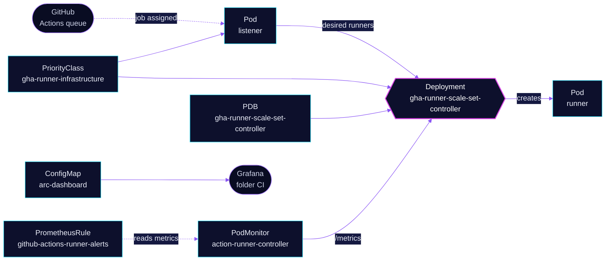

<!-- header: icon=server-cog -->
<!-- concept: From a GitHub job to a runner pod | github Queue | radio-tower Listen | scale Scale | container Run -->
<p align="center"></p>

> The GitHub Actions Runner Controller: it reconciles runner scale sets and carries the CI alerts and dashboard.

**Live facts:** <https://skrumbach.github.io/home-ops/apps/actions-runner-system/gha-runner-scale-set-controller/> (workloads, routes, storage, backups, secrets and alerts, generated on every merge)

The namespace note [`TROUBLESHOOTING.md`](../TROUBLESHOOTING.md) covers the expired runner certificate. The scale
set that this controller manages is [`gha-runner-scale-set`](../gha-runner-scale-set/README.md); the cleanup job is
[`maintenance`](../maintenance/README.md).

## What it does

- **Runs the ARC controller** (HelmRelease `gha-runner-scale-set-controller`, two replicas). It reconciles the
  scale set's `AutoscalingRunnerSet` and starts its listener and runner pods.
- **Protects the control plane of CI.** PriorityClass `gha-runner-infrastructure` (value `1000000`) ranks the
  controller and the listener above runner pods, and PDB `gha-runner-scale-set-controller` keeps one controller up.
- **Exports metrics.** PodMonitor `action-runner-controller` scrapes the controller pods (`app.kubernetes.io/part-of:
  gha-rs-controller`) on port `metrics`. The listener metrics come from the scale set's own PodMonitor.
- **Ships the alerts and the dashboard.** PrometheusRule `github-actions-runner-alerts` and ConfigMap `arc-dashboard`
  (Grafana folder `CI`) cover every scale set in the namespace.

## How it works

<p align="center"></p>

<details>
<summary><b>Resource graph</b>: every object involved, by name</summary>



</details>

1. Flux applies Kustomization `gha-runner-scale-set-controller` after `onepassword-store`. The scale set and the
   maintenance job depend on it.
2. Each scale set gets a listener pod (see `listenerTemplate` in the scale set) that connects to GitHub. The listener
   pods and the controller both serve metrics on `:8080/metrics`.
3. Runner pods are single-use. The alert `GithubActionsRunnerShortLifetimeDetected` treats runners that finish in
   under 30 seconds as ghost job assignments.

## Settings that matter

| Setting | Value | Why |
|---|---|---|
| `replicaCount` | `2` | The manifest records no reason. |
| `priorityClassName` | `gha-runner-infrastructure` | Controller and listener rank above runner pods, so pressure evicts runners first. The PriorityClass description names "controller, listener". |
| `metrics.controllerManagerAddr`, `listenerAddr`, `listenerEndpoint` | `:8080`, `:8080`, `/metrics` | Turns on the metrics the PodMonitor, dashboard and alerts read. |
| `resources` | 100m CPU, 128Mi request; 500m CPU, 512Mi limit | The manifest records no reason. |
| PDB `minAvailable` | `1` | One controller stays through a node drain. |
| `GithubActionsRunnerControllerDown` expression | `up{job=~".*action-runner-controller"}` | The live scrape job is `namespace/PodMonitor name`, not the HelmRelease name. Matching the HelmRelease name would false-fire. |

## Operate it

```bash
flux -n actions-runner-system get ks gha-runner-scale-set-controller
flux -n actions-runner-system get hr
kubectl -n actions-runner-system get pods -o wide
kubectl -n actions-runner-system get autoscalingrunnerset
task actions-runner:diagnose            # controller, listener, runners, events, GitHub registrations
kubectl -n actions-runner-system logs deploy/gha-runner-scale-set-controller --tail=100
```

### When an alert fires

From [`app/prometheusrule.yaml`](app/prometheusrule.yaml), routed by the `alerts` component.

| Alert | Fires when | First look |
|---|---|---|
| `GithubActionsRunnerJobFailureRateHigh` | over 20% of jobs failed in the last hour, for 15m | The `arc-dashboard` Grafana dashboard, by `job_name`. |
| `GithubActionsRunnerZeroIdleRunners` | no idle runner while jobs are assigned, for 10m | Runner pods in the namespace: Pending or not created. |
| `GithubActionsRunnerControllerDown` | no healthy controller scrape for 5m | The controller Deployment and the PodMonitor. |
| `GithubActionsRunnerJobStartupSlow` | p95 startup over 2 minutes, for 15m | Runner pod events in the namespace. |
| `GithubActionsRunnerShortLifetimeDetected` | more than 3 runners exited in under 30s, for 5m | The rule comment: a very short runner lifetime means a stale job assignment. |
| `GithubActionsRunnerListenerDisconnected` | listener restarted over 3 times in 15m | The listener log: broker connection problems. |
| `GithubActionsRunnerAssignedJobsStuck` | jobs assigned, none running, no idle runner, for 10m | The listener and controller logs. |

Upstream: [Actions Runner Controller](https://docs.github.com/en/actions/tutorials/use-actions-runner-controller)
