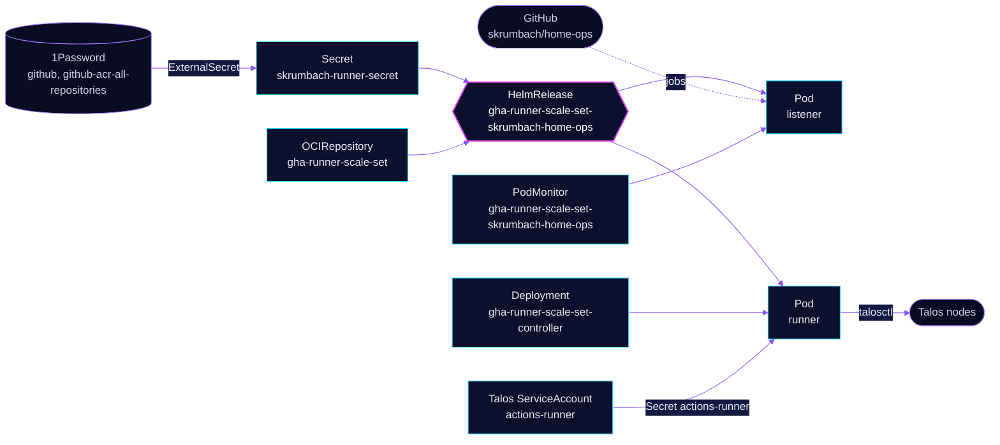

<!-- header: icon=boxes -->
<!-- concept: From a workflow to a throwaway runner | file-code Workflow | radio-tower Listen | box Runner pod | terminal Job | trash-2 Discard -->
<p align="center"></p>

> Autoscaling, single-use GitHub Actions runners for `skrumbach/home-ops`, with `talosctl` ready inside each job.

**Live facts:** <https://skrumbach.github.io/home-ops/apps/actions-runner-system/gha-runner-scale-set/> (workloads, routes, storage, backups, secrets and alerts, generated on every merge)

The controller is [`gha-runner-scale-set-controller`](../gha-runner-scale-set-controller/README.md). Runner
certificate trouble is in [`TROUBLESHOOTING.md`](../TROUBLESHOOTING.md).

## What it does

- **Provides the runner label** `gha-runner-scale-set-skrumbach-home-ops`, which workflows name in `runs-on`:
  `.github/workflows/image-pull.yaml` (job `pull`) and `.github/workflows/terraform-diff.yaml` (jobs `filter`, `plan`,
  `success`). Other workflows run GitHub-hosted.
- **Scales** between `minRunners: 1` and `maxRunners: 15`. Each runner is a pod that takes one job.
- **Authenticates to GitHub** with a GitHub App. ExternalSecret `skrumbach-runner-secret` builds `github_app_id`,
  `github_app_installation_id` and `github_app_private_key` from 1Password items `github` and `github-acr-all-repositories`.
- **Reaches Talos nodes.** Every runner mounts Secret `actions-runner`, a Talos `ServiceAccount` with role
  `os:operator`, as `TALOSCONFIG`, and gets `talosctl` from an init container. `image-pull` uses it for `talosctl image pull`.
- **Exports metrics.** PodMonitor `gha-runner-scale-set-skrumbach-home-ops` scrapes the listener, with the metric
  labels set in `listenerMetrics`.

## Why it is built this way

| Choice | Why |
|---|---|
| **No Kubernetes RBAC for runners** | No workflow on this runner calls the Kubernetes API, so no token is mounted (`automountServiceAccountToken: false`) and the chart's own no-permission ServiceAccount is used. The `rbac.yaml` comment says never to reintroduce a shared cluster-admin binding. |
| **Talos `os:operator`, not admin** | It is the least Talos role that can image-pull, and only this runner mounts it. |
| **`talosctl` from an init container** | Avoids downloading it on every job. Renovate tracks the image. |
| **`emptyDir` work volume, not a PVC** | Single-use pod on local disk with an enforced 20Gi bound (kubelet evicts past it), and no 50 to 95 second RBD provision per job. |
| **1 CPU request** | Runners tolerate control-plane taints. A 200m request let the scheduler pack them onto one node and starve kube-apiserver and an OSD there. |

## How it works

<p align="center"></p>

<details>
<summary><b>Resource graph</b>: every object involved, by name</summary>



</details>

1. Flux applies Kustomization `gha-runner-scale-set` after `gha-runner-scale-set-controller` and `rook-ceph-cluster`.
   It holds the chart source, the Talos ServiceAccount and the `skrumbach` directory with the HelmRelease.
2. A listener pod (priority class `gha-runner-infrastructure`) waits for jobs on `skrumbach/home-ops`.
3. A runner pod runs one job. The init container `talosctl-installer` copies `talosctl` into an `emptyDir` that the
   `runner` container mounts at `/usr/local/bin/talosctl`. `NODE` and `NODE_IP` are the host IP of the node the pod runs on.
4. The scale set and the runner pod template carry `secret.reloader.stakater.com/reload: skrumbach-runner-secret`;
   the template comment says it forces pod recreation when that Secret changes.

## Settings that matter

All values are in [`app/skrumbach/home-ops/helmrelease.yaml`](app/skrumbach/home-ops/helmrelease.yaml).

| Setting | Value | Why |
|---|---|---|
| `minRunners`, `maxRunners` | `1`, `15` | "Leaves headroom for other workloads." |
| `driftDetection.mode` | `enabled` | The manifest records no reason. |
| `tolerations` | `node-role.kubernetes.io/control-plane` `NoSchedule` | Runners may land on control-plane nodes. The 1 CPU request below keeps them from packing onto one. |
| `runner` `resources` | request 1 CPU, 512Mi; limit 2 CPU, 8Gi | See the CPU row in the table above. |
| `work` volume | `emptyDir`, `sizeLimit: 20Gi` | See above. |
| `securityContext.fsGroup` | `1001` | The manifest records no reason. |
| `ACTIONS_RUNNER_REQUIRE_JOB_CONTAINER` | `"false"` | The manifest records no reason. |
| `terminationGracePeriodSeconds` | `30` | The manifest records no reason. |
| `listenerTemplate` `resources` | request 50m CPU, 64Mi; limit 200m CPU, 256Mi | "To prevent eviction during pressure", together with the priority class. |
| `controllerServiceAccount` | `gha-runner-scale-set-controller` in `actions-runner-system` | Points the scale set at the controller. |

## Operate it

```bash
flux -n actions-runner-system get ks gha-runner-scale-set
flux -n actions-runner-system get hr gha-runner-scale-set-skrumbach-home-ops
kubectl -n actions-runner-system get pods -l actions.github.com/scale-set-name -o wide
kubectl -n actions-runner-system get externalsecret skrumbach-runner-secret
gh api repos/skrumbach/home-ops/actions/runners --jq '.runners[] | "\(.name) \(.status) busy=\(.busy)"'
task actions-runner:diagnose
```

Writes that exist as tasks: `task actions-runner:restart-listener` deletes the listener pod, and
`task actions-runner:reset-scale-set` deletes and recreates the HelmRelease and interrupts running jobs. Both need
the owner's go-ahead.

For alerts on this scale set see the controller README: its rules cover every scale set in the namespace.

## Invariants

- Do not reintroduce a shared cluster-admin binding for runners (`app/rbac.yaml`).

Upstream: [Actions Runner Controller](https://docs.github.com/en/actions/tutorials/use-actions-runner-controller)
