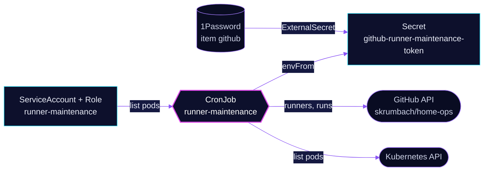

<!-- header: icon=wrench -->
<!-- concept: From orphaned runners to a clean queue | clock Every 15 min | ghost Orphans | list-x Stuck runs | check Clean -->
<p align="center"></p>

> A CronJob that deletes orphaned runner registrations and cancels stuck queued runs for `skrumbach/home-ops`.

**Live facts:** <https://skrumbach.github.io/home-ops/apps/actions-runner-system/maintenance/> (workloads, routes, storage, backups, secrets and alerts, generated on every merge)

It cleans up after [`gha-runner-scale-set`](../gha-runner-scale-set/README.md). Namespace note:
[`TROUBLESHOOTING.md`](../TROUBLESHOOTING.md).

## What it does

- **Deletes orphaned runners.** CronJob `runner-maintenance` (`*/15 * * * *`) lists the repository's runners through
  the GitHub API and deletes each one that is offline, not busy, and has no Pod of the same name in the namespace.
- **Cancels stuck runs.** A workflow run queued for more than `STUCK_RUN_MINUTES` (`30`) is cancelled.
- **Reports long runs.** A run `in_progress` for over 60 minutes gets a `[WARNING]` line in the log. Nothing is cancelled.
- **Uses a narrow identity.** ServiceAccount `runner-maintenance` may only `list` pods in `actions-runner-system`.
  The GitHub side is a PAT in Secret `github-runner-maintenance-token`.

## How it works

<p align="center"></p>

<details>
<summary><b>Resource graph</b>: every object involved, by name</summary>



</details>

1. Flux applies Kustomization `actions-runner-maintenance` after `gha-runner-scale-set-controller`,
   `gha-runner-scale-set` and `external-secrets`.
2. Step 1 reads the runners and the pods in the namespace. If the pod list cannot be read (no token, non-200 answer),
   the job deletes no runner that run. A busy runner is never touched.
3. Step 2 cancels queued runs older than the threshold. Step 3 only logs long-running ones.
4. The script is inline in `app/cronjob.yaml` and calls `gh`, `jq` and `curl` in the `actions-runner` image.

## Settings that matter

| Setting | Value | Why |
|---|---|---|
| `schedule` | `*/15 * * * *` | The manifest records no reason. |
| `concurrencyPolicy` | `Forbid` | The manifest records no reason. |
| `activeDeadlineSeconds` | `600` | "Terminate job after 10 minutes to prevent hangs." |
| `STUCK_RUN_MINUTES` | `30` | Queue age after which a run is cancelled. The manifest records no further reason. |
| Staleness signal | the runner has no Pod of its name | The GitHub runners API has no timestamp, and ARC names each ephemeral runner after its Pod. A runner mid-registration still has its Pod, so it is left alone. |
| `GITHUB_TOKEN` | PAT with Actions (read/write) and Administration (read) | Needed to list and delete runners and cancel runs. The value comes from 1Password item `github`, property `GITHUB_RUNNER_MAINTENANCE_PAT`. |

## Operate it

```bash
flux -n actions-runner-system get ks actions-runner-maintenance
kubectl -n actions-runner-system get cronjob,jobs
task actions-runner:logs-maintenance        # logs of the newest maintenance Job
```

`task actions-runner:run-maintenance` creates a Job from the CronJob. That is a write and needs the owner's go-ahead.

## Invariants

- A runner is deleted only when it is offline, not busy, and the Pod lookup succeeded and found no Pod of that name.

Upstream: [GitHub self-hosted runners API](https://docs.github.com/en/rest/actions/self-hosted-runners)
