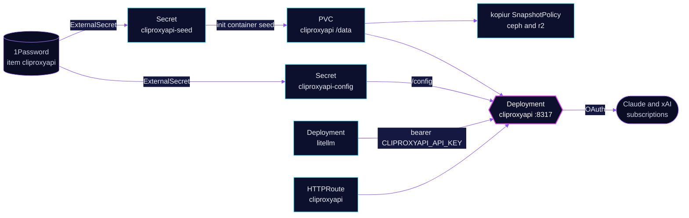

<!-- header: icon=plug-zap -->
<!-- concept: From a subscription login to an API call | log-in Login | key-round Token | plug-zap Proxy | cloud Provider -->
<p align="center"></p>

> Turns Claude and xAI subscription logins into an OpenAI-compatible API that LiteLLM calls in-cluster.

**Live facts:** <https://skrumbach.github.io/home-ops/apps/ai/cliproxyapi/> (workloads, routes, storage, backups, secrets and alerts, generated on every merge)

## What it does

- **Holds OAuth logins** for a Claude subscription and an xAI subscription, in `/data/auths` on PVC `cliproxyapi`.
  The app rewrites each file when it refreshes a token.
- **Serves an OpenAI-compatible API** on `cliproxyapi:8317`. `ai/litellm` reaches it at
  `http://cliproxyapi.ai.svc.cluster.local:8317/v1` for the subscription-backed models.
- **Serves a management UI** at `https://cliproxyapi.sklab.dev/management.html` on `envoy-internal`, with its own
  secret key and no Envoy sign-in.
- **Keeps the logins backed up** through the `kopiur` component (ceph and r2 repositories) and restores them from
  the newest snapshot when the claim is recreated.

## Why it is built this way

| Choice | Why |
|---|---|
| **Seed once, then the app owns the file** | Init container `seed` copies a login from Secret `cliproxyapi-seed` only if that file is missing. The app rewrites refreshed tokens, so a later seed must not overwrite them. |
| **`strategy: Recreate`** | One replica on an RWO claim: a rolling update would deadlock on Multi-Attach. |
| **No SecurityPolicy on the route** | API clients send bearer keys, and the management UI has its own secret key. |
| **Two API keys** | `CLIPROXYAPI_API_KEY` is LiteLLM's bearer key. `CLIPROXYAPI_DIRECT_KEY` is for laptop clients. |
| **Config rendered into a Secret** | `config.yaml` carries the keys, so ExternalSecret `cliproxyapi-config` templates it and the pod mounts it read-only. |

## How it works

<p align="center"></p>

<details>
<summary><b>Resource graph</b>: every object involved, by name</summary>



</details>

1. Flux applies Kustomization `cliproxyapi` after `onepassword-store` and `kopiur-repository`. The `kopiur/pvc`
   component owns PVC `cliproxyapi`; the HelmRelease mounts it with `existingClaim`.
2. Init container `seed` creates `/data/auths` and copies `claude.json` and `xai.json` from the seed Secret when they
   are missing, mode `600`.
3. The app reads `/config/config.yaml` and serves on `8317`. `request-retry` is `2`. `WRITABLE_PATH` is `/tmp`,
   because `/config` is read-only and the management panel assets download there.
4. LiteLLM calls with `CLIPROXYAPI_API_KEY`. The app uses the stored login to call the provider.

## Settings that matter

| Setting | Value | Why |
|---|---|---|
| `KOPIUR_CAPACITY`, `KOPIUR_CACHE_CAPACITY` (overlay) | `1Gi`, `2Gi` | Claim size and the kopiur cache size. The manifest records no reason. |
| `KOPIUR_SCHEDULE_R2` (overlay) | `H 19 * * *` | The offsite copy runs daily in hour 19, not the component default (hour 4). Ceph keeps its default. |
| `KOPIUR_PUID`, `KOPIUR_PGID` | `"1000"` | Same value as the pod's `runAsUser`, `runAsGroup` and `fsGroup`. |
| Startup probe | `/healthz`, every 5s, 24 failures | Up to 120s to start before liveness counts. |
| Security context | non-root, read-only root, no capabilities, no service account token | Hardening on every container; `/tmp` is an emptyDir. |

## Operate it

```bash
flux -n ai get ks cliproxyapi
kubectl -n ai get deploy cliproxyapi
kubectl -n ai logs deploy/cliproxyapi -c app --tail=100
kubectl -n ai get pvc,snapshotpolicy,restore | grep cliproxyapi
kubectl -n ai exec deploy/cliproxyapi -c app -- ls /data/auths    # exec: lists login files, no contents
```

Add a login: run the provider's login command on a laptop (`--claude-login`, `-xai-login`) and store the file in
1Password item `cliproxyapi` (`CLAUDE_AUTH_JSON`, `XAI_AUTH_JSON`). The seed copies a file only when that name is
missing on the PVC. Restores: [`restore.md`](../../../../../.agents/skills/incident-runbooks/references/restore.md).

## Invariants

- **No cloud fallback in LiteLLM may point at `cliproxy-claude`.** It is a flat-rate subscription route.
- **`cliproxy-claude` carries an explicit `0` on every price field** (flat-rate subscription). The Claude and Grok
  models that also use this proxy are `LiteLLMModel` objects in `ai/litellm`; see their own comments.
- **The Kustomization owns a kopiur claim, so it never sets `wait: true`.** It uses a Deployment health check.

Upstream: [CLIProxyAPI](https://github.com/router-for-me/CLIProxyAPI)
