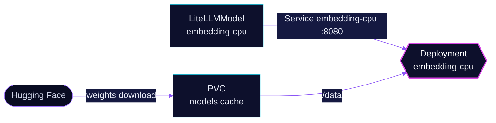

<!-- header: icon=cpu -->
<!-- concept: From text to a vector on CPU | file-text Text | cpu CPU | binary Vector | share-2 Share -->
<p align="center"></p>

> The CPU embedding server, reached as `embedding-cpu` through LiteLLM, for apps that should not touch the shared GPU.

**Live facts:** <https://skrumbach.github.io/home-ops/apps/ai/embedding-cpu/> (workloads, routes, storage, backups, secrets and alerts, generated on every merge)

## What it does

- **Serves `/v1/embeddings`** on Service `embedding-cpu:8080`, from Text Embeddings Inference (CPU build).
- **Backs one LiteLLM model.** `LiteLLMModel` `embedding-cpu` points its `apiBase` here.
- **Matches `embedding-local`'s vector space:** the same Qwen3-Embedding-0.6B at 1024 dimensions, so the two are
  interchangeable by design. They are still separate aliases: a store must keep using one.
- **Leaves the B70 alone.** There is no GPU request and no shared-GPU rate cap.

## Why it is built this way

| Choice | Why |
|---|---|
| **A second embedder next to `embedding-gpu`** | The B70 has two tenants and `embedding-local` is capped at 1 request per second for every key. A retain burst from an agent-memory app would hit 429s. |
| **TEI, not llama.cpp** | TEI fails on this Battlemage card, but it is the supported CPU server and takes the safetensors weights directly. |
| **Not a fallback for `embedding-local`** | A fallback could write vectors from a different server into one index. Each consumer picks one alias and keeps it. |
| **`--auto-truncate`** | Over-length input is cut instead of failing the caller. |
| **Recreate, one replica** | The weights cache is a RWO claim. |

## How it works

<p align="center"></p>

<details>
<summary><b>Resource graph</b>: every object involved, by name</summary>



</details>

## Settings that matter

All values are in [`app/helmrelease.yaml`](app/helmrelease.yaml).

| Setting | Value | Why |
|---|---|---|
| `--model-id` | `Qwen/Qwen3-Embedding-0.6B` | The same model as `embedding-gpu`, so the vectors are in one space. |
| `--max-client-batch-size` | `16` | Bounds one request's CPU time. |
| `--max-batch-tokens` | `1024` | Attention memory grows with the square of it: the default 16384 OOM-killed the pod at 3Gi and 4096 still did at 6Gi. Input beyond it is cut by `--auto-truncate`. |
| Memory request, limit | `3Gi`, `6Gi` | The CPU backend loads the weights as float32 (about 2.4GB) before any batch. |
| LiteLLM `max_parallel_requests`, `timeout` | `4`, `20` | A burst queues at LiteLLM instead of on the CPU. |

## Operate it

```bash
flux -n ai get ks embedding-cpu
kubectl -n ai get pods -l app.kubernetes.io/name=embedding-cpu -o wide
kubectl -n ai logs deploy/embedding-cpu --tail=50
kubectl -n ai get litellmmodel embedding-cpu
```

## Invariants

- **No prices and no cloud fallback on `embedding-cpu`** ([`../litellm/app/models/embedding-cpu.yaml`](../litellm/app/models/embedding-cpu.yaml)),
  and `params.model` names what this server serves.
- **Never mix this server's vectors and `embedding-local`'s in one index**, even though the dimensions match.
- **The model and the 1024 dimensions are fixed for every consumer.** Changing either needs a re-embed of each store.

Upstream: [Text Embeddings Inference](https://github.com/huggingface/text-embeddings-inference)
