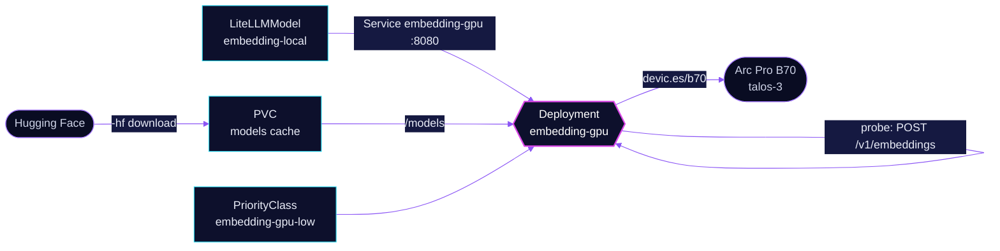

<!-- header: icon=scan-search -->
<!-- concept: From text to a checked vector on the shared GPU | file-text Text | microchip GPU | binary Vector | shield-check Check -->
<p align="center"></p>

> The local embedding server on the shared Arc Pro B70, reached as `embedding-local` through LiteLLM.

**Live facts:** <https://skrumbach.github.io/home-ops/apps/ai/embedding-gpu/> (workloads, routes, storage, backups, secrets and alerts, generated on every merge)

## What it does

- **Serves `/v1/embeddings`** on Service `embedding-gpu:8080`, from a llama.cpp SYCL server in embedding mode.
- **Backs one LiteLLM model.** `LiteLLMModel` `embedding-local` points its `apiBase` here. The model name and the
  1024 dimensions are in [`../litellm/app/models/embedding-local.yaml`](../litellm/app/models/embedding-local.yaml).
- **Yields to chat.** It shares the B70 with `ai/vllm`, runs at the lowest priority, and is evicted first.
- **Fails its probes on a NaN vector.** Readiness and liveness post a real embedding request and reject `null`
  values, which is how llama.cpp prints NaN.

## Why it is built this way

| Choice | Why |
|---|---|
| **A separate HelmRelease from chat** | A change here must not Recreate the chat server. |
| **llama.cpp, not TEI** | TEI on XPU failed on this Battlemage card. |
| **Recreate** | `devic.es/b70` is a share token, so two copies of the pod would both load weights. |
| **PriorityClass `embedding-gpu-low` (-10, `Never` preempts)** | Last to schedule and first to evict, and it never displaces chat. GPU contention is not a scheduling problem. |
| **Probes that read the vector** | `/health` cannot see NaN, so it is the startup probe only. Readiness and liveness assert finite values. |
| **Load capped at LiteLLM, not here** | `--timeout 30` is only a socket timeout and does not bound a queued request. The caps sit on the `embedding-local` model. |

## How it works

<p align="center"></p>

<details>
<summary><b>Resource graph</b>: every object involved, by name</summary>



</details>

1. Flux applies Kustomization `embedding-gpu`. Its health check is the Deployment, not the HelmRelease, because a
   HelmRelease check stays Ready through a crashloop. `wait` stays false so the list is consulted.
2. On first start llama.cpp downloads the GGUF into `/models`. The startup probe polls `/health` for up to 10 minutes
   (40 failures at 15 s). The claim is re-downloadable and not backed up; without it every start fetches the model
   again.
3. The server runs with last-token pooling, two parallel slots and one shared context of 512 tokens.
4. LiteLLM forwards `embedding-local` calls here. It caps the rate (60 requests per minute for every key together),
   the in-flight count (8) and the per-attempt timeout (5 s), and returns 429 at once instead of queueing.
5. Every 30 s (readiness) and 60 s (liveness) the pod posts its own embedding request. The probe fails on a non-200
   answer, on any `null` in the body, or on a vector with no non-zero digit.

## Settings that matter

All values are in [`app/helmrelease.yaml`](app/helmrelease.yaml).

| Setting | Value | Why |
|---|---|---|
| `--pooling` | `last` | Mean pooling is a different vector space. |
| `--parallel`, `--kv-unified` | `2`, set | The pin is required: the KV pool is 56 MiB and the `0.00 MiB` log line is only the reserve pass. The chat rule "do not pin `--parallel`" does not transfer. `--kv-unified` is required with it, or the slot context halves to 256. |
| `--cache-ram` | `"0"` | The embedding cache is write-only. Absence restores the silent 8192 MiB default, and a memory limit cannot stop that. Do not copy chat's `4096`. |
| `--ctx-size`, `-b`, `-ub` | `512` each | One triple. 512 leaves room for a chat restart; 2048 fits but spends that margin. |
| `--no-cont-batching`, `--timeout` | set, `"30"` | `--timeout` replaces the image default of 3600 but only bounds the socket (see above). |
| `ONEAPI_DEVICE_SELECTOR` | `level_zero:0` | Per the manifest comment, `/dev/dri/card0` here is the B70 while `/sys/class/drm/card0` is the iGPU; use PCI `0000:03:00.0` to name the B70. |
| Memory request, limit | `1024Mi`, `4Gi` | The request is low on purpose: this pod is evicted before chat. Do not raise it without redoing the talos-3 arithmetic. The limit is headroom; `--cache-ram 0` is what stops the OOM. |
| `tolerations` | `home-operations.com/dedicated` `PreferNoSchedule` | talos-3 carries that taint and this pod can only land there. |

## Operate it

```bash
flux -n ai get ks embedding-gpu
kubectl -n ai get pods -l app.kubernetes.io/name=embedding-gpu -o wide
kubectl -n ai logs deploy/embedding-gpu --tail=50
kubectl -n ai get litellmmodel embedding-local
```

Check a vector for NaN (needs `exec`; the answer must contain no `null`):

```bash
kubectl -n ai exec deploy/embedding-gpu -- curl -s --max-time 10 -X POST http://127.0.0.1:8080/v1/embeddings \
  -H 'Content-Type: application/json' -d '{"model":"probe","input":"embedding health probe"}' | grep -c null
```

## Invariants

- **The B70 has two tenants: throttle the embedding endpoint by request rate. Both llama.cpp workloads pin `--cache-ram`
  (chat non-zero, embeddings `0`) and `vllm` sets `GGML_SYCL_FA_ONEDNN: "0"` or host RAM leaks with no OOM. An
  embedding endpoint can return pure NaN with green health.**
- **NEVER rename a DRM device node with `generic-device-plugin`'s `mountPath`, and never ship a GPU change without the
  VA-API check:** `kubectl -n media exec deploy/tdarr-tdarr-node -c app -- vainfo --display drm --device /dev/dri/renderD129`.
  VA-API consumers use `devic.es/b70-vaapi`. No DRA migration, never `adminAccess: true`.
- **Throttle at LiteLLM, on `embedding-local`.** The server's own `--timeout` is only a socket timeout.
- **`--cache-ram` stays `0`.** Do not copy chat's `4096`.
- **Only the vector-reading probes catch NaN.** `/health` cannot see it, so it stays the startup probe only.
- **Do not append `<|endoftext|>`** to the input.
- **Cosine similarity against the CPU endpoint is not the NaN probe.**
- **Same image tag as `ai/vllm`.** Re-measure both workloads before the next bump.
- **`embedding-local` has no prices and no cloud fallback, and its `params.model` names what this server serves**
  ([`../litellm/app/models/embedding-local.yaml`](../litellm/app/models/embedding-local.yaml)).

Upstream: [llama.cpp server](https://github.com/ggml-org/llama.cpp/tree/master/tools/server)
