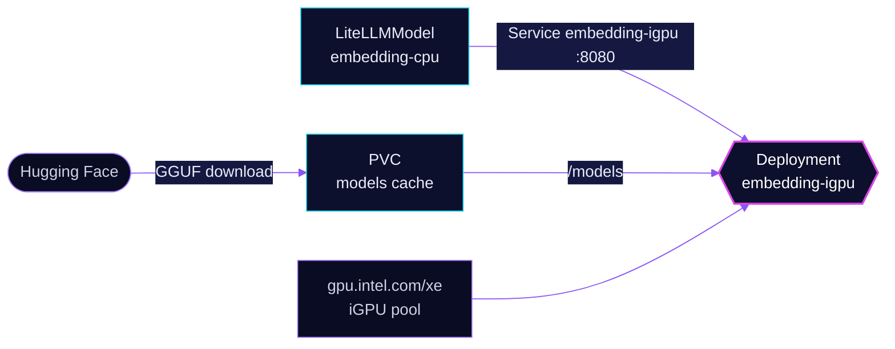

<!-- header: icon=cpu -->
<!-- concept: From text to a vector on the iGPU | file-text Text | cpu iGPU | binary Vector | shield-check Check -->
<p align="center"></p>

> The embedding server on a node's Intel iGPU, reached as `embedding-cpu` through LiteLLM, off the shared B70.

**Live facts:** <https://skrumbach.github.io/home-ops/apps/ai/embedding-igpu/> (workloads, routes, storage, backups, secrets and alerts, generated on every merge)

## What it does

- **Serves `/v1/embeddings`** on Service `embedding-igpu:8080`, from the same llama.cpp SYCL server and Qwen3-Embedding-0.6B f16 GGUF as `embedding-gpu`.
- **Backs one LiteLLM model.** `LiteLLMModel` `embedding-cpu` points its `apiBase` here. The alias keeps its name because
  Hindsight's key and every stored vector are bound to it.
- **Leaves the B70 alone.** It requests `gpu.intel.com/xe`, the iGPU pool, not `devic.es/b70`.
- **Keeps the vector space.** Measured against the TEI CPU server it replaced: cosine 1.00000 on every vector, so nothing is re-embedded.

## Why it is built this way

| Choice | Why |
|---|---|
| **The iGPU, not the CPU** | Under a Hindsight retain burst the TEI CPU pod used 5.5 cores, queued 8-17s per call and timed out at LiteLLM. The iGPU took about 1.5s per text in the same test. |
| **llama.cpp, not TEI** | TEI has no Intel GPU path that works here; the SYCL server is what `embedding-gpu` already runs. |
| **Not on talos-3** | The B70 is a second Level Zero device there, so `level_zero:0` may select it and take it from chat. talos-1 and talos-2 have the iGPU only. |
| **Same probes as `embedding-gpu`** | `/health` cannot see NaN. Readiness and liveness assert a finite vector. |
| **Recreate, one replica** | The weights cache is a RWO claim. |

## How it works

<p align="center"></p>

<details>
<summary><b>Resource graph</b>: every object involved, by name</summary>



</details>

## Settings that matter

All values are in [`app/helmrelease.yaml`](app/helmrelease.yaml).

| Setting | Value | Why |
|---|---|---|
| `--pooling` | `last` | Mean pooling is a different vector space. |
| `--parallel`, `--ctx-size` | `2`, `512` | Pinned together: without `--kv-unified` the per-slot context halves. |
| `--cache-ram` | `0` | The embedding cache is write-only, and absence restores a silent 8192 MiB default. |
| `gpu.intel.com/xe` | `1` | A share of the iGPU pool (99 per node), also used by Plex and rsshub. |
| Memory request, limit | `1Gi`, `4Gi` | About 1.4Gi in use; the limit is headroom. |
| LiteLLM `max_parallel_requests`, `timeout` | `4`, `20` | A burst queues at LiteLLM instead of on the iGPU. |

## Operate it

```bash
flux -n ai get ks embedding-igpu
kubectl -n ai get pods -l app.kubernetes.io/name=embedding-igpu -o wide
kubectl -n ai logs deploy/embedding-igpu --tail=50
kubectl -n ai get litellmmodel embedding-cpu
```

## Invariants

- **The model and the 1024 dimensions are fixed for every consumer.** Changing either needs a re-embed of each store.
- **Never schedule it on talos-3**, and never add a `devic.es/b70` request: the B70 has two tenants already.
- **Do not append `<|endoftext|>`**, and keep last-token pooling.
- **A fallback to another embedder is not allowed:** it could write vectors from a different server into one index.

Upstream: [llama.cpp](https://github.com/ggml-org/llama.cpp)
