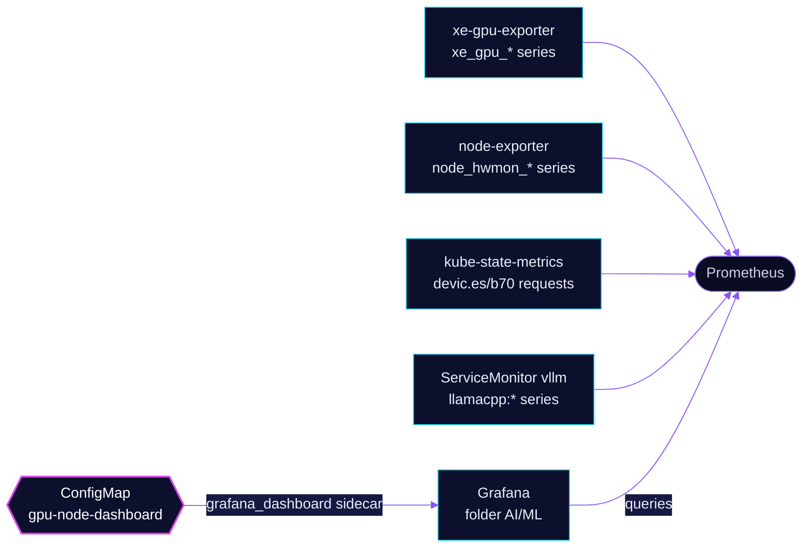

<!-- header: icon=activity -->
<!-- concept: From GPU and host series to one Grafana board | gauge Metrics | file-json Dashboard | layout-dashboard Grafana -->
<p align="center"></p>

> One Grafana dashboard for the Arc B70 on talos-3: VRAM, power, device-plugin slots, host load and chat throughput.

**Live facts:** <https://skrumbach.github.io/home-ops/apps/ai/gpu-node-dashboard/> (workloads, routes, storage, backups, secrets and alerts, generated on every merge)

## What it does

- **Ships a dashboard only.** ConfigMap `gpu-node-dashboard` carries `resources/gpu-node.json`, labelled
  `grafana_dashboard: "true"` and annotated `grafana_folder: AI/ML`, so the Grafana sidecar loads it into folder
  `AI/ML` as `GPU Node (Intel Arc B70 / iGPU Fleet)` (uid `ai-gpu-node`).
- **Shows five groups of panels:** B70 VRAM used and held per pod, power, temperature and fan, device-plugin slot
  allocation, talos-3 CPU and memory pressure, and chat throughput per model and KV type.
- **Runs no workload.** The Kustomization has no health check and nothing to wait for.

## How it works

<p align="center"></p>

<details>
<summary><b>Resource graph</b>: every object involved, by name</summary>



</details>

1. Flux applies Kustomization `gpu-node-dashboard`. The configMapGenerator turns the JSON into the ConfigMap with a
   fixed name (`disableNameSuffixHash`), so an edit replaces the dashboard in place.
2. The Grafana sidecar watches ConfigMaps with that label and loads the file.
3. The panels read Prometheus. VRAM comes from `xe-gpu-exporter`, power, temperature and fan from node-exporter hwmon
   series of talos-3, slot counts from kube-state-metrics, and token rates from the llama.cpp metrics that the
   `vllm` ServiceMonitor labels with `model` and `kv`.

## Settings that matter

| Setting | Value | Why |
|---|---|---|
| `pdev` and hwmon `chip` in the queries | `0000:03:00.0`, `0000:02:01_0_0000:03:00_0` | They name the B70 by PCI address. A card in another slot or another node needs new queries. |
| `instance="talos-3"` | in the host and hwmon queries | The only node with the B70. |
| Chat panels group by `model, kv` | `llamacpp:*` series | A variant that ships its own `model` or `kv` label keeps separate history. The `vllm` ServiceMonitor sets both labels. |

## Operate it

```bash
flux -n ai get ks gpu-node-dashboard
kubectl -n ai get configmap gpu-node-dashboard --show-labels
```

Edit `app/resources/gpu-node.json` and merge; Flux replaces the ConfigMap and Grafana reloads it.

## Invariants

- **Keep the panels' `model` and `kv` grouping in step with the `vllm` ServiceMonitor relabelings.** Nothing checks it.
