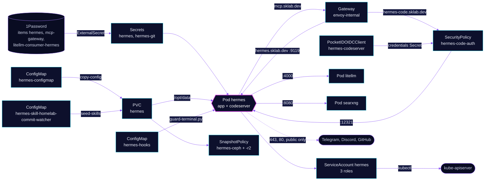

<!-- header: icon=bot -->
<!-- concept: From a message to a guarded cluster action | message-square Message | brain Agent | shield-check Guard | wrench Action -->
<p align="center"></p>

> The homelab operator agent: it answers on a dashboard, Telegram and Discord and runs a fenced kubectl terminal.

**Live facts:** <https://skrumbach.github.io/home-ops/apps/ai/hermes/> (workloads, routes, storage, backups, secrets and alerts, generated on every merge)

## What it does

- **Serves a dashboard** at `https://hermes.sklab.dev` (container `app`, port `9119`, its own basic auth) on
  `envoy-internal` only. An OpenAI-compatible API listens on `8642` of Service `hermes`, with no route.
- **Serves code-server** at `https://hermes-code.sklab.dev` (container `codeserver`, port `12321`) over the state
  volume. It has no auth of its own: SecurityPolicy `hermes-code-auth` puts Pocket ID in front at Envoy.
- **Talks to every model through LiteLLM** with its own virtual key. The default model is the role alias `chat-local`.
  Failover and the background tasks use cloud models, set in `config.yaml`.
- **Operates the cluster** as ServiceAccount `hermes`: it can read most of the cluster, delete a wedged pod, and
  exec into pods and restart Deployments in namespace `ai` only.
- **Answers in chat.** DM the Telegram bot from an allowed user. The Discord bot answers one dedicated channel.
  The `homelab-commit-watcher` skill posts a digest to a Discord webhook.
- **Keeps its state** on PVC `hermes` (`/opt/data`), backed up by kopiur to the in-cluster `ceph` and offsite `r2`
  repositories. It also mounts the shared claims `shared-xml` at `/opt/xml` and `shared-files` at `/opt/files`.

## Why it is built this way

| Choice | Why |
|---|---|
| **Config is Git, copied on every start** | `copy-config` overwrites `/opt/data/config.yaml` from ConfigMap `hermes-configmap`, so an edit in the pod is lost on restart. Models and providers change in Git. |
| **One replica, Recreate** | `/opt/data` (sessions, memories, skills) is not safe for concurrent writers. |
| **`-desktop` image** | Chromium and the VNC stack are baked in, and the process cannot install packages after it drops to uid 10000. |
| **Egress fenced in Cilium** | Hermes has a terminal, `execute_code`, a browser, cluster-wide read RBAC and `pods/exec` in `ai`. CiliumNetworkPolicy `hermes` cuts the LAN, nodes and other private ranges out of egress, so a hijacked session cannot reach them. |
| **A guard hook in front of the terminal** | `hooks/guard-terminal.py` blocks the catastrophic, sends "ask first" commands to the approval gate and allows the rest. It is a backstop, not a sandbox: it reads the command string. `fail_closed` makes a crashed guard refuse the command. |
| **Cloud models for background chores** | `web_extract` fires one call per page in parallel, and the local server's slots queue and time out past their count. |
| **Pocket ID at Envoy for code-server only** | code-server runs with `--auth none`. The dashboard keeps its own basic auth and is not gated by the SecurityPolicy. |
| **Two GitHub tokens** | Hermes renders the read-only token. The write token belongs to OpenCode, so an agent terminal that can see the variable cannot write to home-ops. |

## How it works

<p align="center"></p>

<details>
<summary><b>Resource graph</b>: every object involved, by name</summary>



</details>

1. Flux applies Kustomization `hermes` after `ai-pvc` (which creates `shared-xml` and `shared-files`),
   `onepassword-store`, `litellm` and `kopiur-repository`. The `kopiur` components add the snapshot policies and own
   PVC `hermes`.
2. Two init containers run as root. `copy-config` copies `config.yaml` onto the PVC and `seed-skills` copies the
   skill, each chowned to uid 10000. Reloader restarts the pod when any mounted ConfigMap or Secret changes.
3. The `app` container starts with `sleep infinity`. The image's s6 init starts as root, chowns `/opt/data` and drops
   to uid 10000, then runs its services, among them `gateway-default`. A `postStart` hook runs `s6-svc -u` on that
   service, because a graceful exit records `stopped` in `gateway_state.json` and boot does not restart it.
4. The `secrets.command` helper in `config.yaml` reads the keys of Secret `hermes`, mounted as files under
   `/secrets/mcp`, and hands them to Hermes. MCP `${VAR}` references, the provider `key_env` and a skill's required
   env resolve only from that scope, never from the container env.
5. Every LLM call goes to `litellm:4000`. The default is `chat-local`. If the local model errors, the main loop falls
   through `fallback_providers`: two flat-rate Go models, then one metered model that spends the `hermes` key's own
   budget. Each auxiliary task has its own `fallback_chain`; without it Hermes falls back to the main model and
   times out again.
6. Tools come from the ToolHive MCP gateway at `https://mcp.sklab.dev/mcp` with a bearer token. Web search goes to
   SearXNG. Git uses one repo-scoped token read from `/secrets/git/.git-credentials`.
7. Before a terminal command runs, `guard-terminal.py` returns allow, block or approve. Approvals use `mode: smart`;
   cron and unattended runs deny what would need a human.
8. The probes are TCP on `9119`, so the pod can stay Running while the gateway is stuck. The watchdog log on the
   volume is the place to look. A static Gatus check polls `hermes.ai.svc:8642/health`, which the
   CiliumNetworkPolicy admits.

## Settings that matter

All values are in [`app/helmrelease.yaml`](app/helmrelease.yaml) unless noted.

| Setting | Value | Why |
|---|---|---|
| `args` | `["sleep", "infinity"]` | Do not pass `gateway run`: `gateway-default` is the only gateway and a second one crash-loops. |
| `HERMES_STARTUP_WATCHDOG_TIMEOUT_S` | `"900"` | The runway is 4 times the 300 default because the integrity check burns CPU and earns extensions. At 300 the pod loops. |
| `AGENT_BROWSER_ARGS` | `--no-sandbox,--disable-dev-shm-usage,--disable-gpu` | The image's sandbox auto-detection never fires (uid 10000, no AppArmor on Talos). Without these Chromium hangs. There is no `browser.launch_args` key. |
| Probes | TCP `9119`; startup allows 30 failures at 10 s | First boot initialises config and skills under `/opt/data`. |
| `resources` (`app` / `codeserver`) | requests 100m CPU, 512Mi / 10m, 256Mi; memory limits 6Gi / 1Gi | The 6Gi limit keeps `state.db`'s page cache from thrashing while the request stays 512Mi. An editor opening a large tree spikes code-server above idle. |
| `defaultPodOptions.automountServiceAccountToken` | `true` | Hermes runs `kubectl`, so it needs the token. The chart default is false. |
| `fsGroup`, `fsGroupChangePolicy` | `10000`, `OnRootMismatch` | Makes the `ceph-block` PVC group-writable for the dropped user. |
| `KOPIUR_PUID`, `KOPIUR_PGID` ([overlay](../../../main/ai/hermes.yaml)) | `"10000"` | The files are 10000:10000. The component default 1000 fails closed. |
| `KOPIUR_CAPACITY`, `KOPIUR_CACHE_CAPACITY`, `KOPIUR_SCHEDULE_R2` | `40Gi`, `48Gi`, `H 19 * * *` | Capacity is create-time only; growing the live claim is a `kubectl patch`. The offsite copy runs daily in hour 19. |
| `sessions.retention_days` ([`config.yaml`](app/resources/config.yaml)) | `30` | The upstream default of 90 does not fit the claim. Dial it down if the volume climbs; it must stay above 0 and below 90. |
| `sessions.auto_prune` | `true` | Pinned, because an upstream flip would silently stop pruning. |
| `sessions.vacuum_after_prune` | `false` | Load-bearing. See Invariants. |
| `model.default`, `delegation.model` | `chat-local`, a Go model | Subagents fan out above the local server's slots and queue, so they run on a fast flat-rate model and the parent keeps `chat-local`. |
| `discover_models` | `false` | `embedding-local` and other keys' models stay unlisted. |
| Egress ports ([`ciliumnetworkpolicy.yaml`](app/ciliumnetworkpolicy.yaml)) | `4000`, `8080`, `10443`, `6443`, public `443` and `80` | Private, CGNAT and link-local ranges are cut out. A new tool target needs its own egress rule. |

### 1Password item `hermes`

| Field | What it is |
| --- | --- |
| `HERMES_DASHBOARD_USER`, `HERMES_DASHBOARD_PASSWORD` | Dashboard basic auth |
| `HERMES_DASHBOARD_SECRET` | `openssl rand -hex 32` |
| `GITHUB_LLM_WIKI_TOKEN` | Fine-grained PAT, one repo, Contents read and write. Not a classic PAT |
| `API_SERVER_KEY` | `openssl rand -hex 32` for the `:8642` API |
| `HOMELAB_GH_READ_TOKEN` | Fine-grained PAT, **read-only** (issue and file writes answer 403). Hermes' `HOMELAB_GH_TOKEN` env (commit-watcher) and the GitHub MCP render from it. Distinct from the wiki token |
| `HOMELAB_GH_TOKEN` | Fine-grained PAT that **can write** to home-ops. OpenCode's `GITHUB_TOKEN` only. Hermes must never render from it (`scripts/ci/hermes-github-token-test.py`) |
| `DISCORD_WEBHOOK` | Channel webhook for the commit digest |
| `TELEGRAM_BOT_TOKEN`, `TELEGRAM_ALLOWED_USERS` | BotFather token and numeric user ids |
| `DISCORD_BOT_TOKEN`, `DISCORD_ALLOWED_USERS` | Discord bot token and allowed user ids. The bot is gated twice: these ids, and `discord.allowed_channels` in `config.yaml` |

`MCP_GATEWAY_TOKEN` (the ToolHive MCP gateway bearer token, sent to
`https://mcp.sklab.dev/mcp`) is not a prerequisite.
It comes from 1Password item `mcp-gateway`, which
`ai/toolhive`'s PushSecret writes.

`LITELLM_HERMES_API_KEY` is not a prerequisite either. It is
1Password item `litellm-consumer-hermes`, field `key`, written by the
`hermes` LiteLLMVirtualKey's PushSecret (`ai/litellm`). Hermes' one
LLM provider is `litellm` (`/model custom:litellm:<model>`): default
model `chat-local`, the fallback chain and every auxiliary task all use
it. The key is Hermes' alone, so its spend is attributable; its $50 per
30 days covers only the metered Claude/GPT routes (`chat-local` and the
OpenCode Go `go-*` models are $0). Hermes sends `x-opencode-session` for
the `go-*` models (`session_affinity_header`). Do not name that env var
`OPENAI_API_KEY` or `GH_TOKEN`: Hermes scrubs built-in provider
credential names.

## Operate it

```bash
flux -n ai get ks hermes
flux -n ai get hr hermes
kubectl -n ai get pods -l app.kubernetes.io/name=hermes -o wide
kubectl -n ai logs deploy/hermes -c app --tail=100
kubectl -n ai get snapshotpolicy,restore,pvc
kubectl -n ai get securitypolicy/hermes-code-auth pocketidoidcclient/hermes-codeserver
kubectl get clusterrole hermes-read-all hermes-pod-delete; kubectl -n ai get role hermes-exec-deploy
```

These need `exec` into the pod:

```bash
kubectl -n ai exec deploy/hermes -c app -- tail -n 50 /opt/data/logs/gateway-startup-watchdog.log
kubectl -n ai exec deploy/hermes -c app -- hermes computer-use screen status
```

Register the commit-watcher cron once in the dashboard after the pod is up. Open Bot Desktop from the dashboard
Screen pane, or with `hermes computer-use screen status|start|stop`. The viewer is the existing dashboard WebSocket.
Restores: [`restore.md`](../../../../../.agents/skills/incident-runbooks/references/restore.md).

### When an alert fires

From [`app/prometheusrule.yaml`](app/prometheusrule.yaml).

| Alert | Fires when | First look |
|---|---|---|
| `HermesStateVolumeApproachingCapacity` | the `hermes` claim is projected to fill within 14 days, for 1 h | `state.db` growth and retention (`sessions.retention_days`), or grow the claim. |
| `HermesStateVolumeCriticalCapacity` | projected to fill within 3 days, for 30 min | Same, now: a full RWO volume stops the single writer. |
| `HermesStateVolumeNearlyFull` | above 95% used, for 15 min | The static backstop. Reclaiming disk is an offline `hermes sessions optimize-storage` after there is free space. |

## Invariants

- **NEVER set `sessions.vacuum_after_prune: true` on `ai/hermes`.** Any Hermes config byte restarts it uncleanly.
- Image tag stays on the `-desktop` suffix (Chromium and the VNC stack are baked in; the process cannot `apt install` after it drops to uid 10000).
- `copy-config` copies `app/resources/config.yaml` onto the PVC on every start. Edit that file and commit. `hermes config edit` in the pod is overwritten on the next restart. Any byte of that file or a runtime skill restarts the pod. Do not edit them to tidy comments.
- The unclean exit leaves `gateway.lifecycle.json` at `phase=running`. If the restart loop outlasts the 900 s watchdog runway, the only exit is deleting `/opt/data/state/gateway.lifecycle.json`; the manifest marks that step `UNVERIFIED-LIVE`.
- `AGENT_BROWSER_ARGS` is set because the image's sandbox auto-detection never fires (uid 10000, no AppArmor on Talos). Without `--no-sandbox,--disable-dev-shm-usage,--disable-gpu`, Chromium hangs.
- Bot Desktop is opt-in (`bot_desktop.auto_start` stays false). VNC listens on a mode-0600 unix socket only. `min_free_memory_mb` defaults to 1536, inside the 6Gi app limit. (Carried over from the older README; no file in this repository sets or shows that default.)
- Probes are TCP on `9119`. The pod stays Running and Gatus stays green while the gateway is stuck. Read `/opt/data/logs/gateway-startup-watchdog.log`. Do not add a gateway liveness probe. (Older rule. Only the route's dashboard check stays green: the static `Hermes Gateway` check on `:8642/health` in `monitoring/gatus/app/resources/config.yaml` now watches the gateway. No file here shows the log path.)
- `sessions.vacuum_after_prune` stays false. Narrowing `retention_days` is the dial. Reclaiming disk is an offline `hermes sessions optimize-storage` after there is free space.
- `hermes-exec-deploy` is `pods/exec` and deployment rollout-restart in namespace `ai` only. Widen that Role on purpose. It is not read-only. `hermes-read-all` is get/list/watch across the homelab and `hermes-pod-delete` can delete a wedged pod.
- Long-term memory is the bundled `holographic` provider (`memory.provider: holographic`), a SQLite store on this pod. It is not shared with other agents. `agentmemory` is retired.
- The skill file is a payload: editing it restarts Hermes. Runtime skills live in `app/skills/` and are copied to `/opt/data/skills` on start. Shipped: `homelab-commit-watcher` (Discord digest).
- `HOMELAB_GH_TOKEN` (the write token) is OpenCode's only. Hermes must never render from it.
- Do not name that env var `OPENAI_API_KEY` or `GH_TOKEN`: Hermes scrubs built-in provider credential names.
- Git access is that one repo-scoped fine-grained PAT, rendered to `/secrets/git/.git-credentials`. GitHub rejects it for every other repo. Do not substitute a classic PAT or an account SSH key.
- Never set `OPENAI_BASE_URL`: it overrides every provider. Routing is `config.yaml`.
- Never name a custom provider after a built-in id (`openrouter`, `openai`): the auxiliary-client resolver then skips this `base_url`.

Upstream: [Hermes Agent](https://github.com/NousResearch/hermes-agent) •
[Envoy Gateway OIDC](https://gateway.envoyproxy.io/docs/tasks/security/oidc/)
