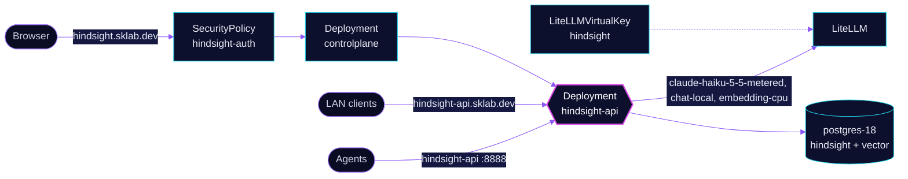

<!-- header: icon=brain -->
<!-- concept: From a conversation to a recalled fact | message-square Turn | filter Extract | database Store | search Recall -->
<p align="center"></p>

> Long-term memory for the agents: it extracts facts from conversations, stores them and recalls them later.

**Live facts:** <https://skrumbach.github.io/home-ops/apps/ai/hindsight/> (workloads, routes, storage, backups, secrets and alerts, generated on every merge)

## What it does

- **Serves the memory API** on Service `hindsight-api:8888` (`/v1` and the MCP endpoint at `/mcp/<bank>/`). In-cluster
  agents call the Service; LAN and VPN devices use `https://hindsight-api.sklab.dev` (`envoy-internal` only). Both need
  the tenant key as a bearer token.
- **Serves the control plane** at `https://hindsight.sklab.dev` (container `controlplane`, port `3000`), with Pocket ID in
  front at Envoy (SecurityPolicy `hindsight-auth`). It is an admin UI for browsing banks and memories.
- **Extracts and consolidates facts** with `claude-haiku-5-5-metered` through LiteLLM, under its own virtual key
  (`hindsight`), and fails over to `chat-local` when Anthropic errors.
- **Embeds with `embedding-cpu`** through LiteLLM (1024 dimensions) and reranks with the bundled local cross-encoder.
- **Keeps its state in Postgres.** Database `hindsight` on `postgres-18`, with the `vector` extension.

## Why it is built this way

| Choice | Why |
|---|---|
| **Haiku 5.5 on the metered key, `chat-local` as failover** | On `chat-local` one extraction took 1-4 minutes on the shared B70, and page refreshes timed out in the queue during a bank seed. Haiku answers in seconds for a few dollars a month (key `maxBudget` is the cap). Memory content, Hermes included, now goes to Anthropic. The failover member runs with thinking off. The subscription route (`claude-haiku-5-5`) is not used: Hindsight documents its Claude subscription provider as personal-use only. |
| **`embedding-cpu`, not `embedding-local`** | `embedding-local` is capped at 1 request per second for every key. A retain burst would hit 429s. |
| **Full image, not `-slim`** | The slim image has no local reranker. |
| **No volume under `~/.cache`** | The image bakes its models there and a mount shadows them. |
| **No PVC, no kopiur** | Everything is in the database, which CNPG backs up. |
| **Envoy OIDC, no control-plane access key** | One Pocket ID login instead of two. |
| **API route on `envoy-internal`, no OIDC** | Claude Code, Obsidian and MCP clients send a bearer token and cannot follow a login redirect. Only `/v1`, `/mcp`, `/health` and `/version` are routed, so `/metrics` and `/docs` stay in the cluster. |
| **Its own HTTPRoute manifest** | A second app-template route would rename the first to `hindsight-ui`, and SecurityPolicy `hindsight-auth` would stop matching it. |
| **Ingress fences on both pods** | The API's `/metrics` takes no key, and the control plane has no login of its own. CiliumNetworkPolicy `hindsight` and `hindsight-controlplane` admit only the named consumers. |
| **One replica, Recreate** | The worker runs in-process. A restart is a short outage for recall, and agents must tolerate a failed call. |

## How it works

<p align="center"></p>

<details>
<summary><b>Resource graph</b>: every object involved, by name</summary>



</details>

## Clients

One bank per source, so coding noise stays out of the assistant's recall.

| Client | How | Bank |
|---|---|---|
| Hermes (`ai/hermes`) | Catalog plugin `hindsight`, installed by an initContainer; `memory.provider: hindsight` | `hermes` |
| OpenCode (`ai/opencode`) | Plugin `@vectorize-io/hindsight-coding-agents`, Service URL | `coding-agent::<repo>` |
| Claude Code on a laptop | `npx @vectorize-io/hindsight-coding-agents install claude-code --server self-hosted --api-url https://hindsight-api.sklab.dev`, token in `~/.hindsight/coding-agent.json` (`apiToken`) | `coding-agent::<repo>`, shared with OpenCode |
| Any MCP client | `https://hindsight-api.sklab.dev/mcp/<bank>/`, header `Authorization: Bearer <tenant key>` | the one in the URL |
| Obsidian | Plugin `vectorize-io/hindsight-obsidian` (beta, through BRAT), API URL and key in its settings | `obsidian` |

A first Obsidian sync sends every note through Haiku four at a time, so it spends from the key's `maxBudget` for as
long as the vault takes.

## Secrets

1Password item `hindsight` (vault `Automation`):

| Field | Note |
|---|---|
| `POSTGRES_DB_USER_PASSWORD` | Letters and digits only. It sits inside a DSN, so `@ / : #` parse as a bad credential. |
| `HINDSIGHT_TENANT_API_KEY` | `openssl rand -hex 32`. One key is read and write on every bank. |

The LiteLLM key is written by the litellm app into item `litellm-consumer-hindsight`.

## Operate it

```bash
flux -n ai get ks hindsight hindsight-db
kubectl -n ai get pods -l app.kubernetes.io/instance=hindsight -o wide
kubectl -n ai logs deploy/hindsight-api --tail=50
kubectl -n ai get litellmvirtualkey hindsight
```

## Invariants

- **The tenant key is admin-equivalent.** There is no per-consumer isolation: banks are a naming convention, not a boundary.
  Recalled memories are injected into agent prompts, so anyone holding the key can plant a memory that a future session
  trusts. Rotate it on that footing: every client above holds it. The API route stays on `envoy-internal`, never
  `envoy-external`.
- **A new in-cluster consumer needs a rule in CiliumNetworkPolicy `hindsight`**, and a reply rule for the API pod in its
  own policy if it has one.
- **Embedding dimensions are fixed at `1024` once a memory is stored.** Changing the model or `embedding-cpu` needs
  `hindsight-admin reembed`. Never point the key at a second embedder.
- **Recall injects stale facts as trusted context.** Hindsight has no fact-validity windows, so review what agents retain.
- **Snapshots are not selective:** CNPG PITR restores the whole `postgres-18` cluster, not the `hindsight` database alone.

Upstream: [Hindsight](https://hindsight.vectorize.io/)
