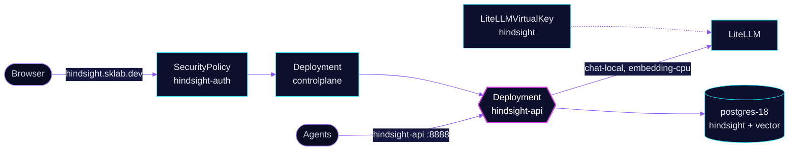

<!-- header: icon=brain -->
<!-- concept: From a conversation to a recalled fact | message-square Turn | filter Extract | database Store | search Recall -->
<p align="center"></p>

> Long-term memory for the agents: it extracts facts from conversations, stores them and recalls them later.

**Live facts:** <https://skrumbach.github.io/home-ops/apps/ai/hindsight/> (workloads, routes, storage, backups, secrets and alerts, generated on every merge)

## What it does

- **Serves the memory API** on Service `hindsight-api:8888` (`/v1` and the MCP endpoint at `/mcp/<bank>/`). It has no route:
  agents call the Service in-cluster with the tenant key.
- **Serves the control plane** at `https://hindsight.sklab.dev` (container `controlplane`, port `3000`), with Pocket ID in
  front at Envoy (SecurityPolicy `hindsight-auth`). It is an admin UI for browsing banks and memories.
- **Extracts and consolidates facts** with `chat-local` through LiteLLM, under its own virtual key (`hindsight`).
- **Embeds with `embedding-cpu`** through LiteLLM (1024 dimensions) and reranks with the bundled local cross-encoder.
- **Keeps its state in Postgres.** Database `hindsight` on `postgres-18`, with the `vector` extension.

## Why it is built this way

| Choice | Why |
|---|---|
| **`chat-local` for extraction** | Free, and memory content never leaves the cluster. It shares the B70 with Hermes chat, so LLM concurrency is `2`. |
| **`embedding-cpu`, not `embedding-local`** | `embedding-local` is capped at 1 request per second for every key. A retain burst would hit 429s. |
| **Full image, not `-slim`** | The slim image has no local reranker. |
| **No volume under `~/.cache`** | The image bakes its models there and a mount shadows them. |
| **No PVC, no kopiur** | Everything is in the database, which CNPG backs up. |
| **Envoy OIDC, no control-plane access key** | One Pocket ID login instead of two. |
| **One replica, Recreate** | The worker runs in-process. A restart is a short outage for recall, and agents must tolerate a failed call. |

## How it works

<p align="center"></p>

<details>
<summary><b>Resource graph</b>: every object involved, by name</summary>



</details>

## Secrets

1Password item `hindsight` (vault read by External Secrets):

| Field | Note |
|---|---|
| `POSTGRES_DB_USER_PASSWORD` | Letters and digits only. It sits inside a DSN, so `@ / : #` parse as a bad credential. |
| `HINDSIGHT_TENANT_API_KEY` | `openssl rand -hex 32`. One key is read and write on every bank. |

The LiteLLM key is written by the litellm app into item `litellm-consumer-hindsight`.

## Operate it

```bash
flux -n ai get ks hindsight hindsight-db
kubectl -n ai get pods -l app.kubernetes.io/instance=hindsight -o wide
kubectl -n ai logs deploy/hindsight-api --tail=50
kubectl -n ai get litellmvirtualkey hindsight
```

## Invariants

- **The tenant key is admin-equivalent.** There is no per-consumer isolation: banks are a naming convention, not a boundary.
  Recalled memories are injected into agent prompts, so anyone holding the key can plant a memory that a future session
  trusts. Rotate it on that footing, and never expose the API outside the cluster.
- **Embedding dimensions are fixed at `1024` once a memory is stored.** Changing the model or `embedding-cpu` needs
  `hindsight-admin reembed`. Never point the key at a second embedder.
- **Recall injects stale facts as trusted context.** Hindsight has no fact-validity windows, so review what agents retain.
- **Snapshots are not selective:** CNPG PITR restores the whole `postgres-18` cluster, not the `hindsight` database alone.
- **Hermes is not wired yet.** Its plugin installs from the plugin catalog at runtime (`hermes plugins install hindsight`,
  then `memory.provider: hindsight`); set `retain_every_n_turns` first because it defaults to `1`.

Upstream: [Hindsight](https://hindsight.vectorize.io/)
