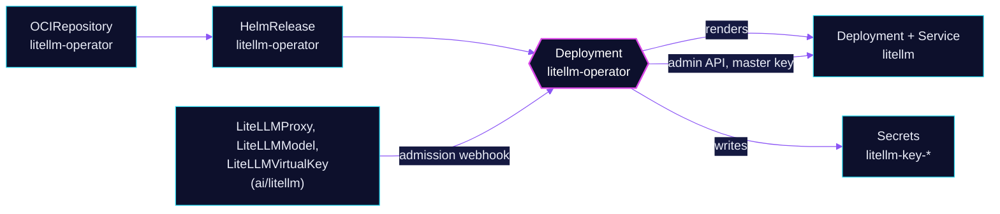

<!-- header: icon=cog -->
<!-- concept: From a LiteLLM custom resource to a running proxy | file-text Declare | shield-check Admit | cog Render | server Run -->
<p align="center"></p>

> The operator that turns LiteLLM custom resources into the proxy Deployment, its config and its virtual keys.

**Live facts:** <https://skrumbach.github.io/home-ops/apps/ai/litellm-operator/> (workloads, routes, storage, backups, secrets and alerts, generated on every merge)

## What it does

- **Renders the proxy.** From `LiteLLMProxy`, `LiteLLMModel` and `LiteLLMVirtualKey` objects in `ai/litellm` it builds the
  Deployment, Service and `config.yaml`.
- **Mints virtual keys** through the proxy's admin API and writes each into a Secret.
- **Admits or rejects** every LiteLLM kind through its validating webhook (`failurePolicy: Fail`).
- **Ships the CRDs** (the chart installs them; `cluster-apps` patches in `CreateReplace`).

## Why it is built this way

| Choice | Why |
|---|---|
| **Health check on the Deployment, not the HelmRelease** | A HelmRelease check stays Ready through a crashloop, and the CRs cannot be admitted until this pod serves its webhook. |
| **`webhook.enabled: true` written out** | So a chart-default flip cannot silently drop the admission webhook. |
| **`llmkube.autoRegister: false`** | LLMKube is not installed here; a chart-default flip must not create undeclared `LiteLLMModel` objects. |
| **`ai/litellm` depends on this app** | The webhook rejects LiteLLM CRs at admission while it is down. |

## How it works

<p align="center"></p>

<details>
<summary><b>Resource graph</b>: every object involved, by name</summary>



</details>

1. Flux applies Kustomization `litellm-operator` (`retryInterval: 1m`) and waits for the Deployment.
2. A LiteLLM object is applied. The webhook validates it, and the controller reconciles it. Leader election is on.
3. The controller renders the proxy from the CRs, and calls the proxy's admin API with the key named in
   `spec.apiAccess.masterKeyRef` of the `litellm` proxy CR.

## Settings that matter

All values are in [`app/helmrelease.yaml`](app/helmrelease.yaml).

| Setting | Value | Why |
|---|---|---|
| `resources` | request 25m CPU and 128Mi, limit 256Mi memory | The live working set is about 143Mi. |
| `GOMEMLIMIT` | `200MiB` | A soft Go heap cap below the limit, so GC runs before the kernel OOM-kills the pod. An OOM takes the `failurePolicy: Fail` webhook down. |

## Operate it

```bash
flux -n ai get ks litellm-operator
kubectl -n ai get deploy litellm-operator
kubectl -n ai logs deploy/litellm-operator --tail=100
kubectl get validatingwebhookconfigurations | grep -i litellm
```

## Invariants

- The operator's pod hardening comes from the chart. The proxy pod it renders has none (a CRD gap, noted in the
  HelmRelease).
- Never create a route through the proxy CR's `spec.route`; `ai/litellm` ships its own HTTPRoute.

Upstream: [litellm-operator](https://github.com/home-operations/litellm-operator)
