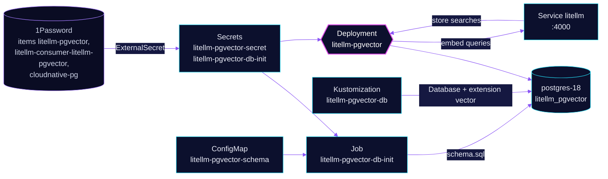

<!-- header: icon=database -->
<!-- concept: From a document chunk to a ranked search hit | file-text Chunk | cpu Embed | database Store | search Search -->
<p align="center"></p>

> The vector store behind LiteLLM: a stateless server over a pgvector database on the shared Postgres cluster.

**Live facts:** <https://skrumbach.github.io/home-ops/apps/ai/litellm-pgvector/> (workloads, routes, storage, backups, secrets and alerts, generated on every merge)

## What it does

- **Serves the `default` vector store** that `ai/litellm` registers (`vector_store_registry` in its proxy CR), on
  `litellm-pgvector.ai.svc.cluster.local:8000`. ClusterIP only, no route.
- **Embeds queries through LiteLLM**, with its own key (`litellm-pgvector`) allowed one model,
  `qwen/qwen3-embedding-8b`.
- **Keeps data in Postgres.** Role and database `litellm_pgvector` live on `postgres-18`, with the `vector` extension.
- **Creates its own schema.** A Job (`litellm-pgvector-db-init`) makes the role and database, then applies
  [`app/resources/schema.sql`](app/resources/schema.sql) on every run.

## Why it is built this way

| Choice | Why |
|---|---|
| **A schema Job, not the image** | The image never creates tables, and upstream's Prisma schema hardcodes `vector(1536)`. The server only uses raw SQL, so declaring the tables here with the right width is enough. |
| **Width 2000** | pgvector's HNSW index caps `vector` at 2000 dimensions; the model's native 4096 cannot be indexed. |
| **Hashed schema ConfigMap** | A `schema.sql` edit renames the ConfigMap, which changes the Job spec, so Flux recreates the Job and re-applies the SQL. |
| **Superuser only in the Job** | Only a superuser may `CREATE EXTENSION vector`. The Job then runs `SET ROLE` to the app role, so the app owns every object. |
| **Two Secrets** | `litellm-pgvector-secret` holds the server's credentials. The Postgres superuser password stays in `litellm-pgvector-db-init`. |
| **Credentials pushed by `ai/litellm`** | `PushSecret` `litellm-pgvector-seed` there writes item `litellm-pgvector`; this app depends on `litellm`. |

## How it works

<p align="center"></p>

<details>
<summary><b>Resource graph</b>: every object involved, by name</summary>



</details>

1. Kustomization `litellm-pgvector-db` creates the `DatabaseRole` and `Database` (from `components/cnpg-database`,
   plus a patch adding extension `vector`) in the `database` namespace. Removing it never drops data.
2. Kustomization `litellm-pgvector` waits for that, `onepassword-store`, `cloudnative-pg` and `litellm`.
3. The Job's init container `init-db` creates the role and database. Its container `init-schema` runs `psql` as
   `postgres` with the schema file.
4. The server starts with `DATABASE_URL` (`connection_limit=5`, to cap Prisma's pool on the shared cluster) and
   `SERVER_API_KEY`, the bearer key every caller sends. LiteLLM holds the same value as `LITELLM_PGVECTOR_API_KEY`.
5. A search arrives from the proxy. The server embeds the query through `litellm:4000` and orders rows by cosine
   distance against the HNSW index.

## Settings that matter

| Setting | Value | Why |
|---|---|---|
| `EMBEDDING__MODEL`, `EMBEDDING__DIMENSIONS` ([`app/helmrelease.yaml`](app/helmrelease.yaml)) | `openai/qwen/qwen3-embedding-8b`, `2000` | Must move together with `vector(2000)` in `schema.sql` and the key's one-model allow-list. |
| `LITELLM_LOCAL_MODEL_COST_MAP` | `"True"` | No cost-map fetch from GitHub at import; nothing here prices anything. |
| Probes | `GET /health` every 30s | The endpoint is static (process up, not database up). A database outage shows as 500s on search. |
| `securityContext` | uid and gid `65534`, read-only root, no `fsGroup` | The image's own user; no owned volume. `/tmp` is an emptyDir for Prisma and Python. |
| `CNPG_PASSWORD_KEY` (overlay) | `LITELLM_PGVECTOR_DB_PASSWORD` | Names the 1Password field the role password comes from. |

## Operate it

```bash
flux -n ai get ks litellm-pgvector litellm-pgvector-db
kubectl -n ai get deploy litellm-pgvector
kubectl -n ai get job litellm-pgvector-db-init
kubectl -n ai logs job/litellm-pgvector-db-init -c init-schema
kubectl -n database get databaserole,database
```

The Job carries `kustomize.toolkit.fluxcd.io/force: enabled`, so Flux recreates it when its spec changes.

## Invariants

- **Model, `EMBEDDING__DIMENSIONS`, the `vector(N)` width and the key's one-model allow-list move together.** Changing
  the model or the width means truncating `embeddings` first. Vectors from two models are not comparable.
- **Never add libpq `PG*` variables to `litellm-pgvector-db-init`.** `postgres-init` loads that Secret too and would
  leave the role with a NULL password while reporting Completed. The Job sets its `PG*` variables itself.
- **Never name the server's key `PG_VECTOR_API_KEY` in LiteLLM** (see `ai/litellm`).
- **Non-sensitive content only:** the store is open to every virtual key.

## Known gaps

- **`schema.sql` points at files that do not exist.** Its header names `../dbinit.yaml` (the Job is
  [`app/job.yaml`](app/job.yaml)) and `scripts/ci/litellm-pgvector-test.py` (no such file under `scripts/ci/`), and a
  skill `litellm-proxy` (the only skill is `incident-runbooks`).

Upstream: [BerriAI/litellm-pgvector](https://github.com/BerriAI/litellm-pgvector) •
[pgvector](https://github.com/pgvector/pgvector)
