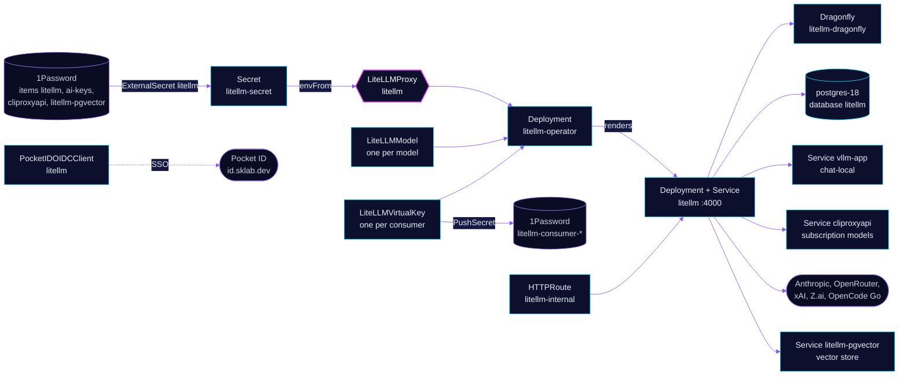

<!-- header: icon=router -->
<!-- concept: From a caller's virtual key to a priced model backend | key-round Key | shield-check Allow | split Route | cpu Backend | receipt Account -->
<p align="center"></p>

> The one LLM gateway: per-consumer keys and budgets in front of local, subscription and metered models.

**Live facts:** <https://skrumbach.github.io/home-ops/apps/ai/litellm/> (workloads, routes, storage, backups, secrets and alerts, generated on every merge)

## What it does

- **Gives each consumer its own key.** One `LiteLLMVirtualKey` per consumer in `app/virtualkeys/`, each with a model
  allow-list and, for most, a budget and rate limits. A `PushSecret` mirrors the key into 1Password item
  `litellm-consumer-<name>`.
- **Registers every model.** One `LiteLLMModel` per model in `app/models/`: the local llama.cpp aliases, the
  subscription routes through `ai/cliproxyapi`, the Claude Code pass-through models, and the metered cloud models.
- **Routes by complexity.** Model `auto` classifies a request with the local `chat-local-classifier` and sends it to
  `chat-local`, `claude-sonnet-5-metered` or `claude-opus-5-metered`.
- **Fronts a vector store.** The `default` store is served by `ai/litellm-pgvector` and embeds through this proxy.
- **Signs the UI in** through Pocket ID (client `litellm`). Only the Pocket ID group `admins` may sign in.
- **Answers at** `https://litellm.sklab.dev` on `envoy-internal` and at `http://litellm.ai.svc.cluster.local:4000`
  in-cluster. The route is internal only.

## Why it is built this way

| Choice | Why |
|---|---|
| **CRs rendered by `ai/litellm-operator`, not a Deployment** | The operator renders the Deployment, Service and `config.yaml` from `LiteLLMProxy`, `LiteLLMModel` and `LiteLLMVirtualKey`. Git stays the only source of models and keys. |
| **`applyMode: file` and `store_model_in_db: false`** | `api` would turn `store_model_in_db` on, and UI edits would then compete with Git. |
| **Two CRs for one Claude model** | The natural name (`claude-sonnet-5`) is a credential-less pass-through: the caller's own OAuth token pays. The `-metered` CR carries `ANTHROPIC_API_KEY` and a priced cost map. Tiers and fallbacks name only the metered CR. |
| **Four aliases on one local backend** | Each alias carries one property: `chat-local` (zero price, terminal), `chat-ha` (cloud fallback), `chat-local-classifier` (thinking off), `demo-priced-local` (synthetic prices for the `demo` key). Naming rule: [`../AGENTS.md`](../AGENTS.md). |
| **Hand-written HTTPRoute, not `spec.route`** | The operator's route cannot carry annotations, and the operator deletes a route named after the proxy CR. |
| **UI secret generated in the cluster** | `litellm-oidc-client` comes from a `Password` generator once. The proxy reads it before it starts, and `PocketIDOIDCClient` pushes the same value to Pocket ID. |
| **Dragonfly for cache and counters** | `components/dragonfly` gives `litellm-dragonfly`. The 300s response cache and the router's rate counters live there, so limits are shared across workers. |

## How it works

<p align="center"></p>

<details>
<summary><b>Resource graph</b>: every object involved, by name</summary>



</details>

1. Flux applies Kustomization `litellm` after `litellm-db`, `onepassword-store`, `dragonfly-operator`,
   `litellm-operator` (its admission webhook rejects LiteLLM CRs while it is down), `cloudnative-pg` and `vllm`
   (ordering only). Its health check is the operator-rendered Deployment `litellm`, never the CR.
2. The operator renders `config.yaml` from the proxy CR and every model CR, creates the Deployment, and mints each
   virtual key through the admin API with `LITELLM_MASTER_KEY`.
3. A caller sends its virtual key. The proxy checks the key's allow-list, rate limits and budget, then picks a
   deployment (`simple-shuffle`).
4. Local aliases go to `vllm-app:8000`. Subscription models go to `cliproxyapi:8317` with `CLIPROXYAPI_API_KEY`.
   Metered models use the provider key from `litellm-secret`, named in the CR as `os.environ/<VAR>`.
5. Prometheus scrapes `/metrics` with the master key. Prompts and responses go to the Postgres spend log for 30 days.
6. `/anthropic` is closed twice: by the pass-through entries in the proxy and by `HTTPRouteFilter`
   `litellm-anthropic-passthrough-block` (404) on the hostname.

Models and keys, by purpose. [`app/models/`](app/models/) holds one CR per model name. Subscription routes and
pass-throughs are priced at `0`, metered routes use the cost map, and `demo-priced-local` is synthetic.
[`app/virtualkeys/`](app/virtualkeys/) holds one key per consumer (agents, Hermes, OpenCode, Linkwarden, Paperless-ngx,
the vector store, smoke-test keys); read the key's own comments for its allow-list rule.

## Settings that matter

All values are in [`app/litellmproxy.yaml`](app/litellmproxy.yaml) unless noted.

| Setting | Value | Why |
|---|---|---|
| `image` | `litellm-non_root`, floor v1.93.0 | Below v1.93.0 the auto-router LLM classifier config is silently ignored. `.renovate/overrides.json5` enforces the floor. |
| `store_prompts_in_spend_logs`, `maximum_spend_logs_retention_period` | `true`, `30d` | Full capture; it matches the postgres-18 Barman window. Write `30d`, never `1mo`. |
| `MAX_STRING_LENGTH_PROMPT_IN_DB` | `1000000` | The default cuts stored bodies at 2048 characters. |
| `pass_through_endpoints` | four entries | Provider pass-throughs are admin-only. Each exact path sits above its dead-loopback catch-all (`127.0.0.1:9`). The order is load-bearing. |
| `GENERIC_SCOPE` | `openid email profile` | Pocket ID releases the `litellm_role` claim only with `profile`. Without it the first login lands as `INTERNAL_USER_VIEW_ONLY`. |
| `AUTO_REDIRECT_UI_LOGIN_TO_SSO` | `"true"` | Master-key browser login moves to `/fallback/login`. |
| `litellmSettings.cache` | Redis on `litellm-dragonfly`, `ttl: 300` | Exact-match response cache. |
| `forward_client_headers_to_llm_api` | the three `go-*` groups | OpenCode Go rejects a request without `x-opencode-session` (HTTP 400). Only these groups get client headers. |
| `public_model_groups` | explicit list | The only way a model reaches the AI Hub. A new model stays unpublished until added; it grants nothing. |
| `routerSettings.optional_pre_call_checks` | `enforce_model_rate_limits` | Makes a deployment's `rpm` a hard limit (429 before the backend). Only `embedding-local` sets `rpm` (60). |
| `model_group_retry_policy` | `embedding-local`: no 429 or timeout retries | A retried 429 sleeps to the end of the rpm window, and a retried timeout multiplies by 3. |
| `fallbacks`, `context_window_fallbacks` | `chat-ha`, `auto` to `claude-sonnet-5-metered` | Local 262k window to cloud 1M. No reverse entry. |
| Probes | liveness delay `240`s, readiness `/health/readiness` | The CR has no `startupProbe` field, so a 240s delay stands in for a 300s boot budget. Readiness also checks the database. |
| `resources` | request 1280Mi, limit 4Gi | A bare `GET /spend/logs` OOM-killed the proxy at 2Gi. |
| `ServiceMonitor` credentials | the master key | Deliberate: Prometheus holds the full admin credential, which can read logged prompts. The manifest says to revisit it before any wider exposure. |
| `LITELLM_SALT_KEY` ([`app/externalsecret.yaml`](app/externalsecret.yaml)) | never rotated | It encrypts every stored virtual key. |

## Operate it

```bash
flux -n ai get ks litellm litellm-db litellm-operator
kubectl -n ai get deploy litellm
kubectl -n ai get litellmproxy,litellmmodel,litellmvirtualkey
kubectl -n ai get externalsecret,pushsecret
kubectl -n ai get dragonfly litellm-dragonfly
kubectl -n ai logs deploy/litellm --tail=100
```

Routing and cost checks live in the CI test `scripts/ci/litellm-billing-guard-test.py`; run it after any change to a
model, a key or a fallback. A new model also needs: an entry in `public_model_groups`, and an allow-list entry on each
key that should use it.

### Prerequisites (before first sync)

1Password item **`litellm`** (vault of the `onepassword` ClusterSecretStore),
the only item created by hand:

| Field | How to generate |
| --- | --- |
| `LITELLM_MASTER_KEY` | `echo sk-$(openssl rand -hex 32)` |
| `LITELLM_SALT_KEY` | `echo sk-$(openssl rand -hex 32)` |
| `POSTGRES_DB_NAME` | `litellm` |
| `POSTGRES_DB_USER_NAME` | `litellm` |
| `POSTGRES_DB_USER_PASSWORD` | `openssl rand -hex 24` |

Already existing and reused: `ai-keys` (`ANTHROPIC_API_KEY`, `XAI_API_KEY`, `ZAI_API_KEY`, `OPENROUTER_API_KEY`,
`OPENCODE_GO_API_KEY`). The UI's SSO client secret is generated in the cluster (`app/externalsecret-oidc.yaml`), not
kept in 1Password. Written by PushSecrets, not by hand: `litellm-pgvector` (seed command in
`app/pushsecret-pgvector.yaml`) and every `litellm-consumer-*` item.

Until `litellm` exists the ExternalSecret reports `SecretSyncedError`, the `litellm-db` role has no password and the
proxy sits in `CreateContainerConfigError`: an unmet prerequisite, not a manifest bug.

### When an alert fires

Rules are in [`app/prometheusrule.yaml`](app/prometheusrule.yaml).

| Alert | Fires when | First look |
|---|---|---|
| `LiteLLMProxyDown` | `up{job="litellm"}` is 0 for 5m | Flux Kustomization `litellm`, then `litellm-secret` and the `litellm-db` role. |
| `LiteLLMHighFailureRate` | failed requests above 0.1/s for 10m | The `/v1` backend `vllm-app`, then proxy logs. |
| `LiteLLMConsumerBudgetExhausted` | a key's remaining budget is 0 for 5m | Deliberate (small initial budgets). Raise `maxBudget` on that `LiteLLMVirtualKey` or wait for the reset. |
| `LiteLLMFallbackChainExhausted` | every leg of a fallback chain failed | The B70 (`vllm-app`) and the Anthropic status page together. |
| `LiteLLMSustainedFailover`, `LiteLLMContextWindowFallbackFiring` | traffic on the cloud fallback for 15m (or context overflow for 30m) | Real USD is being spent. Fix the local backend, or move the consumer to a cloud alias. |
| `LiteLLMDeploymentStuckFailing` | a deployment is marked unhealthy and still failing | The deployment named in the labels (`api_base`). |
| `LiteLLMCloudProviderAuthFailing`, `LiteLLMCloudProviderQuotaExhausted` | Anthropic answers 401/403 or 429 | `ANTHROPIC_API_KEY` in 1Password item `ai-keys`, then provider quota. |
| `LiteLLMRouterClassifierFailingOpen`, `LiteLLMRouterClassifierSlow`, `LiteLLMRouterCloudTierShare` | classifier errors above 20%, mean latency above 6s, or over half of `auto` traffic in a cloud tier | `vllm-app` health and B70 contention, then the classifier `timeout_ms` (8000). |
| `LiteLLMClaudeCodeSubscriptionSpendRegression` | key `claude-code-subscription` records spend | A price field lost its `0`, or an unpriced model joined that key. |

The two fallback counters are sparse: no series exists until the first fallback, so absence is the healthy state.

## Invariants

- **Internal route only.** Scope (captain decision B4): internal route only - `litellm-internal` on `envoy-internal` at
  `litellm.sklab.dev`, plus `http://litellm.ai.svc.cluster.local:4000` in-cluster. It never fronts the public
  listener: no `envoy-external` parentRef, ever.
- **LiteLLM: a config fallback bypasses every key allow-list, and a `LiteLLMModel` with no `apiKey` bills the
  household-metered `ANTHROPIC_API_KEY`.**
- Only cloud-entitled aliases may appear in `routerSettings` fallbacks, and each must target the `-metered` CR, never a
  terminal local alias. Holding `chat-ha` is the cloud entitlement.
- Pass-through CRs carry a placeholder `apiKey` and an explicit `0` on all seven price fields. `chat-local` has no
  prices and no cloud fallback.
- **A key without `maxBudget` reaches only free-credential models** (`not-needed`, `sk-ant-oat`, the cliproxyapi key),
  following fallbacks. CI test `scripts/ci/litellm-billing-guard-test.py` checks this and that pass-throughs stay
  admin-only.
- **Never add `PG_VECTOR_API_KEY`** (it would open every store id to every key), and never add a fallback embedding
  model (a second model writes vectors the pgvector index cannot compare).
- **Remove every model that names a provider key before removing the key** from `litellm-secret`, or the whole proxy
  goes down at startup.
- **Never name the route `litellm`.** The operator deletes it on a later reconcile, and never set `spec.route`.
- **Registration is not entitlement.** A key must allow-list a model, and a new model must join `public_model_groups`.
- **Chat model naming:** consumers use `chat-local`, never the real model name; the real name appears only as
  `${CHAT_MODEL_ID}`.

Upstream: [LiteLLM docs](https://docs.litellm.ai/) •
[litellm-operator](https://github.com/home-operations/litellm-operator) •
[Pocket ID](https://pocket-id.org/docs)
