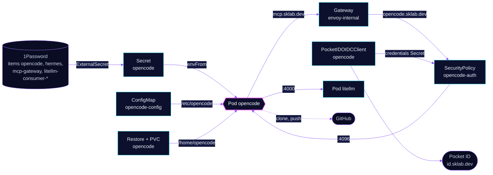

<!-- header: icon=terminal -->
<!-- concept: From a sign-in to a model-driven commit | fingerprint Sign-in | terminal Workspace | route Models | git-branch Commit -->
<p align="center"></p>

> The internal coding workspace: OpenCode behind Pocket ID, with every model call routed through LiteLLM.

**Live facts:** <https://skrumbach.github.io/home-ops/apps/ai/opencode/> (workloads, routes, storage, backups, secrets and alerts, generated on every merge)

## What it does

- **Serves the OpenCode web UI** at `opencode.sklab.dev` on `envoy-internal` only, from Service `opencode-app:4096`.
  Nothing is public.
- **Signs people in at Envoy.** SecurityPolicy `opencode-auth` runs native OIDC against Pocket ID, with client
  `opencode` and the group `admins`. The server password stays as an inner layer.
- **Sends every model call to LiteLLM** (`litellm.ai.svc.cluster.local:4000`) through two providers: `litellm` for the
  default model `litellm/auto`, and `litellm-projects` for the Anthropic and OpenAI chat models.
- **Reaches ToolHive tools** through the MCP gateway at `https://mcp.sklab.dev/mcp`.
- **Works on home-ops.** On start the entrypoint clones the public repository into `~/projects/home-ops` on the
  home volume, and a credential helper supplies `GITHUB_TOKEN` for pushes.
- **Keeps its home directory** on PVC `opencode`, backed up by kopiur to the in-cluster `ceph` and offsite `r2`
  repositories.

## Why it is built this way

| Choice | Why |
|---|---|
| **Pocket ID at Envoy, password inside** | With `forwardAccessToken` off, Envoy Gateway keeps the client's `Authorization` header, so `OPENCODE_PASSWORD` basic auth still works as the second layer. Do not turn `forwardAccessToken` on. |
| **No second API route** | The securitypolicy comment: nothing here needs programmatic access. |
| **Service named `opencode-app`** | In namespace `ai` the DNS search path turns the provider host `opencode.ai` into `opencode.ai.svc.cluster.local`. A Service named `opencode` would take that name and black-hole every OpenCode Go call from LiteLLM. |
| **Token read from the environment, never written** | The credential helper reads `GITHUB_TOKEN` on each use, so it never reaches the home PVC and its kopia snapshots. The entrypoint deletes the `~/.git-credentials` file that older revisions wrote. |
| **Ingress fence, open egress** | The pod serves an agent with model-directed bash and a GitHub write token on `0.0.0.0:4096`. CiliumNetworkPolicy `opencode` admits Envoy, the kubelet probes and replies. Egress stays open for GitHub, npm, LiteLLM and ToolHive. |
| **A write-capable GitHub token, unlike `repo-wiki`** | OpenCode is an internal-only, Pocket ID-gated interactive workspace for the owner and is meant to push to home-ops (comment in `app/externalsecret.yaml`). `repo-wiki` only reads public repositories. |

## How it works

<p align="center"></p>

<details>
<summary><b>Resource graph</b>: every object involved, by name</summary>



</details>

1. Flux applies Kustomization `opencode` after `onepassword-store`, `litellm` and `kopiur-repository`. The `kopiur`
   components add the snapshot policies and own PVC `opencode`.
2. ConfigMap `opencode-config` holds `entrypoint.sh` and `opencode.json`, mounted at `/etc/opencode`. Flux
   substitution is disabled on it, because the script's own `${...}` expansions are not Flux variables.
3. The entrypoint sets the git identity, installs the credential helper, clones `home-ops` if it is missing, and runs
   `opencode serve` on `0.0.0.0:4096`. A failed clone only warns.
4. A browser request to `opencode.sklab.dev` goes through `opencode-auth`. Envoy reads the client from Secret
   `opencode-oidc-credentials`, which the Pocket ID operator writes.
5. `opencode.json` points both providers at LiteLLM with different keys. The tool list comes from the `toolhive` MCP
   entry, authenticated by a bearer token.

## Settings that matter

| Setting | Value | Why |
|---|---|---|
| `model` ([`opencode.json`](app/resources/opencode.json)) | `litellm/auto` | Uses virtual key `litellm-consumer-opencode` and stays that way. |
| Provider `litellm-projects` | key `litellm-consumer-litellm-consume-projects` | The Anthropic and OpenAI chat models on that key's allow-list; the provider lists neither `embedding-local` nor `jev`. Its $100 per 30 days is one pool for every caller of that key. |
| `OPENCODE_PASSWORD` | 1Password item `opencode`, vault `Homelab` | The server password (user `opencode`). Without it each start makes a random one and logs it; rotating it signs out every session. |
| `GITHUB_TOKEN` | 1Password item `hermes`, field `HOMELAB_GH_TOKEN` | `public_repo`, read and write. No new item. |
| `LITELLM_API_KEY` | 1Password item `litellm-consumer-opencode`, field `key` | Not a prerequisite: the LiteLLM virtual key `opencode` writes it. |
| `MCP_GATEWAY_TOKEN` | 1Password item `mcp-gateway` | Written by `ai/toolhive`, not by hand. |
| Tolerations | none | `PreferNoSchedule` keeps it off talos-3. A hostname deny-list fails open. |
| `KOPIUR_CAPACITY`, `KOPIUR_CACHE_CAPACITY`, `KOPIUR_SCHEDULE_R2` ([overlay](../../../main/ai/opencode.yaml)) | `20Gi`, `5Gi`, `H 19 * * *` | Claim size; the offsite copy runs daily in hour 19. |

## Operate it

```bash
flux -n ai get ks opencode
flux -n ai get hr opencode
kubectl -n ai get pods -l app.kubernetes.io/name=opencode -o wide
kubectl -n ai logs deploy/opencode --tail=50
kubectl -n ai get securitypolicy/opencode-auth pocketidoidcclient/opencode
kubectl -n ai get snapshotpolicy,restore,pvc
```

Restores: [`restore.md`](../../../../../.agents/skills/incident-runbooks/references/restore.md).

## Invariants

- Pocket ID sign-in at Envoy (native OIDC) on `envoy-internal` only.
- Default model `litellm/auto` uses virtual key `litellm-consumer-opencode` and stays that way.
- Provider `litellm-projects` is the additional key `litellm-consumer-litellm-consume-projects`: the Anthropic and OpenAI chat models on that key's allow-list (not `embedding-local`, not `jev`). Its $100 per 30 days is one pool shared by every caller of that key. Never a provider key.
- `GITHUB_TOKEN` reuses the `hermes` 1Password item field `HOMELAB_GH_TOKEN` (`public_repo`, read and write). No new item.
- `OPENCODE_PASSWORD` is 1Password item `opencode` (vault `Homelab`), the server password (user `opencode`). Without it each start makes a random one and logs it; rotating it signs out every session.
- The gate is `app/securitypolicy.yaml` with its Pocket ID client `app/pocketidoidcclient.yaml`. A new hostname needs its own callback URL there and a real login after merge before treating the route as covered. Do not add a second basic-auth API route.
- Keep `forwardAccessToken` off in `opencode-auth`.
- Do not name the Service `opencode`.

Upstream: [OpenCode docs](https://opencode.ai/docs/) •
[Envoy Gateway OIDC](https://gateway.envoyproxy.io/docs/tasks/security/oidc/)
