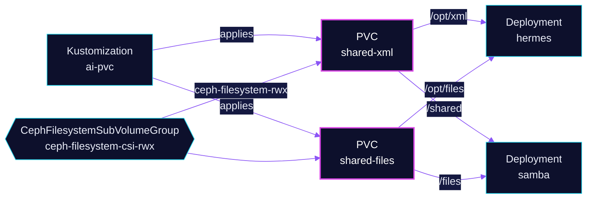

<!-- header: icon=hard-drive -->
<!-- concept: From one volume to two pods that share it | hard-drive Volume | users Writers | folder-sync Shared -->
<p align="center"></p>

> Two shared, deliberately unbacked CephFS volumes that the Hermes agent and the Samba server mount together.

**Live facts:** <https://skrumbach.github.io/home-ops/apps/ai/pvc/> (workloads, routes, storage, backups, secrets and alerts, generated on every merge)

## What it does

- **Creates `shared-xml`**, the "Mac-authoritative XML corpus" (manifest comment). Samba exports it as share `xml`.
- **Creates `shared-files`**, a scratch drop folder at `smb://10.50.0.55/files`. Samba exports it as share `files`.
- Both are 100Gi, ReadWriteMany, `ceph-filesystem-rwx`. Flux Kustomization `ai-pvc` applies them after
  `rook-ceph-cluster`, and both `hermes` and `samba` depend on `ai-pvc`.

| Claim | `ai/hermes` mounts at | `ai/samba` mounts at |
|---|---|---|
| `shared-xml` | `/opt/xml` | `/shared` |
| `shared-files` | `/opt/files` | `/files` |

## How it works

<p align="center"></p>

<details>
<summary><b>Resource graph</b>: every object involved, by name</summary>



</details>

1. Flux applies the two plain `PersistentVolumeClaim`s, no chart and no component.
2. Ceph provisions them in the CephFS subvolume group `csi-rwx`. Four RWX claims use that group, so its CR
   must never be deleted ([`cephfilesystemsubvolumegroup.yaml`](../../rook-ceph/rook-ceph/cluster/cephfilesystemsubvolumegroup.yaml)).
3. `samba` and `hermes` write the same files at the same time; file ownership is described in
   [`../samba/README.md`](../samba/README.md).

## Settings that matter

| Setting | Value | Why |
|---|---|---|
| `storageClassName`, `accessModes` | `ceph-filesystem-rwx`, `ReadWriteMany` | Two pods write the same volume. |
| `components/kopiur` on `ai-pvc` | not attached | "Deliberately unbacked: there is no second copy. Do not add kopiur without being asked." |

## Operate it

```bash
flux -n ai get ks ai-pvc
kubectl -n ai get pvc shared-xml shared-files
```

## Invariants

- Do not attach `components/kopiur` to `ai-pvc`; neither claim is a backup.
- There is no second copy of either claim's data.
