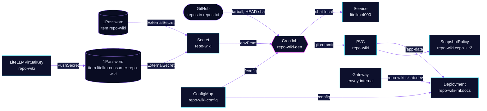

<!-- header: icon=book-open -->
<!-- concept: From a GitHub repository to a wiki page on the LAN | github Repos | brain Plan | pen-line Write | git-commit-horizontal Commit | book-open Serve -->
<p align="center"></p>

> Writes a browsable wiki for a list of GitHub repositories with the local chat model and serves it on the LAN.

**Live facts:** <https://skrumbach.github.io/home-ops/apps/ai/repo-wiki/> (workloads, routes, storage, backups, secrets and alerts, generated on every merge)

## What it does

- **Generates pages** with a CronJob (`repo-wiki-gen`, every 12 hours). For one repository per run it asks the
  model for a page plan, then writes each page from the files that page needs.
- **Skips unchanged repositories.** The generator stores each repository's remote `HEAD` sha in
  `/app-data/.wiki-state.json` and only regenerates one whose sha moved.
- **Commits the result** into a local git repository on the PVC `repo-wiki`, one commit per regenerated repository.
- **Serves the wiki** with `mkdocs-material` (`mkdocs serve --dirty`) at `repo-wiki.sklab.dev` on `envoy-internal`.
- **Uses the local chat model through LiteLLM.** The generator calls `litellm.ai.svc.cluster.local:4000` as model
  `chat-local` with its own virtual key, so no provider key lives in this app.

## Why it is built this way

| Choice | Why |
|---|---|
| **`chat-local`, not `demo-priced-local`** | Same GPU and weights, but `demo-priced-local` carries synthetic per-token prices so a smoke test can exhaust a $0.05 budget. Billing this cron against them made a free batch job look like it spent about $7.50 per repo (comment in `app/helmrelease.yaml`). |
| **A scoped LiteLLM virtual key, not a shared key** | LiteLLM checks the model the caller asks for. The `repo-wiki` key allows `chat-local` and `embedding-local` and carries a request and token limit sized for one repository. |
| **One repository per run** | One repository is nine back-to-back calls (one plan, up to eight pages). The key's `rpmLimit` is 12, so a run stays inside it. |
| **The generator runs on the mkdocs node** | Both mount the same `ceph-block` ReadWriteOnce claim. Required pod affinity avoids a cross-node attach for the generator's short run. |
| **A read-only GitHub token of its own** | The wiki reads public repositories only. `HOMELAB_GH_TOKEN` can push, so it stays out of this app. |

## How it works

<p align="center"></p>

<details>
<summary><b>Resource graph</b>: every object involved, by name</summary>



</details>

1. Flux applies Kustomization `repo-wiki` after `onepassword-store`, `litellm` and `kopiur-repository`. The `kopiur`
   components back up PVC `repo-wiki`. The health check targets Deployment `repo-wiki-mkdocs`.
2. `kustomization.yaml` turns `repos.txt`, `mkdocs.yml` and `generate.py` into ConfigMap `repo-wiki-config`, mounted
   at `/config` in both workloads. The name has no hash suffix, and `reloader.stakater.com/auto` restarts mkdocs
   when the content changes.
3. At 12-hour marks (`America/New_York`) the CronJob starts. `generate.py` expands `owner/*` entries through the
   GitHub API (archived repositories and forks are skipped), compares each repository's `HEAD` sha with the state
   file, and takes the first `MAX_REPOS_PER_RUN` that moved.
4. For that repository it downloads the tarball, skips files over 96 kB and binary types by extension, and asks `chat-local` for a JSON
   page plan of at most `MAX_PAGES_PER_REPO` pages. Each page is a second call with the planned files as context.
   If the plan is empty, it writes one `overview` page.
5. It replaces the repository's directory, writes an `index.md`, saves the sha, commits, then rewrites the root
   `index.md` (unwritten repositories show as `(pending)`) and commits again.
6. mkdocs serves `/app-data/repository`. On an empty volume it first writes a placeholder `index.md`.

## Settings that matter

All values are in [`app/helmrelease.yaml`](app/helmrelease.yaml) unless noted.

| Setting | Value | Why |
|---|---|---|
| `WIKI_MODEL` | `chat-local` | Must match the `models` allow-list of the `repo-wiki` LiteLLMVirtualKey. Not `demo-priced-local` (see the choice table). |
| `MAX_REPOS_PER_RUN`, `MAX_PAGES_PER_REPO` | `"1"`, `"8"` | One repository is nine calls; the virtual key allows 12 requests per minute. The manifest records no other reason. |
| `repo-wiki-gen` memory | request 128Mi, limit 2Gi | 128Mi is 3.0 times the 14-day peak. A 2Gi request needed 2Gi free on the node mkdocs holds. |
| `mkdocs` memory | request 128Mi, limit 512Mi | 128Mi is 2.7 times the 14-day peak. |
| `defaultPodOptions.securityContext` | uid, gid, `fsGroup` `1000` | Matches the kopiur mover identity (component default 1000). |
| `KOPIUR_CAPACITY`, `KOPIUR_CACHE_CAPACITY` ([overlay](../../../main/ai/repo-wiki.yaml)) | `5Gi`, `2Gi` | Claim size and backup cache. The manifest records no reason. |
| `KOPIUR_SCHEDULE_R2` (overlay) | `H 19 * * *` | Daily offsite copy. The ceph copy keeps the component default. |
| LiteLLM key `rpmLimit`, `tpmLimit` ([`repo-wiki.yaml`](../litellm/app/virtualkeys/repo-wiki.yaml)) | `12`, `200000` | Nine calls per repository, and about 137k tokens for a full regeneration. |
| LiteLLM key `maxBudget` | `"30.00"` per `30d` | Inert on zero-priced models. Kept as the guard if `models` is widened. |

## Operate it

```bash
flux -n ai get ks repo-wiki
flux -n ai get hr repo-wiki
kubectl -n ai get cronjob,job,pods -l app.kubernetes.io/name=repo-wiki
kubectl -n ai logs job/<job-name>                      # a generator run: repos found, pages written, skips
kubectl -n ai get externalsecret repo-wiki             # SecretSynced, or SecretSyncedError without the PAT
kubectl -n ai get litellmvirtualkey repo-wiki
kubectl -n ai get snapshotpolicy,restore,pvc
```

### Prerequisites

1Password item `repo-wiki`, field `GITHUB_TOKEN`: a fine-grained PAT with
account access "Public Repositories (read-only)". Do not reuse
`HOMELAB_GH_TOKEN`. That token can push.

Until the item exists, the ExternalSecret reports `SecretSyncedError`
and the generator sits in `CreateContainerConfigError`. mkdocs still
serves, with an empty site.

The LiteLLM key is minted by the `repo-wiki` `LiteLLMVirtualKey` and its
PushSecret. No key material to paste. The model string and that key's
allow-list have to move together.

## Invariants

- The repo list is only `app/resources/repos.txt`.
- Those resource files are `configMapGenerator` input. A byte change rolls the pod.
- The model string (`WIKI_MODEL`) and the `repo-wiki` key's allow-list have to move together.
- Never give the key the `auto` model (comment in the virtual key manifest).

## Known gaps

- **Dangling README reference.** `app/resources/generate.py` (line 5) says "see this app's README.md for what
  changed" against the joryirving/home-ops original. No version of this README has recorded those changes.

Upstream: [mkdocs-material](https://squidfunk.github.io/mkdocs-material/)
