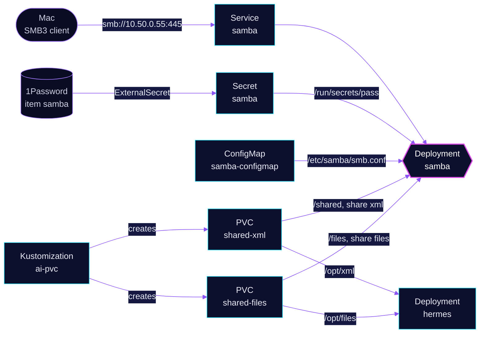

<!-- header: icon=folder-open -->
<!-- concept: From a Mac on the LAN to files the agent owns | laptop Mac | log-in Sign-in | user-cog Forced identity | folder-open Share | bot Agent -->
<p align="center"></p>

> Exports two LAN-only SMB shares of the Hermes agent's volumes, so a Mac can read and write the same files.

**Live facts:** <https://skrumbach.github.io/home-ops/apps/ai/samba/> (workloads, routes, storage, backups, secrets and alerts, generated on every merge)

## What it does

- **Serves two shares** from one smbd: `[xml]` (`/shared`, claim `shared-xml`) and `[files]` (`/files`, claim
  `shared-files`). The Hermes pod mounts the same two claims at `/opt/xml` and `/opt/files`.
- **Listens on the LAN only.** Service `samba` is a `LoadBalancer` with the fixed Cilium pool address `10.50.0.55`,
  port 445. There is no HTTPRoute.
- **Has one account.** `hermes`, uid and gid `10000`, with the password from Secret `samba` (1Password item `samba`,
  field `SMB_PASSWORD`), mounted as a file.
- **Forces every file to the Hermes identity.** `force user = hermes` makes a file a Mac creates look like one the
  agent created.

## Why it is built this way

| Choice | Why |
|---|---|
| **Forced uid and gid 10000** | The Hermes agent runs as 10000 (`HERMES_UID`, `HERMES_GID`, pod `fsGroup`). With the identity forced, either side can read what the other wrote. A wrong id fails silently and looks healthy. |
| **One server, one account, a `[section]` per share** | Adding a share is a section in `smb.conf` plus a volume on the samba and Hermes HelmReleases, never a second Samba app. |
| **Password as a file, not `PASS`** | The `dockur/samba` entrypoint reads `/run/secrets/pass` when it is non-empty, so the credential never enters the container environment. |
| **`smb.conf` supplied whole** | The entrypoint uses an existing non-empty `/etc/samba/smb.conf` verbatim and skips its env-driven template. Everything in the file is authoritative. |
| **Runs as root** | smbd creates the uid-10000 account at boot and then setuids per session to honour `force user`. An unprivileged container can do neither. This is a deliberate exception to the repo's non-root convention. |
| **`fruit:nfs_aces = no`** | With NFS ACEs on (the default), Finder's Get Info can write UNIX mode and owner, which would undo the forced identity. |
| **`fruit:metadata = stream`** | The AppleDouble metadata goes in an xattr, not a `._` sidecar file, which would double the inode count on a tree of about 300k files. |

## How it works

<p align="center"></p>

<details>
<summary><b>Resource graph</b>: every object involved, by name</summary>



</details>

1. Flux applies Kustomization `samba` after `onepassword-store` and `ai-pvc`. `ai-pvc` creates the two claims (see
   [`../pvc/README.md`](../pvc/README.md)). The health check targets Deployment `samba`.
2. `samba-configmap` is generated from `resources/smb.conf` with no name hash, so Reloader restarts the pod on a
   content change. Flux substitution is off for it (`kustomize.toolkit.fluxcd.io/substitute: disabled`).
3. The init container `chown-share` (root) sets owner `10000:10000` and mode `2770` on `/shared` and `/files`. It is
   not recursive.
4. The entrypoint creates the `hermes` account and the `smb` group at `UID` and `GID` `10000`, then starts smbd.
   On an empty `/shared` it resets the mode to `0770`, so a `postStart` hook waits for smbd and sets `2770` again.
5. A Mac connects with SMB3 and signs in as `hermes`. smbd runs every read and write as `hermes:smb`, with mode
   `0664` for files and `0775` for directories. Finder's `.DS_Store`, `._.DS_Store`, `.TemporaryItems`, `.Trashes`,
   `.fseventsd` and `.Spotlight-V100` are vetoed.

## Settings that matter

All values are in [`app/helmrelease.yaml`](app/helmrelease.yaml) or [`app/resources/smb.conf`](app/resources/smb.conf).

| Setting | Value | Why |
|---|---|---|
| `replicas`, `strategy` | `1`, `Recreate` | One writer identity, and smbd keeps per-file locks in its own process. A second replica would not share that state across either volume. |
| `defaultPodOptions.securityContext` | `fsGroup: 10000`, `OnRootMismatch` | Matches the Hermes pod, so the share root converges to gid 10000 whichever pod mounts a fresh volume first. |
| setgid `2770` on the share roots | `chown-share` and `postStart` | Load-bearing: without it `OnRootMismatch` walks the volume. The entrypoint strips setgid on an empty `/shared`. |
| `server min protocol`, `client min protocol` | `SMB3` | macOS mounts SMB3 on 445 directly. The manifest records no other reason. |
| `disable netbios`, `smb ports` | `yes`, `445` | The image only starts smbd, never nmbd, so NetBIOS name service could not answer. This keeps the LoadBalancer to one port. |
| `netbios name` | `HOMELAB-XML` | Explicit and 15 characters or fewer, or smbd warns on every start. Kept so the Mac's saved mounts do not change. |
| `map to guest`, `restrict anonymous` | `never`, `2` | Every session must authenticate. |
| `fruit:resource` | `file` | The corpus is plain XML with no resource forks. `xattr` would bound each fork by the CephFS xattr size limit. |
| `create mask`, `directory mask` | `0664`, `0775` (and the forced modes) | Group 10000 keeps write access even when a client asks for something more restrictive. |
| `inherit permissions` | `no` | The forced modes are the whole contract. |
| `lbipam.cilium.io/ips` | `10.50.0.55` | LAN-only BGP pool address. Never behind Envoy: SMB is not HTTP and must not be reachable from the internet. |

## Operate it

```bash
flux -n ai get ks samba
flux -n ai get hr samba
kubectl -n ai get pods,svc -l app.kubernetes.io/name=samba -o wide
kubectl -n ai logs deploy/samba -c app
kubectl -n ai get pvc shared-xml shared-files
kubectl -n ai exec deploy/samba -c app -- smbstatus   # needs exec: who is connected
kubectl -n ai exec deploy/samba -c app -- ls -ldn /shared /files   # needs exec: expect 10000 10000, drwxrws---
```

From a Mac: Finder, Go, Connect to Server, `smb://10.50.0.55/xml` or `smb://10.50.0.55/files`, user `hermes`.

## Invariants

- `UID` and `GID` stay `10000`. They are the ids the Hermes agent runs as. A mismatch fails silently.
- Both shares force the same identity and modes. `smb.conf` has no share-level include, so `[files]` repeats the
  `[xml]` block. Change one, change both.
- A new share is a `[section]` plus a volume on the samba and Hermes HelmReleases, never a second Samba app.
- Never expose it through an HTTPRoute or an Envoy listener.
- Neither claim is backed up. Do not add `components/kopiur` to `ai-pvc` or `samba` unless the owner asks.

Upstream: [dockur/samba](https://github.com/dockur/samba)
