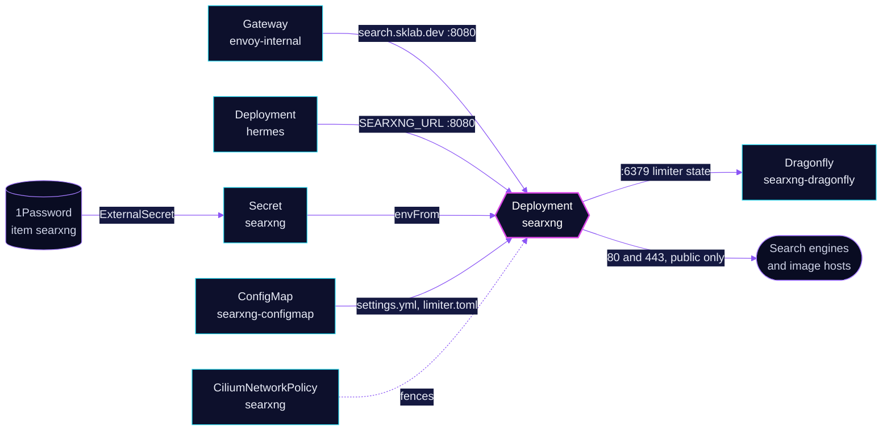

<!-- header: icon=search -->
<!-- concept: From a query to results without leaving the cluster's fence | search Query | shield Fence | globe Engines | list-filter Results -->
<p align="center"></p>

> A private metasearch engine: people use it on the LAN, and the Hermes agent uses it for web search.

**Live facts:** <https://skrumbach.github.io/home-ops/apps/ai/searxng/> (workloads, routes, storage, backups, secrets and alerts, generated on every merge)

## What it does

- **Searches the web** for people at `search.sklab.dev` (and `searxng.sklab.dev`) on `envoy-internal` only.
- **Answers the Hermes agent** at `http://searxng.ai.svc.cluster.local:8080` (`SEARXNG_URL`), the only in-cluster
  caller. A new caller needs its own ingress rule in `app/ciliumnetworkpolicy.yaml`.
- **Rate-limits clients** with the SearXNG limiter, keeping its state in the Dragonfly instance
  `searxng-dragonfly` (`SEARXNG_VALKEY_URL`).
- **Proxies images** itself (`image_proxy: true`), so a browser never contacts an upstream site directly.
- **Is fenced by a CiliumNetworkPolicy** in both directions (see below).

## Why it is built this way

| Choice | Why |
|---|---|
| **A network policy on both directions** | SearXNG has no login and `image_proxy` is on. Ingress limits who can use it anonymously. Egress limits what it can fetch for them. |
| **Egress to public 80 and 443 only** | The CIDR rule cuts out `10.0.0.0/8`, `172.16.0.0/12`, `192.168.0.0/16`, `100.64.0.0/10` (tailnet) and `169.254.0.0/16`, so a query cannot reach the LAN or a node. |
| **Limiter state in Dragonfly** | The limiter keeps its counters behind `SEARXNG_VALKEY_URL`, and the Dragonfly component provides that store (two replicas). |
| **`trusted_proxies` is the pod CIDR** | Envoy runs in `10.42.0.0/16`. Only a request from there has its `X-Forwarded-For` believed, so the limiter sees the real client address. |
| **LAN ranges skip the limiter** | `pass_ip` holds `192.168.0.0/16` and `10.0.0.0/8`, so LAN clients and scripts such as `curl` are never treated as bots. |
| **Settings files stay out of Flux substitution** | `settings.yml` and `limiter.toml` carry no Flux variables. Substitution is disabled on the ConfigMap so a later literal `${...}` cannot fail the Kustomization. |

## How it works

<p align="center"></p>

<details>
<summary><b>Resource graph</b>: every object involved, by name</summary>



</details>

1. Flux applies Kustomization `searxng` after `dragonfly-operator` and `onepassword-store`. The
   [`dragonfly` component](../../../../components/dragonfly/dragonfly.yaml) adds `searxng-dragonfly` (`APP=searxng`).
2. `kustomization.yaml` builds ConfigMap `searxng-configmap` (no name hash) from `settings.yml` and `limiter.toml`.
   Both are mounted read-only into `/etc/searxng`. `reloader.stakater.com/auto` restarts the pod when they change.
3. Secret `searxng` comes from 1Password item `searxng`, field `SEARXNG_SECRET_KEY`, exposed as `SEARXNG_SECRET`.
4. The pod runs as uid 977 with a read-only root filesystem and an `emptyDir` on `/tmp`.
5. A request through the route reaches port 8080. The limiter checks the client address (taken from
   `X-Forwarded-For` only when the peer is in the pod CIDR) against `pass_ip`, `block_ip` and its bot checks, with
   counters in Dragonfly.
6. SearXNG queries the enabled engines over the internet, rewrites results (tracker URLs removed) and proxies images.

## Settings that matter

All values are in [`app/helmrelease.yaml`](app/helmrelease.yaml), [`app/resources/settings.yml`](app/resources/settings.yml)
or [`app/resources/limiter.toml`](app/resources/limiter.toml).

| Setting | Value | Why |
|---|---|---|
| `server.limiter`, `server.public_instance` | `true`, `false` | Bot protection on, and the instance is not advertised as public. The manifest records no other reason. |
| `server.method` | `GET` | The comment links searxng/searxng PR 3619. |
| `search.formats` | `html`, `json` | Adds the JSON API next to the web page. The manifest records no other reason. |
| `engines`: `ahmia`, `torch` | `inactive: true` | Tor-only engines. There is no Tor proxy, so they fail to register. |
| `botdetection.ip_limit.link_token` | `true` | Activates the `link_token` method of the limiter. |
| Probes | `GET /stats :8080` | Startup every 5s up to 12 failures; liveness and readiness every 10s. Gatus probes `https://search.sklab.dev/stats` too. |

## Operate it

```bash
flux -n ai get ks searxng
flux -n ai get hr searxng
kubectl -n ai get pods -l app.kubernetes.io/name=searxng -o wide
kubectl -n ai logs deploy/searxng
kubectl -n ai get dragonfly searxng-dragonfly
kubectl -n ai get ciliumnetworkpolicy searxng
curl -s 'https://search.sklab.dev/search?q=test&format=json' | head -c 300   # from the LAN
```

## Invariants

- The Dragonfly ingress rule has no `toPorts`: a same-node Service reply arrives with the ClusterIP as source after
  reverse NAT and is checked again (cilium/cilium#47913). Remove the port-free rule only when that bug is fixed.
- The DNS ingress rule has no `toPorts` either: a reply lands on an ephemeral port, never 53.
- The policy's `endpointSelector` carries `app.kubernetes.io/controller: searxng` so the operator-managed
  `searxng-dragonfly` pods stay out of it.
- Egress to private, CGNAT and link-local ranges stays cut out. SearXNG fetches URLs for anyone who can reach it.

Upstream: [SearXNG docs](https://docs.searxng.org/)
