<!-- header: icon=plug-zap -->
<!-- concept: From an agent's tool call to a guarded backend | bot Agent | key-round Token | route Gateway | search Select | server Backend -->
<p align="center"></p>

> Federates the cluster's MCP servers behind one token-guarded gateway at `mcp.sklab.dev` for the AI agents.

**Live facts:** <https://skrumbach.github.io/home-ops/apps/ai/toolhive/> (workloads, routes, storage, backups, secrets and alerts, generated on every merge)

## What it does

- **Runs the ToolHive operator** (`toolhive-operator`) and its CRDs. The operator turns each `MCPServer` into a proxy
  Deployment and a StatefulSet for the MCP container.
- **Groups the servers.** Every `MCPServer` joins `MCPGroup` `mcp-tools` through `groupRef`.
- **Federates them.** `VirtualMCPServer` `mcp-gateway-internal` (vmcp) serves every member of the group at one
  streamable-HTTP endpoint, with tool names prefixed `{workload}_`. Its tool-selection index (`find_tool`) uses
  `EmbeddingServer` `mcp-tools-embedding`.
- **Exposes it on the LAN** at `https://mcp.sklab.dev/mcp` through HTTPRoute `mcp-gateway` on `envoy-internal`.
  Envoy checks a bearer token; `/health` is open for Gatus.
- **Mints the token itself.** A generated Secret `mcp-gateway-token` is pushed to 1Password item `mcp-gateway`
  (vault Automation), where Hermes, OpenCode and Gatus read it back.
- **Hosts eight backends**, each narrowed where the tool allows: `arr`, `flux`, `github`, `grafana-mcp`, `ha-mcp`, `kubectl`,
  `kubesearch` and `seerr-mcp` (see `mcp-servers/`).

## Why it is built this way

| Choice | Why |
|---|---|
| **The token is enforced at Envoy, not in vmcp** | vmcp accepts only anonymous, local or OIDC JWT auth and has no static-token mode. SecurityPolicy `mcp-gateway-auth` checks the `Authorization` header and drops it before vmcp. |
| **A NetworkPolicy closes the Service** | The in-cluster Service is unauthenticated, so NetworkPolicy `mcp-gateway-internal` is the only thing stopping a bypass. Only `envoy-internal` and Prometheus reach port 4483. |
| **Two route rules, `health` and `mcp`** | The token sits on rule `mcp` only, so Gatus can probe `/health` without it. Rule names are load-bearing. |
| **Narrowed backends, enforced twice** | Hermes reaches this gateway, so a backend gets no write path it does not need. Most servers pair a read-only credential or RBAC with a read-only flag or tool filter, so a later token swap cannot quietly add writes (table below). |
| **A CPU embedding model** | `bge-small-en-v1.5` is the index model. `Qwen3-Embedding-0.6B` takes about 487s per session and the handshake budget is 30s. The index stays off the B70. |
| **Token generated once, pushed to 1Password** | Consumers read one item. The ExternalSecret uses `refreshPolicy: CreatedOnce` and the PushSecret has `deletionPolicy: None`, so pruning never removes the item. |

## How it works

```mermaid
%%{init: {'theme':'base','themeVariables':{'primaryColor':'#0D102C','primaryTextColor':'#E9ECF7','primaryBorderColor':'#22D8F0','lineColor':'#8B55F5','secondaryColor':'#151941','tertiaryColor':'#090C22','edgeLabelBackground':'#151941'}}}%%
flowchart LR
  pw["Password<br/>mcp-gateway-token"] --> es["ExternalSecret<br/>mcp-gateway-token"]
  es --> sec["Secret<br/>mcp-gateway-token"]
  sec -->|PushSecret| op[("1Password<br/>item mcp-gateway")]
  op -.->|read back| ag(["Agents<br/>hermes, opencode, gatus"])
  ag -->|"mcp.sklab.dev/mcp"| gw["Gateway<br/>envoy-internal"]
  gw --> rt["HTTPRoute<br/>mcp-gateway"]
  sp["SecurityPolicy<br/>mcp-gateway-auth"] -->|"rule mcp, bearer"| rt
  sec --> sp
  rt -->|":4483"| v{{"VirtualMCPServer<br/>mcp-gateway-internal"}}
  np["NetworkPolicy<br/>mcp-gateway-internal"] -.->|admits envoy, Prometheus| v
  v -->|find_tool| emb["EmbeddingServer<br/>mcp-tools-embedding"]
  v -->|groupRef| grp["MCPGroup<br/>mcp-tools"]
  grp --> srv["MCPServer x8<br/>arr, flux, github, ..."]
  op2["Operator<br/>toolhive-operator"] -->|renders| srv
  srv -->|tool calls| be(["Sonarr, Flux, GitHub,<br/>Grafana, Home Assistant, ..."])
  classDef accent fill:#0D102C,stroke:#D946E6,stroke-width:2px,color:#FFFFFF
  classDef ext fill:#090C22,stroke:#A57BFF,color:#CDD2E6
  class v accent
  class op,ag,be ext
```

<p align="center"></p>

<details>
<summary><b>Resource graph</b>: every object involved, by name</summary>



</details>

1. Four Flux Kustomizations in [`toolhive.yaml`](../../../main/ai/toolhive.yaml), in order: `toolhive-crds` (`wait: true`,
   a gate), `toolhive` (the operator, health check on Deployment `toolhive-operator`), `toolhive-config` (the gateway,
   after `onepassword-store`) and `toolhive-mcp-servers`.
2. `toolhive-config` applies the gateway pieces: `MCPGroup` `mcp-tools`, `MCPTelemetryConfig` `prometheus`,
   `EmbeddingServer`, `VirtualMCPServer`, the route, SecurityPolicy and NetworkPolicy, the token generator,
   `PodMonitor` and `PrometheusRule`. Its health checks are Deployment `mcp-gateway-internal` and StatefulSet
   `mcp-tools-embedding`.
3. `toolhive-mcp-servers` applies one directory per backend. Its health checks name both the proxy Deployment and
   the MCP StatefulSet of every server, because the proxy's `/health` does not cover the backend.
4. A client calls `POST /mcp` with `Authorization: Bearer <token>`. Envoy compares the token, strips `Bearer ` and the
   header, and passes the request to Service `vmcp-mcp-gateway-internal:4483`.
5. vmcp (`incomingAuth: anonymous`, `outgoingAuth: discovered`) lists the tools of every group member and routes
   a call to the right proxy. The optimizer builds a SQLite FTS5 index per session in `/tmp`.

### Add an MCP server

1. Create `mcp-servers/<name>/` with `kustomization.yaml` and `mcpserver.yaml`. Set `groupRef.name: mcp-tools`.
   That one field is the whole registration: no route, no gateway edit, no new NetworkPolicy.
2. Narrow it before it joins: a read-only flag, an `MCPToolConfig` `toolsFilter` (as in `arr` and `seerr-mcp`), or a
   read-only ServiceAccount (as in `kubectl` and `flux`).
3. Credentials come from an `ExternalSecret` that names a 1Password item and a Secret `toolhive-<service>`
   (`toolhive-sonarr`, `toolhive-grafana`); the `MCPServer` reads it through `spec.secrets`. For a read-only root filesystem, mount an `emptyDir` on `/tmp`.
4. Add `./<name>` to `mcp-servers/kustomization.yaml`, and its Deployment and StatefulSet to `healthChecks` of
   `toolhive-mcp-servers` in `kubernetes/apps/main/ai/toolhive.yaml`.
5. The policy's no-`ports` peer rule admits replies from pods labelled `toolhive: "true"`, so a new server needs
   no policy change.

Access guard of each backend, as the manifests set it:

| Server | Guard |
|---|---|
| `arr` | `MCPToolConfig` `arr-readonly`: query tools only, no add, search-trigger or delete tools. |
| `seerr-mcp` | `MCPToolConfig` `seerr-request-only`: `search_media`, `get_media_details`, `request_media`. |
| `github` | Read-only PAT `HOMELAB_GH_READ_TOKEN` (item `hermes`) plus `GITHUB_READ_ONLY=1`. |
| `grafana-mcp` | Viewer-role service account token plus `--disable-write`. |
| `kubectl`, `flux` | `--read-only` and ClusterRole `kubectl-mcp-readonly` (no core Secrets). |
| `ha-mcp` | A Home Assistant long-lived token (item `home-assistant`). The manifest sets no read-only guard. |
| `kubesearch` | No credential: a public read-only index. |

## Settings that matter

| Setting | Value | Why |
|---|---|---|
| `incomingAuth.type` (vmcp) | `anonymous` | The token lives at Envoy; see the choice table. |
| `aggregation.conflictResolution` | `prefix`, `{workload}_` | Tool names from different servers cannot collide. |
| vmcp `resources` | request 256Mi; limit 2Gi memory | The alert comment records a baseline climb of about 680MiB/day, so a restart is expected. |
| vmcp `/tmp` | `emptyDir` | The optimizer's FTS5 index needs a writable path; without it, it fails with "disk I/O error". |
| `EmbeddingServer` `resources` | request 1 CPU and 1Gi; limit 4 CPU and 2Gi | 1 CPU so a saturated node still finishes inside 30s; 4 CPU is the burst. No `--max-batch-tokens`. |
| Password `mcp-gateway-token` | 64 characters, no symbols | Alphanumeric only: it travels in an HTTP header. |
| ExternalSecret `toolhive-grafana` `refreshInterval` | `5m` | `grafana-sa-provisioner` rotates the token on that cadence; 1h would leave it dead for up to an hour. |
| `grafana-mcp` pod annotation | `secret.reloader.stakater.com/reload: toolhive-grafana` | The token goes to the StatefulSet, and the CRD has no StatefulSet override hook. |
| ExternalSecret `toolhive-seerr` `refreshInterval` | `5m` | The first sync races the PushSecret that creates the item. |
| `kubectl` env `MCP_ALLOW_UNAUTHENTICATED` | `"true"` | Version 2.0.0 refuses a non-loopback bind without auth, and the proxy reaches the pod IP. Exposure stays a read-only ServiceAccount with no core Secrets. |
| `PodMonitor` port | `http` (4483), `/metrics`, 15s | vmcp serves metrics on its main port; nothing listens on 8080. |

## Operate it

```bash
flux -n ai get ks toolhive-crds toolhive toolhive-config toolhive-mcp-servers
flux -n ai get hr toolhive-operator toolhive-operator-crds
kubectl -n ai get mcpgroup,mcpserver,virtualmcpserver,embeddingserver,mcptoolconfig
kubectl -n ai get pods -o wide | grep -E 'mcp-|toolhive'
kubectl -n ai get externalsecret,pushsecret,securitypolicy,httproute
kubectl -n ai describe virtualmcpserver mcp-gateway-internal
kubectl -n ai logs deploy/mcp-gateway-internal -c vmcp
curl -s https://mcp.sklab.dev/health                    # from the LAN: {"status":"ok"}, no token needed
```

`/health` stays 200 while no MCP session can open. The Gatus check `ToolHive MCP Session` (in
`monitoring/gatus`) runs a real `initialize` call every 5 minutes.

### When an alert fires

| Alert | Fires when | First look |
|---|---|---|
| `MCPGatewayMemoryGrowth` | The vmcp working set is projected to pass its memory limit within 48h (6h trend, for 1h). | `kubectl -n ai top pod -l app.kubernetes.io/instance=mcp-gateway-internal`; restart the pod or raise the limit in `config/virtualmcpserver.yaml`. |
| `MCPGatewayMemoryNearLimit` | The working set is above 80% of the limit for 15m. | The same. An OOMKill drops every open MCP session. |

## Invariants

- Keep `BAAI/bge-small-en-v1.5` for `mcp-tools-embedding`. Do not point it at the B70.
- Rule names `health` and `mcp` in HTTPRoute `mcp-gateway` stay: the SecurityPolicy targets `mcp` by `sectionName`.
- Reply traffic: sources are admitted with no `ports:`, because default-deny also drops replies to vmcp's own
  outbound calls (DNS, backend proxies, embedding server).
- Deleting ExternalSecret `mcp-gateway-token` deletes the Secret and mints a new token, which the PushSecret then
  writes over the 1Password field.
- `flux` stays `--read-only` and bound to a read-only ClusterRole: Flux applies as cluster-admin, so any write grant
  lets a gateway-token holder apply anything.
- `manage_media_requests` in the Seerr MCP can approve, decline and delete, so it stays out of the tool filter.
  Approval stays with the owner in Seerr.
- `github` uses `HOMELAB_GH_READ_TOKEN`, never `HOMELAB_GH_TOKEN`, which can write to home-ops. A different
  read-only token is fine; never a write-capable one (Hermes reaches this MCP).
- ClusterRole `kubectl-mcp-readonly` is an aggregation role. Hand-written rules on it are discarded; grants go on
  `kubectl-mcp-readonly-base`.

Upstream: [ToolHive docs](https://docs.stacklok.com/toolhive/)
