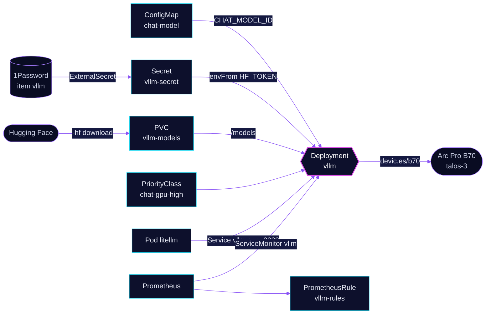

<!-- header: icon=message-square-text -->
<!-- concept: From a LiteLLM request to a token on the GPU | route LiteLLM | scale-3d Slot | microchip GPU | text Token -->
<p align="center"></p>

> The local chat model server on the shared Arc Pro B70: a llama.cpp SYCL server that LiteLLM reaches as `chat-local`.

**Live facts:** <https://skrumbach.github.io/home-ops/apps/ai/vllm/> (workloads, routes, storage, backups, secrets and alerts, generated on every merge)

## What it does

- **Serves chat completions** on Service `vllm-app:8000`. Despite the name it is `llama-server` from llama.cpp, not
  vLLM. The controller keeps the name `vllm` so the Service does not move.
- **Answers only LiteLLM.** CiliumNetworkPolicy `vllm` admits LiteLLM, Prometheus, and the kubelet probes.
  `chat-local`, `chat-ha`, `chat-local-classifier` and `demo-priced-local` all use it as their `apiBase`.
- **Names the model once.** The `--alias` is `${CHAT_MODEL_ID}` from ConfigMap `chat-model`. Consumers pick the role
  alias `chat-local` and never see the real name ([`../AGENTS.md`](../AGENTS.md)).
- **Shares the B70** with `ai/embedding-gpu`. Both request `devic.es/b70`, so both can only land on talos-3.
- **Exports llama.cpp metrics** through ServiceMonitor `vllm`, labelled with the model and the KV type for the
  `ai/gpu-node-dashboard` panels.

## Why it is built this way

| Choice | Why |
|---|---|
| **llama.cpp SYCL, not vLLM** | The GPTQ build cannot finish vLLM warmup on one B70 (`intel/llm-scaler#382`). |
| **Recreate** | The manifest records no reason for chat. `ai/embedding-gpu` notes that `devic.es/b70` is a share token, so two pods on the card would both load their weights. |
| **PriorityClass `chat-gpu-high` (1100000)** | It outranks the CI runners (1000000), so the 8-CPU request is always schedulable on talos-3 and a runner burst cannot preempt chat. |
| **`--cache-ram` pinned, `GLIBC_TUNABLES` beside it** | Without the flag llama.cpp keeps a silent 8192 MiB prompt cache, and the host leaks memory with no OOM. A memory limit cannot stop it. |
| **Root container, no `runAsNonRoot`** | The image has no `USER`, and the `/models` claim and the GPU nodes are root-owned. No `fsGroup`, because it would re-own `/models`. |
| **Service and claim use `suffix`** | With one service and one claim the chart would name both `vllm`, and Helm would delete the model cache. |
| **Alias from a ConfigMap** | A model swap is one line in `chat-model.yaml` plus the `-hf` repo. Nothing that calls `chat-local` changes. |

## How it works

<p align="center"></p>

<details>
<summary><b>Resource graph</b>: every object involved, by name</summary>



</details>

1. Flux applies Kustomization `vllm` after `rook-ceph` and `onepassword-store`, with `${CHAT_MODEL_ID}` substituted
   from `chat-model`. The health check is the Deployment, not the HelmRelease.
2. On first start llama.cpp downloads the GGUF and the vision projector from Hugging Face into `/models/llama`
   (`LLAMA_CACHE`). The startup probe allows 30 minutes (60 failures at 30 s), and the HelmRelease and the
   Kustomization both time out at 30 minutes to match. Later starts read the cached files.
3. The server loads all layers on the GPU (`-ngl 99`) at the model's full context window. It runs flash attention, an
   f16 KV cache and n-gram speculative decoding, which needs no draft model and no extra VRAM.
4. LiteLLM sends requests to `vllm-app:8000`. `--parallel` is not pinned, so llama.cpp picks its own slot count.
5. Prometheus scrapes `/metrics` every 30 s. The ServiceMonitor adds `model` and `kv` labels because llama-server
   series carry neither, so a variant keeps its own history.

## Settings that matter

All values are in [`app/helmrelease.yaml`](app/helmrelease.yaml) unless noted.

| Setting | Value | Why |
|---|---|---|
| `--ctx-size` | `262144` | The model's maximum. Do not pin `--parallel` or `--kv-unified`: an explicit pin collapses decode. |
| `--cache-type-k`, `--cache-type-v` | `f16` | Decode is 12 to 16% faster at 16K context and above, and VRAM stays about 9 GiB free. The ServiceMonitor `kv` label must match; nothing checks it. |
| `--cache-ram` | `4096` | The bound on the prompt cache. Absence restores the 8192 MiB default; `0` is not used here. |
| `GLIBC_TUNABLES` | `glibc.malloc.mmap_threshold=131072` | Second half of `--cache-ram`: glibc returns large chunks. Ship neither without the other. |
| `GGML_SYCL_FA_ONEDNN` | `"0"` | Numeric only: `"false"` and `"off"` parse as the default and leave the leak on. Lift it only when the image tag bounds the oneDNN flash-attention path. |
| `-b`, `-ub` | `8192`, `4096` | Prefill is faster by 14% at 16K and 11% at 64K, decode is unchanged, and four concurrent 16K requests finish sooner. Re-measure `-ub 4096` before a tag bump. |
| `--spec-type` | `ngram-mod` | Drafts from n-grams already in context, with no VRAM cost. Neutral on novel text, faster when the output copies the prompt. `draft-mtp` was slower at short context and under concurrency. |
| `-t` | `"8"` | Unset, llama.cpp starts one thread per hardware thread and the spin-waiting extras thrash when tdarr holds cores. Equals the CPU request. |
| `--cache-reuse` | `"256"` | The manifest says it is a no-op while the vision projector is loaded. |
| Memory request, limit | `12Gi`, `48Gi` | The request is about 1232 MiB baseline plus 2.7 times the 4096 MiB cache. Below the working set this pod is evicted first. The limit sits above the request so a prefill spike is not an OOM kill; it cannot stop the host leak. |
| CPU request | `"8"` | Equal to `-t`. The request is the CFS weight against tdarr on the same node. |
| `persistence.models.size` | `75Gi` on `ceph-block` | Each cached model is about 17 GiB with its projector. A claim never shrinks, so lowering the size fails the Helm upgrade. |
| `tolerations` | `home-operations.com/dedicated` `PreferNoSchedule` | talos-3 carries that taint and this pod can only land there. |
| Model repo and quantisation | see the `-hf` comment | The comment records what was compared and why this build was chosen. |

## Operate it

```bash
flux -n ai get ks vllm
kubectl -n ai get pods -l app.kubernetes.io/name=vllm -o wide
kubectl -n ai get cm chat-model -o jsonpath='{.data.CHAT_MODEL_ID}'
kubectl -n ai get deploy vllm -o jsonpath='{.spec.template.spec.containers[0].args}'
kubectl -n ai logs deploy/vllm --tail=50
kubectl -n ai get pvc vllm-models
```

A swap, its side effects and the `/v1/models` check are in [`../AGENTS.md`](../AGENTS.md). The VA-API check for any
GPU change (see Invariants) needs `exec`:

```bash
kubectl -n media exec deploy/tdarr-tdarr-node -c app -- vainfo --display drm --device /dev/dri/renderD129
```

### When an alert fires

From [`app/prometheusrule.yaml`](app/prometheusrule.yaml).

| Alert | Fires when | First look |
|---|---|---|
| `VLLMMemoryApproachingLimit` | projected over the limit within 24 h and now above 60% of it, for 1 h | Growth rate of `container_memory_working_set_bytes`; plan capacity before the critical alert. |
| `VLLMMemoryExceedsRequest` | working set above the 12Gi request for 30 min | The pod is now evicted before pods within their requests. Check whether `VLLMMemoryRetainedAboveBound` also fires. |
| `VLLMMemoryRetainedAboveBound` | working set never below 8 GiB in 3 h | Something grows without bound. First suspect: the oneDNN leak is back, so check the running image still honours `GGML_SYCL_FA_ONEDNN=0`. |
| `VLLMMemoryCriticalLimit` | above 85% of the limit for 15 min | Near an OOM kill. Act now. |

## Invariants

- **The B70 has two tenants: throttle the embedding endpoint by request rate. Both llama.cpp workloads pin `--cache-ram`
  (chat non-zero, embeddings `0`) and `vllm` sets `GGML_SYCL_FA_ONEDNN: "0"` or host RAM leaks with no OOM. An
  embedding endpoint can return pure NaN with green health.**
- **NEVER rename a DRM device node with `generic-device-plugin`'s `mountPath`, and never ship a GPU change without the
  VA-API check:** `kubectl -n media exec deploy/tdarr-tdarr-node -c app -- vainfo --display drm --device /dev/dri/renderD129`.
  VA-API consumers use `devic.es/b70-vaapi`. No DRA migration, never `adminAccess: true`.
- **`--cache-ram` here is `4096` and pairs with `GLIBC_TUNABLES`.** Ship neither without the other.
- **`GGML_SYCL_FA_ONEDNN` is numeric:** `"false"` and `"off"` parse as the default and leave the leak on.
- **Do not raise the memory request to silence `VLLMMemoryRetainedAboveBound`.** Move its 8 GiB threshold with
  `--cache-ram`.
- **Consumers use `chat-local`, never the real model name.** Do not add a literal model name to a new file; use
  `${CHAT_MODEL_ID}` ([`../AGENTS.md`](../AGENTS.md)).
- **Do not pin `--parallel` or `--kv-unified`** on this server: an explicit pin collapses decode.
- **Re-measure the next image tag with `-ub 4096` before bumping.** `ai/embedding-gpu` runs the same tag.

Upstream: [llama.cpp server](https://github.com/ggml-org/llama.cpp/tree/master/tools/server) •
[llama.cpp SYCL backend](https://github.com/ggml-org/llama.cpp/blob/master/docs/backend/SYCL.md)
