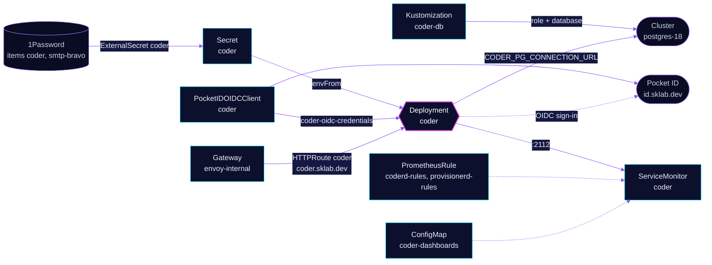

<!-- header: icon=terminal -->
<!-- concept: From a Pocket ID login to a dev workspace | fingerprint Sign-in | door-open LAN route | terminal Coder | database Postgres | activity Metrics -->
<p align="center"></p>

> The Coder server: development workspaces behind Pocket ID sign-in, on the internal gateway only.

**Live facts:** <https://skrumbach.github.io/home-ops/apps/coder/coder/> (workloads, routes, storage, backups, secrets and alerts, generated on every merge)

The sign-in model and the break-glass steps for an issuer change are in the namespace document,
[`../README.md`](../README.md). This page does not repeat them.

## What it does

- **Runs workspaces** from the `coder` Deployment (Helm chart `coder`), with the access URL `https://coder.sklab.dev`
  and the wildcard `*.coder.sklab.dev`.
- **Signs people in with Pocket ID** (PocketIDOIDCClient `coder`). Password login is off, and only the group `admins` gets in.
- **Serves the UI** at `coder.sklab.dev` on `envoy-internal` only, since 2026-11-13. Off-site use goes through the VPN.
- **Stores its data** in database `coder` on the shared `postgres-18` Cluster, created by Kustomization `coder-db`.
- **Exposes metrics** on port `2112`, scraped by ServiceMonitor `coder`, with Grafana dashboards, alert rules and runbooks next to the manifests.

## Why it is built this way

| Choice | Why |
|---|---|
| **One gateway for the hostname** | UniFi stores one CNAME target, so a name on both gateways never settles. |
| **`CODER_OIDC_IGNORE_EMAIL_VERIFIED=true`** | Pocket ID sends `email_verified=false` for a user the operator created through the admin API, and Coder then refuses the login with "Email not verified" (2026-11-13). Signups are disabled in Pocket ID and its users come from Git, so the claim adds nothing. |
| **The chart reads the OIDC Secret directly** | The operator writes `coder-oidc-credentials`; the HelmRelease takes `client-id` and `client-secret` from it. A re-created client has a new secret, and Coder picks it up only at its next restart. |
| **Allowed groups checked twice** | `CODER_OIDC_ALLOWED_GROUPS` rejects everyone outside `admins` in Coder; the client's `allowedUserGroups` stops them at Pocket ID. |

## How it works

<p align="center"></p>

<details>
<summary><b>Resource graph</b>: every object involved, by name</summary>



</details>

1. Flux applies Kustomization `coder` after `coder-db`, `onepassword-store` and `rook-ceph`, with `wait: true` and a 5m timeout.
   `coder-db` is the `cnpg-database` component: a DatabaseRole and a Database on `postgres-18`, removing it never drops data.
2. ExternalSecret `coder` builds Secret `coder` from the 1Password items `smtp-bravo` and `coder`: SMTP login, GitHub OAuth
   settings and `CODER_PG_CONNECTION_URL`, which points at `postgres-18-rw.database.svc.cluster.local`.
3. The chart's Deployment loads Secret `coder` with `envFrom` and reads the OIDC client from `coder-oidc-credentials`.
   The annotation `reloader.stakater.com/auto` restarts it when either Secret changes.
4. A post-render patch adds Service port `prom-http` (`2112`) so ServiceMonitor `coder` can scrape it every 10s.
5. `dashboards/` become ConfigMap `coder-dashboards` for Grafana (folder `Coder`). `rules/` hold the PrometheusRules for
   coderd and provisionerd. `runbooks/` become ConfigMap `coder-runbooks`; alert `runbook_url` values point at the same files in Git.

## Settings that matter

All values are in [`app/helmrelease.yaml`](app/helmrelease.yaml) unless noted.

| Setting | Value | Why |
|---|---|---|
| `CODER_DISABLE_PASSWORD_AUTH` | `"true"` | Sign-in goes through Pocket ID only; see the namespace document. |
| `CODER_OIDC_ALLOWED_GROUPS` | `admins` | Exact, case-sensitive match on the `groups` claim, checked on every OIDC login. |
| `CODER_OIDC_SCOPES` | `openid,profile,email,groups,offline_access` | Pocket ID releases `groups` only with the groups scope. |
| `CODER_OIDC_IGNORE_EMAIL_VERIFIED` | `"true"` | See above. |
| `CODER_OIDC_GROUP_MAPPING`, `CODER_OIDC_USER_ROLE_MAPPING` | `admins` to `CoderAdmins`, `admins` to `owner` | Group and role sync need a Premium license, so both do nothing today. Only `CODER_OIDC_ALLOWED_GROUPS` is enforced. |
| `CODER_OIDC_ISSUER_URL` | `https://id.sklab.dev` | On start Coder clears the link of every OIDC user linked to another issuer (`CODER_OIDC_REPAIR_LINKS`, default true); the next login re-links by email. |
| `CODER_BLOCK_DIRECT`, `CODER_DERP_SERVER_STUN_ADDRESSES` | `"true"`, `"disable"` | The manifest records no reason. |
| `CODER_TELEMETRY_ENABLE`, `CODER_UPDATE_CHECK` | `"false"` | The manifest records no reason. |
| `resources` | requests 71m CPU, 640Mi; limit 1Gi memory, no CPU limit | Request tracks peak working set with tight headroom: coderd grows with concurrent workspace builds. |
| `CODER_PROMETHEUS_COLLECT_AGENT_STATS` | `"true"` | The manifest records no reason. |

## Operate it

```bash
flux -n coder get ks coder coder-db
flux -n coder get hr coder
kubectl -n coder get pods -l app.kubernetes.io/name=coder -o wide
kubectl -n coder logs deploy/coder --tail=100
kubectl -n coder get externalsecret coder
kubectl -n coder get pocketidoidcclient/coder httproute/coder servicemonitor/coder
kubectl -n coder top pod
```

### When an alert fires

| Alert | Fires when | First look |
|---|---|---|
| `CoderdCPUUsage` | never today: it divides CPU use by the CPU limit, which the HelmRelease does not set | [`runbooks/coderd.md`](app/runbooks/coderd.md); `kubectl -n coder top pod` against the 71m request. |
| `CoderdMemoryUsage` | working set above 80% (warning) or 90% (critical) of the memory limit for 10m | [`runbooks/coderd.md`](app/runbooks/coderd.md); `kubectl -n coder top pod`. |
| `CoderdRestarts` | a coderd pod restarts more than 1, 2 or 3 times in 10m (three severities) | The runbook, then `kubectl -n coder logs deploy/coder --previous`. |
| `CoderdReplicas` | no coderd pod is up for 5m | The runbook; `flux -n coder get hr coder`. |
| `CoderdWorkspaceBuildFailures` | more than 2, 5 or 10 workspace builds fail in 10m (three severities) | The runbook; the Coder UI build log. |
| `ProvisionerdReplicas` | the sum of `coderd_provisionerd_num_daemons` is below 1, 2 or 3 for 5m (three severities) | [`runbooks/provisionerd.md`](app/runbooks/provisionerd.md). |

## Invariants

- Do not create a local password user, and do not `UPDATE users.rbac_roles` in Postgres to grant admin
  (namespace document).
- Do not add a CPU limit as a first response to `CoderdCPUUsage` ([`runbooks/coderd.md`](app/runbooks/coderd.md)).

## Known gaps

- **`CODER_OIDC_ROLE_FIELD` has no effect.** [`app/helmrelease.yaml`](app/helmrelease.yaml) sets it to `groups`; its own comment says it is not a Coder option.
- **A runbook cites a comment that is not there.** [`app/runbooks/coderd.md`](app/runbooks/coderd.md) points at "the 2026-06-30 outage comment on the HelmRelease"; `app/helmrelease.yaml` has none.
- **`CoderdCPUUsage` cannot fire.** [`app/rules/coderd.yaml`](app/rules/coderd.yaml) divides by
  `kube_pod_container_resource_limits{resource="cpu"}`, and the HelmRelease sets no CPU limit, so the series is
  empty. The runbook says so too.
- **The wildcard host has no route.** `CODER_WILDCARD_ACCESS_URL` is `*.coder.sklab.dev`, but the only HTTPRoute ([`app/httproute.yaml`](app/httproute.yaml)) lists `coder.sklab.dev`.

Upstream: [Coder docs](https://coder.com/docs) •
[Pocket ID](https://pocket-id.org/docs)
