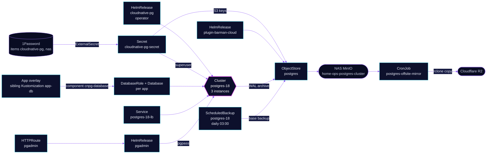

<!-- header: icon=database -->
<!-- concept: From an app's request to a backed-up Postgres database | file-plus Request | database Provision | copy Replicate | archive Archive | cloud-upload Mirror -->
<p align="center"></p>

> One shared three-instance Postgres 18 cluster with its own databases per app, WAL archiving to the NAS and an R2 mirror.

**Live facts:** <https://skrumbach.github.io/home-ops/apps/database/cloudnative-pg/> (workloads, routes, storage, backups, secrets and alerts, generated on every merge)

## What it does

- **Runs Postgres.** The CloudNativePG operator manages `Cluster` `postgres-18` in `database`: three instances on
  node-local `openebs-hostpath` disks, one primary and two standbys. Apps reach the primary at
  `postgres-18-rw.database.svc.cluster.local:5432`. The LAN reaches it at `postgres-18.sklab.dev` through the
  LoadBalancer Service `postgres-18-lb`.
- **Gives each app its own database.** The component
  [`components/cnpg-database`](../../../../components/cnpg-database/kustomization.yaml) creates a `DatabaseRole`, a
  `Database` and the role's password Secret for one app. An app overlay applies it as a sibling Flux Kustomization
  `<app>-db`; `sonarr-db` in [`downloads/sonarr.yaml`](../../../main/downloads/sonarr.yaml) is an example.
- **Archives continuously.** The barman-cloud plugin (`plugin-barman-cloud`) ships WAL and daily base backups to the
  bucket `home-ops-postgres-cluster` on the NAS MinIO. `ObjectStore` `postgres` holds the destination and a 30-day
  retention.
- **Mirrors the archive off site.** CronJob `postgres-offsite-mirror` copies that archive to Cloudflare R2 every
  hour. It is documented in [`offsite-mirror/README.md`](offsite-mirror/README.md).
- **Offers a web UI and a dashboard.** pgAdmin is `pgadmin.sklab.dev` and `pg.sklab.dev` on `envoy-internal`, behind
  Pocket ID. The `cloudnative-pg-dashboard` chart adds the Grafana dashboard to the `Database` folder.

## Why it is built this way

| Choice | Why |
|---|---|
| **Separate Flux Kustomizations, in order** | `cloudnative-pg` (operator) comes first, then `barman-cloud` (needs cert-manager for its gRPC mTLS), then `postgres-cluster-18`. The cluster `dependsOn` the plugin because the plugin supplies the `ObjectStore` CRD. |
| **Plugin, not in-tree `barmanObjectStore`** | CNPG 1.31 removes the in-tree store. The plugin must run in the operator's namespace. |
| **Node-local disks, not Ceph** | Postgres already keeps three copies and archives WAL. Ceph's three copies underneath would make nine. `openebs-hostpath` has no quota, so the `NodeFilesystem*` alerts cover `/var`. A drained node's instance stays Pending until the node returns. |
| **Required anti-affinity, with a toleration** | Three instances on three hosts means one lands on `talos-3`. Its `PreferNoSchedule` taint gets a toleration, which removes the score penalty. |
| **`dataDurability: preferred`** | The cluster keeps accepting writes when no standby is up, then catches up. `synchronous` is `any` with `number: 1`. |
| **`failoverDelay: 30`** | Short pod-network stalls do not fail over at once. |
| **A mirror, not a second destination** | One `Cluster` has one live barman destination, and the plugin ignores a destination set on a `ScheduledBackup`. The reasoning is in [`offsite-mirror/README.md`](offsite-mirror/README.md). |
| **`retain` on every `Database` and `DatabaseRole`** | Deleting a CR, an app removal or a Flux prune never drops data or a role. Dropping is a manual step of retiring an app. |
| **`serverName` per cluster generation** | A rebuilt cluster must not write into an older archive. Bump it in the Cluster and in the mirror together. |
| **Sibling `<app>-db` Kustomization per app** | The role and database are cluster objects in `database`, while the app lives in its own namespace. The component's header names this pattern. The manifest records no reason. |

## How it works

<p align="center"></p>

<details>
<summary><b>Resource graph</b>: every object involved, by name</summary>



</details>

1. Flux applies `cloudnative-pg` (the `operator/` piece): the operator chart with its CRDs and the ExternalSecret
   `cloudnative-pg-secret`. That Secret carries the superuser login from 1Password item `cloudnative-pg` and the
   MinIO access keys from item `nas`.
2. `barman-cloud` installs `plugin-barman-cloud` next to the operator. `postgres-cluster-18` then applies the
   `cluster-18/` piece: the `Cluster`, the `ObjectStore`, the `ScheduledBackup`, the LoadBalancer Service and the
   alert rules. The Kustomization is healthy when `status.readyInstances >= 1` and the `ContinuousArchiving`
   condition is true. It does not read the `Ready` condition, which CNPG can latch `False` while the cluster serves.
3. The instance manager archives WAL through the plugin, and `ScheduledBackup` `postgres-18` runs a
   base backup at 03:00 (`immediate: true` also runs one on creation). Both go to `ObjectStore` `postgres`.
4. An app's `<app>-db` Kustomization (component `cnpg-database`) creates `DatabaseRole` `<app>` with the password
   from its 1Password item, and `Database` `<app>` owned by that role. The app connects to `postgres-18-rw`; the
   manifest hardcodes that host in each app's ExternalSecret.
5. `postgres-offsite-mirror` runs at minute 25 of every hour and copies new archive objects from MinIO to R2. It
   never copies a LAN deletion; it prunes R2 objects older than 35 days on its own.
6. pgAdmin signs users in through Pocket ID client `pgadmin` (group `admins`, PKCE) and connects as the superuser
   with a `pgpass` file built from `cloudnative-pg`. Its one preloaded server is `postgres-18-rw`.

## Settings that matter

| Setting | Value | Why |
|---|---|---|
| `Cluster` `imageName` | `...-standard-trixie` flavour | `standard` ships pgvector (extension `vector`). Backups go through the plugin, so the deprecated `system` flavour is not needed. Renovate holds the image to major 18. |
| `storage` | `100Gi`, `openebs-hostpath` | See the node-local row above. |
| `resources` | request `500m` and `4Gi`, limit `6Gi` | postgres-17 peaked at 3,610Mi on a 4Gi limit with 128MB `shared_buffers`. This cluster adds 384MB, so the request covers that peak. |
| `postgresql.parameters` | `max_connections` 300, `shared_buffers` 512MB, `work_mem` 64MB, `max_slot_wal_keep_size` 2GB, `idle_in_transaction_session_timeout` 600000 ms | The manifest records no reason. |
| `primaryUpdateStrategy`, `primaryUpdateMethod` | `unsupervised`, `switchover` | The manifest records no reason. |
| `enableSuperuserAccess` | `true` | pgAdmin and break-glass use it. Apps use `DatabaseRole` and `Database` CRs. |
| `certificates.serverAltDNSNames` | `postgres-18.sklab.dev` | Adds the LAN name to the CNPG-issued server certificate. Never use `serverTLSSecret` or `serverCASecret`. |
| `bootstrap.recovery.source`, `plugins[].parameters.serverName` | `postgres18-v2` | Recovery restores from the cluster's own archive. A rebuild bumps `serverName` to `postgres18-v3` in the same commit, or the restored primary refuses to archive into the non-empty v2 archive. |
| `ObjectStore` `retentionPolicy` | `30d` | Applies to MinIO only. The mirror never copies a LAN deletion and keeps R2 objects for 35 days, so a LAN prune cannot race the off-site copy. |
| `ObjectStore` `data.compression`, `wal.compression` | `bzip2`, `zstd` | Base backups accept only bzip2, gzip, lz4 and snappy. WAL takes `zstd`. |
| `DatabaseRole` and `Database` `app` | role and database `app` | The cluster was born by a monolith import, which creates neither. The metrics exporter connects to `app` and the instance manager sets the role's password from `postgres-18-app`. Without them every `cnpg_pg_*` series disappears and the backup and WAL alerts go blind. No app uses them. |
| Operator `replicaCount` | `2` | The manifest records no reason. |
| Operator `INHERITED_ANNOTATIONS` | `kyverno.io/ignore` | The manifest records no reason. |
| Component `cnpg-database` variables | `APP`, `CNPG_ROLE`, `CNPG_DATABASE`; optional `CNPG_OP_ITEM`, `CNPG_PASSWORD_KEY` | The 1Password item defaults to `APP`, the password field to `POSTGRES_DB_USER_PASSWORD`. The ExternalSecret refreshes every 5m and carries `cnpg.io/reload`, so CNPG re-applies a changed password. |
| pgAdmin `MASTER_PASSWORD_REQUIRED`, `AUTHENTICATION_SOURCES` | `False`, `oauth2` then `internal` | Users match by email. The manifest records no reason for the master password setting. |
| pgAdmin `topologySpreadConstraints` | `ScheduleAnyway`, `nodeTaintsPolicy: Honor` | `Honor` filters only `NoSchedule` and `NoExecute`. The `talos-3` taint is `PreferNoSchedule`, so its score penalty keeps pgAdmin off that node. |

## Operate it

```bash
flux -n database get ks cloudnative-pg barman-cloud postgres-cluster-18 pgadmin postgres-offsite-mirror
kubectl -n database get cluster,objectstore,scheduledbackup,backup
kubectl -n database get databaserole,database
kubectl -n database get pods -o wide -l cnpg.io/cluster=postgres-18
kubectl -n database get svc postgres-18-rw postgres-18-lb
kubectl -n database get cronjob postgres-offsite-mirror
```

A manual backup is an applied `Backup` object, so it is not a read-only command. To find the primary:

```bash
kubectl -n database get cluster postgres-18 -o jsonpath='{.status.currentPrimary}'
```

### Restore into a fresh cluster

postgres-18 is the only Cluster (postgres-17 was retired 2026-11-07). The
rebuild-in-place rule is the comment above `bootstrap:` in `cluster-18/cluster-18.yaml`.

1. Apply a manual `Backup` (`method: plugin`, `cluster.name: postgres-18`) and
   wait for `phase=completed`.
2. Copy `cluster-18/cluster-18.yaml`. New `metadata.name`. Set
   `bootstrap.recovery.source` and the plugin `externalClusters[]` to the
   previous `serverName`. Set the archiver `plugins[].parameters.serverName` to
   a new value so the archives stay distinct.
3. Add a sibling Flux Kustomization that `dependsOn` the existing cluster
   for the cutover window.
4. Move each app by editing the host hardcoded in its ExternalSecret
   (`postgres-18-rw.database.svc.cluster.local:5432`), then remove the old
   cluster after no client backends remain.

`barman-cloud-backup-list` needs the AWS keys from `cloudnative-pg-secret`
passed into the postgres pod. Do not print them. The off-site mirror copies
the archive to R2 hourly; see `offsite-mirror/README.md`.

### When an alert fires

| Alert | Fires when | First look |
|---|---|---|
| `PostgresBackupStale` | The primary's last base backup is over 36h old | `kubectl -n database get backup`, then the plugin and `ObjectStore` `postgres`. |
| `PostgresBackupTimestampAbsent` | A primary reports no backup timestamp, so the rule above is blind | The plugin metrics: the rules accept `barman_cloud_cloudnative_pg_io_*` or `cnpg_collector_*`. |
| `PostgresWALArchiveStale`, `LastFailedArchiveTime` | No WAL archived for over 1h with segments waiting, or the archiver failed | The `plugin-barman-cloud` pod and the MinIO endpoint `nas.sklab.dev:9000`. |
| `PostgresWALArchiveTimestampAbsent` | A primary reports no archive timestamp | The `app` `DatabaseRole` and `Database`: without them the exporter drops these series. |
| `PGReplication`, `ReplicaFailingReplication` | A replica lags or does not replicate | `kubectl -n database get pods -l cnpg.io/cluster=postgres-18` and the replica's logs. |
| `LongRunningTransaction`, `BackendsWaiting`, `DatabaseDeadlockConflicts` | A query over 5 minutes, waiting backends, over 10 deadlocks | The Grafana `Database` dashboard. |
| `PGDatabase` | A database is over 300,000,000 transactions from its frozen xid | The Grafana `Database` dashboard, then vacuum progress on that database. |
| `PostgresOffsiteMirrorStale` | The mirror has not succeeded in over 6h | [`offsite-mirror/README.md`](offsite-mirror/README.md). |

## Invariants

- The operator chart tag is the
  OCIRepository `ref.tag` in `operator/ocirepository.yaml`, not a version written
  here. No ConfigMap in `cluster-18/` feeds Gatus: the live check is the TCP endpoint
  `postgres-18` on `postgres-18-rw.database.svc.cluster.local:5432` (group `database`) in
  [`monitoring/gatus/app/resources/config.yaml`](../../monitoring/gatus/app/resources/config.yaml).
- **CNPG writes every `ScheduledBackup` of a Cluster to its one live barman store.** A `barmanObjectName` on a
  `ScheduledBackup` is ignored. The off-site copy is the mirror, not a second destination.
- **Bump `serverName` on any rebuild, and `SERVER_NAME` in
  [`offsite-mirror/cronjob.yaml`](offsite-mirror/cronjob.yaml) with it.**
- **Keep `retain` on `Database` and `DatabaseRole`.** Dropping a database or role is a manual step.

Upstream: [CloudNativePG docs](https://cloudnative-pg.io/documentation/current/), [Barman Cloud plugin](https://cloudnative-pg.io/plugin-barman-cloud/)
