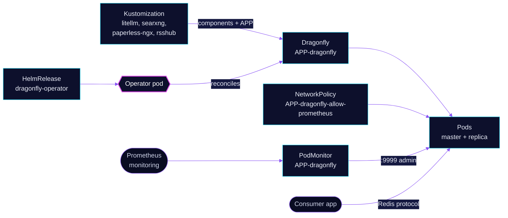

<!-- header: icon=zap -->
<!-- concept: From an app's cache need to a replicated in-memory store | package Component | boxes Instance | copy Replica | activity Scrape -->
<p align="center"></p>

> The Dragonfly operator: each app that needs a Redis-compatible cache gets its own small, replicated instance.

**Live facts:** <https://skrumbach.github.io/home-ops/apps/database/dragonfly/> (workloads, routes, storage, backups, secrets and alerts, generated on every merge)

## What it does

- **Runs the operator** in `database` (HelmRelease `dragonfly-operator`). It builds the pods for each `Dragonfly`
  object the consumers create. There is no central cluster.
- **Gives each consumer its own instance** through the Kustomize component
  [`kubernetes/components/dragonfly/`](../../../../components/dragonfly/). A consumer includes the component in its
  overlay and sets `APP`; the result is `Dragonfly/<APP>-dragonfly` in the consumer's namespace.
  Four consumers do so: `ai/litellm`, `ai/searxng`, `selfhosted/paperless-ngx` and `selfhosted/rsshub`.
- **Runs two replicas per instance**, one master and one replica, on different nodes.
- **Exports metrics** with a `PodMonitor` per instance, and ships the operator's Grafana dashboard into the
  `Database` folder.

## Why it is built this way

| Choice | Why |
|---|---|
| **One instance per app, not a shared one** | The component creates the instance next to its consumer. One app's load or restart cannot reach another app's keys. |
| **Cache mode** | The component sets a cache-only policy. `--cache_mode=true` makes a restart drop the data on purpose. |
| **Required anti-affinity plus a spread constraint** | Master and replica must not share a node. The spread constraint alone balances the whole namespace and does not guarantee that. |
| **An extra NetworkPolicy per instance** | The operator's own policy admits `:9999` only from the operator and peer replicas. The component adds a policy that also admits Prometheus; Kubernetes ORs the two. |

## How it works

<p align="center"></p>

<details>
<summary><b>Resource graph</b>: every object involved, by name</summary>



</details>

1. Flux applies Kustomization `dragonfly-operator` from `apps/base/database/dragonfly/app` with `wait: true`. Each
   consumer Kustomization lists `dragonfly-operator` in `dependsOn`, so the CRD and the operator exist first.
2. A consumer Kustomization includes `components/dragonfly` and substitutes `APP`. The component renders the
   `Dragonfly`, the `PodMonitor` and the `NetworkPolicy`, all named `${APP}-dragonfly...`.
3. The operator turns the `Dragonfly` into pods labelled `app: ${APP}-dragonfly` and elects the master. The consumer
   connects to Service `${APP}-dragonfly` (for example `litellm-dragonfly.ai.svc.cluster.local`).
4. Prometheus scrapes the `admin` port of each pod. The additional NetworkPolicy lets it in on `:9999`.

## Settings that matter

Values are in [`kubernetes/components/dragonfly/dragonfly.yaml`](../../../../components/dragonfly/dragonfly.yaml)
unless noted.

| Setting | Value | Why |
|---|---|---|
| `replicas` | `2` | One master and one replica. |
| `--maxmemory` | `512Mi` | Dragonfly keeps a 256 MiB floor per proactor thread, so two threads need at least 512Mi. |
| `--proactor_threads` | `2` | Sets that floor. The manifest records no other reason. |
| `--cache_mode` | `true` | Cache-only policy; a restart drops the data (see Invariants). |
| `--cluster_mode` | `emulated` | The manifest records no reason. |
| `--default_lua_flags` | `allow-undeclared-keys` | The manifest records no reason. |
| `resources` | requests = limits, `250m` CPU, `640Mi` | Equal values keep the pod in the Guaranteed QoS class. The memory limit is 128Mi above `--maxmemory` for runtime headroom. |
| `topologySpreadConstraints` | `DoNotSchedule`, `nodeTaintsPolicy: Honor` | The default `Ignore` still counts a tainted node, and `DoNotSchedule` can then strand pods. |

## Operate it

```bash
flux -n database get ks dragonfly-operator
flux -n database get hr dragonfly-operator
kubectl get dragonfly -A
kubectl get pods -A -l app.kubernetes.io/part-of=dragonfly -o wide
kubectl get podmonitor,networkpolicy -A | grep dragonfly
```

In Prometheus, `up{job=~".*dragonfly.*"}` should return 8 series: four consumers, two replicas each.

## Invariants

- No central cluster. The operator chart tag is in `app/ocirepository.yaml`.
- Each consumer includes `kubernetes/components/dragonfly/`. Image pin, args, and the cache-only policy are in that
  component.
- Prometheus needs the additive `*-allow-prometheus` NetworkPolicy from the component.
- `--cache_mode=true` means a restart drops the data on purpose.
- Do not add the gnet dashboards 15944, 15945, 21053, or 21054. Those are a different project.
- A NetworkPolicy ingress rule must admit DNS replies with no `toPorts` (the component's DNS rule has none on
  purpose; see `AGENTS.md`).

## Known gaps

- **A comment says one instance per namespace.** [`kubernetes/apps/main/database/dragonfly.yaml`](../../../main/database/dragonfly.yaml)
  ends with "one cluster per consumer namespace", but the component names the instance `${APP}-dragonfly`, and
  `ai/litellm` and `ai/searxng` share the namespace `ai`. It is one instance per consumer app.

Upstream: [Dragonfly docs](https://www.dragonflydb.io/docs) •
[Dragonfly operator](https://github.com/dragonflydb/dragonfly-operator)
