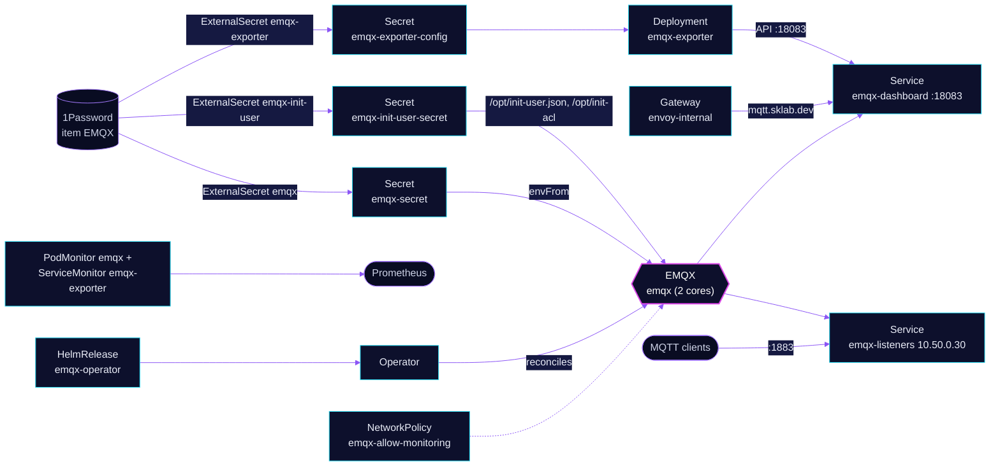

<!-- header: icon=radio-tower -->
<!-- concept: From a device message to every subscriber | cpu Device | plug Connect | shield-check Authorize | share-2 Route | users Subscribe -->
<p align="center"></p>

> The MQTT broker for home automation: a two-node EMQX cluster behind a fixed LoadBalancer address.

**Live facts:** <https://skrumbach.github.io/home-ops/apps/database/emqx/> (workloads, routes, storage, backups, secrets and alerts, generated on every merge)

## What it does

- **Runs the broker** as one `EMQX` object (`emqx`) with two core pods, managed by the EMQX operator.
- **Serves MQTT** on LoadBalancer Service `emqx-listeners` at `10.50.0.30`. Clients inside the cluster, such as
  `home-automation/zigbee2mqtt`, use `emqx-listeners.database.svc.cluster.local:1883`; `home-automation/esphome`
  uses the address `10.50.0.30`.
- **Serves the dashboard and API** at `https://mqtt.sklab.dev` on `envoy-internal`, backend Service `emqx-dashboard`
  port `18083`.
- **Authenticates every client.** A built-in password database plus an ACL file, with `no_match: "deny"`. Both
  users come from the 1Password item `EMQX`.
- **Exports metrics** two ways: the `emqx-exporter` Deployment (ServiceMonitor) and the broker's own
  `/api/v5/prometheus/stats` (PodMonitor `emqx`).
- **Keeps `/opt/emqx/data`** on a 5Gi `ceph-block` volume per core, so retained messages and runtime changes
  survive a restart.

## Why it is built this way

| Choice | Why |
|---|---|
| **Operator 2.2.x, not 2.3.x** | 2.3.x drops `apps.emqx.io/v2beta1` and 404s the Enterprise `load_rebalance` API against this OSS broker, so the readiness gate never sets (emqx/emqx-operator#1202). |
| **Required anti-affinity for the cores** | Two cores have no quorum. Both on one node would make a single drain a broker outage. |
| **`matchLabelKeys: apps.emqx.io/pod-template-hash`** | The operator rolls cores as a new StatefulSet beside the old one. Old-revision pods must not block the new ones. |
| **Memory request equals limit** | The Erlang VM is GC-heavy and an OOM kill is catastrophic for cluster gossip, so memory is locked at the limit. |
| **Exporter key made by hand** | The operator owns `api_key.bootstrap_file` and cannot be overridden from the `EMQX` object, so the exporter's API key is created in the dashboard. |
| **No exporter `/probe`** | The probe cannot send a username and password. `no_match: "deny"` rejects an anonymous connect, so the client-events panel stays empty. |

## How it works

<p align="center"></p>

<details>
<summary><b>Resource graph</b>: every object involved, by name</summary>



</details>

1. Flux applies three Kustomizations in order: `emqx-operator`, then `emqx-cluster` (also after `onepassword-store` and
   `rook-ceph-cluster`), then `emqx-exporter`. `emqx-cluster` is healthy when the `EMQX` condition `Available`
   is `True`.
2. The operator builds the cores. `emqx-secret` sets the dashboard default user. `emqx-init-user-secret` mounts
   `init-user.json` (a superuser and one MQTT user) and `init-acl` (`allow` that MQTT user on `#`).
3. A client connects to `10.50.0.30:1883` and authenticates against the built-in database. The ACL file grants the MQTT
   user everything; a request that no rule matches is denied.
4. NetworkPolicy `emqx-allow-monitoring` turns the pods default-deny and lists what stays open: gossip ports
   `4370`, `4369` and `5369` between cores, MQTT and WebSocket ports from anywhere, `18083` from any pod, and DNS
   replies from CoreDNS.
5. The exporter reads the dashboard API with the API key held in `emqx-exporter-config`.

## Settings that matter

| Setting | Value | Why |
|---|---|---|
| Chart `version` ([`operator/helmrelease.yaml`](operator/helmrelease.yaml)) | last 2.2.x | Pinned to the last 2.2.x; see the first row of the table above. |
| `coreTemplate.spec.replicas`, `minAvailable` | `2`, `1` | Two cores, one may be down during an operator-managed rolling restart. |
| `resources` ([`cluster/emqx.yaml`](cluster/emqx.yaml)) | request 250m CPU, 1Gi; limit 1000m, 1Gi | Memory locked at the limit (see above). |
| `volumeClaimTemplates` | `ceph-block`, `5Gi`, `ReadWriteOnce` | Keeps retained messages, runtime ACLs, dashboard-created rules and database additions across restarts. |
| `authorization.no_match` | `"deny"` | A client with no matching rule gets nothing. |
| `lbipam.cilium.io/ips` on `listenersServiceTemplate` | `10.50.0.30` | A fixed address for clients that cannot use cluster DNS. |
| `reloader.stakater.com/auto` | `"true"` on the cores and on `emqx-exporter` | Restart the pods when a Secret they use changes. |

## Operate it

```bash
flux -n database get ks emqx-operator emqx-cluster emqx-exporter
flux -n database get hr emqx-operator
kubectl -n database get emqx emqx
kubectl -n database get pods -l apps.emqx.io/instance=emqx -o wide
kubectl -n database get svc emqx-listeners emqx-dashboard
kubectl -n database logs deploy/emqx-exporter
# needs exec: cluster view and stopped nodes
kubectl -n database exec <core> -c emqx -- emqx ctl cluster status
```

To create the exporter key: dashboard, System, API Keys, name `exporter`, role Administrator. Store the key and
secret in 1Password item `EMQX` as `EMQX_EXPORTER_API_KEY` and `EMQX_EXPORTER_API_SECRET`. Then force-sync the
ExternalSecret `emqx-exporter` and roll `emqx-exporter`.

Both cores crashloop after a power loss:
[`emqx-power-loss.md`](../../../../.agents/skills/incident-runbooks/references/emqx-power-loss.md).

## Invariants

- Stay on operator 2.2.x. The chart tag is in `operator/helmrelease.yaml`. 2.3.x drops `apps.emqx.io/v2beta1` and
  404s the Enterprise `load_rebalance` API against this OSS broker.
- Both cores crashloop after a power loss: `.agents/skills/incident-runbooks/references/emqx-power-loss.md`.
- Do not remove `volumeClaimTemplates`.
- The exporter API key is created in the dashboard (name `exporter`, role Administrator) and stored as
  `EMQX_EXPORTER_API_KEY` / `EMQX_EXPORTER_API_SECRET` on the EMQX 1Password item. Force-sync the exporter
  ExternalSecret and roll `emqx-exporter`.
- The `/probe` path is omitted because `no_match: deny` rejects anonymous MQTT.
- There is no `gatus.io/enabled` ConfigMap here and no Gatus endpoint comes from one. The live check is the TCP
  endpoint `emqx` (group `database`) on `emqx-listeners.database.svc.cluster.local:1883` in
  [`monitoring/gatus/app/resources/config.yaml`](../../monitoring/gatus/app/resources/config.yaml).
- A NetworkPolicy ingress rule must admit DNS replies with no `toPorts`, as `emqx-allow-monitoring` does (see
  `AGENTS.md`).

Upstream: [EMQX docs](https://docs.emqx.com/en/emqx/latest/) •
[EMQX operator](https://github.com/emqx/emqx-operator)
