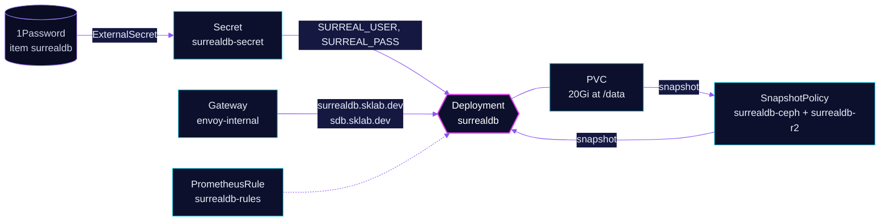

<!-- header: icon=database -->
<!-- concept: From a write to a backup | pencil Write | hard-drive Store | archive Snapshot -->
<p align="center"></p>

> A single-node SurrealDB on RocksDB, kept running empty on purpose and backed up by kopiur (crash-consistent snapshots, no export).

**Live facts:** <https://skrumbach.github.io/home-ops/apps/database/surrealdb/> (workloads, routes, storage, backups, secrets and alerts, generated on every merge)

## What it does

- **Runs one SurrealDB pod** with the RocksDB engine on a 20Gi `ReadWriteOnce` volume mounted at `/data`.
- **Serves HTTP and WebSocket** on Service `surrealdb:8000`, and at `surrealdb.sklab.dev` and `sdb.sklab.dev` through
  `envoy-internal`.
- **Requires a login.** `unauthenticated: false`; the root user and password come from the 1Password item
  `surrealdb`, through Secret `surrealdb-secret` (`SURREAL_USER`, `SURREAL_PASS`).
- **Is backed up by kopiur.** Two SnapshotPolicies (`surrealdb-ceph`, `surrealdb-r2`) snapshot the volume with no
  export hook.
- **Has no live consumer in this repository.** Its only client, `ai/open-notebook`, is retired. The owner keeps the
  server running empty for a future use.

## Why it is built this way

| Choice | Why |
|---|---|
| **RocksDB on one pod, not a cluster** | RocksDB allows one writer on the data dir lock, so `replicaCount` stays 1. Ceph RBD provides the durability that TiKV's Raft replication used to. |
| **`strategy: Recreate`** | The RWO volume must detach from the old pod before the new one mounts it. |
| **No rollback on a failed upgrade** | `remediation.strategy: uninstall`. The last good release points at TiKV, which is gone. |
| **Own backup Kustomization** | `surrealdb-kopiur` is separate because the parent uses `wait: true` and the standing Restore stays `Ready=False` until a rebuild. |

## How it works

<p align="center"></p>

<details>
<summary><b>Resource graph</b>: every object involved, by name</summary>



</details>

1. Flux applies Kustomization `surrealdb` after `external-secrets` and `onepassword-store`, with `wait: true` and a
   health check on the Deployment. The HelmRelease comes from HelmRepository `surrealdb`.
2. Kustomization `surrealdb-kopiur` (after `kopiur-repository` and `surrealdb`) applies the kopiur backup bundle with
   `APP=surrealdb`. It renders the two SnapshotPolicies and their schedules. The ceph schedule is the component
   default; the r2 schedule is `H 7 * * *`.
3. The PVC is chart-owned and has no kopiur populator. A lost volume starts empty and is hand-restored
   ([`restore.md`](../../../../.agents/skills/incident-runbooks/references/restore.md), section A, step 11).

## Settings that matter

Values are in [`app/helmrelease.yaml`](app/helmrelease.yaml) unless noted.

| Setting | Value | Why |
|---|---|---|
| `replicaCount` | `1` | RocksDB single writer lock. |
| `podSecurityContext.fsGroup` | `65532` | The image runs as UID 65532; `fsGroup` makes the root-owned Ceph mount writable. |
| `KOPIUR_PUID`, `KOPIUR_PGID` (overlay) | `65532` | The mover identity must match the file owner, or the backup fails closed. |
| `KOPIUR_SCHEDULE_R2` (overlay) | `H 7 * * *` | The namespace's r2 hour in the kopiur schedule table. |
| `surrealdb.extraArgs` | `--allow-all`, `--allow-funcs` | The manifest records no reason. |
| `resources` | request `100m` CPU, `512Mi`; limit `2Gi` memory, no CPU limit | The comment says to re-measure at `[14d:30s]` before trimming CPU, because coarser sampling under-reads the peak. |
| `topologySpreadConstraints` | `ScheduleAnyway`, `nodeTaintsPolicy: Honor` | `Honor` only filters `NoSchedule`/`NoExecute`. talos-3 is `PreferNoSchedule`, so the score penalty keeps the pod off it. |
| `persistence.storageClassName` | omitted | The comment says the chart renders it twice. |

## Operate it

```bash
flux -n database get ks surrealdb surrealdb-kopiur
flux -n database get hr surrealdb
kubectl -n database get pods -l app.kubernetes.io/name=surrealdb -o wide
kubectl -n database get pvc
kubectl -n database get snapshotpolicy,snapshotschedule,snapshot
```

### When an alert fires

| Alert | Fires when | First look |
|---|---|---|
| `SurrealDBPodDown` | a `surrealdb-*` pod is not Ready for 2m | `kubectl -n database describe pod -l app.kubernetes.io/name=surrealdb`. |
| `SurrealDBReplicasUnavailable` | the Deployment has no available replica for 5m | Same; a stuck RWO volume detach shows in the pod events. |
| `SurrealDBHighMemoryUsage` | working set above 80% of the memory limit for 5m | The pod's memory graph; the limit is `2Gi`. |
| `SurrealDBHighCPU` | CPU above 80% of the request for 10m | The request is `100m`; there is no CPU limit. |

## Invariants

- Keep `replicaCount: 1`. The alert `SurrealDBReplicasUnavailable` stays at `< 1`: do not raise it without changing
  the storage backend first.
- Keep `remediation.strategy: uninstall` on upgrade. Never roll back to the last release.
- Snapshots are crash-consistent, which is enough while the server holds no data. Add a `beforeSnapshot` export hook
  in [`backup/kustomization.yaml`](backup/kustomization.yaml) before storing anything that matters.
- The `route:` chart key does not work on this chart. A real HTTPRoute is its own manifest.

## Known gaps

- **A ServiceMonitor for a port with no metrics.** `serviceMonitor.enabled: true` in
  [`app/helmrelease.yaml`](app/helmrelease.yaml), while a comment in [`app/prometheusrule.yaml`](app/prometheusrule.yaml)
  says SurrealDB serves no `/metrics` on its only port, 8000.

Upstream: [SurrealDB docs](https://surrealdb.com/docs) •
[SurrealDB Helm chart](https://github.com/surrealdb/helm-charts)
