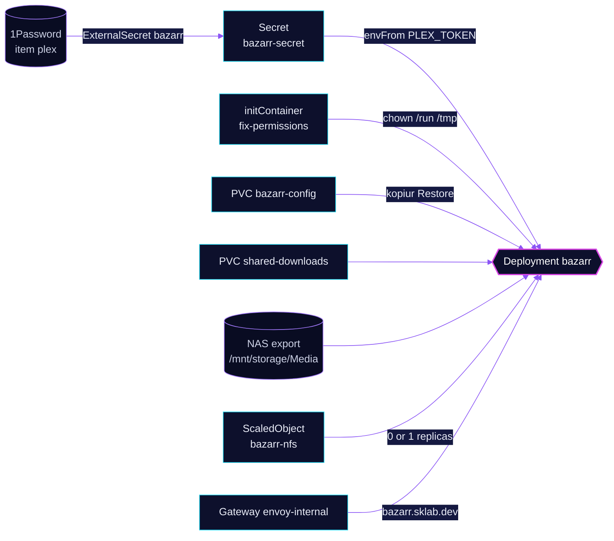

<!-- header: icon=captions -->
<!-- concept: From a library file to its subtitles | library-big Library | languages Providers | captions Subtitles | refresh-cw Sync -->
<p align="center"></p>

> The subtitle manager: it finds and stores subtitles for the media in the library.

**Live facts:** <https://skrumbach.github.io/home-ops/apps/downloads/bazarr/> (workloads, routes, storage, backups, secrets and alerts, generated on every merge)

## What it does

- **Fetches subtitles.** The Homepage annotation describes it as "Subtitles".
- **Reads the library** through the same mounts as the *arr apps: `shared-downloads` at `/data/downloads` and the
  NFS export `/mnt/storage/Media` on `nas.sklab.dev` at `/data/nas-media`.
- **Uses no PostgreSQL.** Its overlay has no `-db` Kustomization and its Secret holds no database settings. Its state
  is the `bazarr-config` claim, backed up by kopiur.
- **Serves the UI** at `bazarr.sklab.dev` on `envoy-internal` only.
- **Gets a Plex token** as `PLEX_TOKEN` in Secret `bazarr-secret`, from 1Password item `plex`.

## Why it is built this way

| Choice | Why |
|---|---|
| **`linuxserver/bazarr`, not `home-operations/bazarr`** | The manifest comment: the linuxserver image runs upstream Bazarr on Alpine's Python 3.12, under Bazarr's 3.13 ceiling. The `home-operations` build uses Python 3.14, which upstream does not support and which hangs before binding its HTTP port. |
| **A root init container, then a non-root app** | The manifest comment: emptyDir volumes are root-owned, and the s6-overlay preinit refuses to start unless `/run` belongs to the uid it runs as. `fix-permissions` runs `chown -R 2000:2000 /run /tmp`. |
| **`LSIO_NON_ROOT_USER` and `LSIO_READ_ONLY_FS`** | The manifest comment: the pod already runs as the target uid on a read-only root, so the init system skips its root-only `usermod` and `chown` steps, which would fail anyway. |
| **KEDA owns the replica count** | `replicas: null` keeps Helm off the Deployment. The `keda/nfs-scaler` component scales it to 0 while the NAS NFS export is unreachable. |

## How it works

<p align="center"></p>

<details>
<summary><b>Resource graph</b>: every object involved, by name</summary>



</details>

1. Flux applies Kustomization `bazarr` after `downloads-pvc`, `onepassword-store`, `kopiur-repository` and `keda`.
   The `kopiur/pvc` component owns PVC `bazarr-config`. The HelmRelease waits for `rook-ceph-cluster`.
2. ExternalSecret `bazarr` copies `PLEX_TOKEN` from 1Password item `plex` into Secret `bazarr-secret`. The manifest
   comment: it is the same item and key as `media/plex-exporter`, and `SecretSynced` does not mean the value is
   non-empty, so check its decoded length.
3. `fix-permissions` runs as root and chowns the `run` and `tmp` emptyDirs. The app then starts as uid and gid `2000`
   with supplemental group `65542`.
4. The startup probe polls `GET /health :6767` for up to 90 failures at 10s. The manifest comment: the first boot runs
   a single-threaded SQLite migration (Alembic) that can take minutes, and the startup probe holds liveness and
   readiness back until it passes.

## Settings that matter

All values are in [`app/helmrelease.yaml`](app/helmrelease.yaml) unless noted.

| Setting | Value | Why |
|---|---|---|
| `supplementalGroups` | `65542` | The manifest comment names it `gladius:external-services`. The manifest records no more. |
| Startup probe | `/health :6767`, `initialDelaySeconds: 10`, `failureThreshold: 90` | Covers the one-time migration (see step 4). |
| `resources` | request 15m CPU, 256Mi; limit 512Mi memory | The manifest records no reason. |
| Gatus endpoint | `https://bazarr.sklab.dev/api/system/ping` | The manifest records no reason. |
| `KOPIUR_SCHEDULE_R2` (overlay) | `H 11 * * *` | Offsite copy daily in hour 11. The manifest records no reason. |

## Operate it

```bash
flux -n downloads get ks bazarr
flux -n downloads get hr bazarr
kubectl -n downloads get pods -l app.kubernetes.io/name=bazarr -o wide
kubectl -n downloads get scaledobject bazarr-nfs
kubectl -n downloads get snapshotpolicy,restore,pvc | grep bazarr
kubectl -n downloads logs deploy/bazarr -c fix-permissions
```

Restores: [`restore.md`](../../../../../.agents/skills/incident-runbooks/references/restore.md).

Upstream: [Bazarr docs](https://wiki.bazarr.media/)
