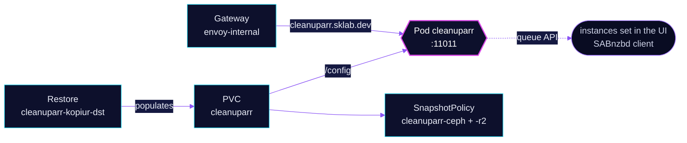

<!-- header: icon=trash-2 -->
<!-- concept: From a stalled download to a clean queue | list-checks Watch | timer-off Detect | trash-2 Remove | refresh-cw Retry -->
<p align="center"></p>

> Clears stalled downloads from the queues it is pointed at; its instances and rules live in its own database.

**Live facts:** <https://skrumbach.github.io/home-ops/apps/downloads/cleanuparr/> (workloads, routes, storage, backups, secrets and alerts, generated on every merge)

## What it does

- **Serves the UI and API** at `cleanuparr.sklab.dev` on `envoy-internal` only, on port 11011.
- **Keeps its settings in its own database** on PVC `cleanuparr` at `/config`: instances, the SABnzbd client
  and the queue rules are set in the UI or REST API, not in Git.
- **Backs that database up** with the `kopiur` component: `ceph` and offsite `r2` policies, and a restore from
  the newest ceph snapshot when the claim is recreated.
- **Reports health** at `/health`. Gatus checks that it answers 200 with the body `healthy`.

## Why it is built this way

| Choice | Why |
|---|---|
| **Rules in the app, not in a ConfigMap** | The manifest sets only `PORT`. Cleanuparr stores instances and rules in its database, so the PVC and its backup are the source of truth. |
| **`strategy: Recreate`** | One replica with an RWO config claim: a rolling update would deadlock on Multi-Attach. |
| **`kopiur/pvc` owns the claim** | A recreated claim is filled from the newest snapshot instead of starting with no rules. |

## How it works

<p align="center"></p>

<details>
<summary><b>Resource graph</b>: every object involved, by name</summary>



</details>

1. Flux applies Kustomization `cleanuparr` after `kopiur-repository`. The HelmRelease waits for `rook-ceph-cluster`.
2. The `kopiur` components add the two SnapshotPolicies, the standing Restore and the claim `cleanuparr` (1Gi,
   the claim is named after the app because `KOPIUR_CLAIM` is not set).
3. The pod runs as uid and gid `2000` with a read-only root filesystem. `/config` is the PVC and `/tmp` is an emptyDir.
4. Cleanuparr polls the instances you configured in its UI and applies the queue rules stored in its database.
   Which instances and rules exist is app state, not visible in Git.

## Settings that matter

All values are in [`app/helmrelease.yaml`](app/helmrelease.yaml) unless noted.

| Setting | Value | Why |
|---|---|---|
| `strategy` | `Recreate` | Avoids the Multi-Attach deadlock of an RWO claim (see above). |
| `runAsUser`, `runAsGroup`, `fsGroup` | `2000` | Matches `KOPIUR_PUID` and `KOPIUR_PGID` in the overlay; a mismatch fails the backup closed. |
| `resources` | requests 15m CPU, 256Mi; limit 512Mi | Every limit has a request. The manifest records no reason for the sizes. |
| `KOPIUR_SCHEDULE_R2` (overlay) | `H 11 * * *` | Offsite copy daily in hour 11. The manifest records no reason. |

## Operate it

```bash
flux -n downloads get ks cleanuparr
flux -n downloads get hr cleanuparr
kubectl -n downloads get pods -l app.kubernetes.io/name=cleanuparr -o wide
kubectl -n downloads get snapshotpolicy,restore,pvc | grep cleanuparr
```

Restores: [`restore.md`](../../../../../.agents/skills/incident-runbooks/references/restore.md).

Upstream: [Cleanuparr](https://github.com/Cleanuparr/Cleanuparr)
