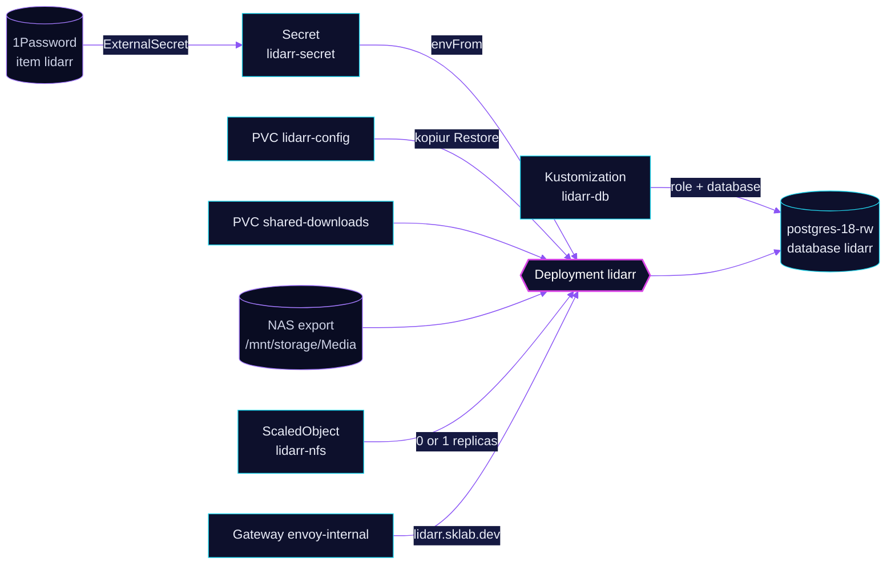

<!-- header: icon=disc-3 -->
<!-- concept: From a wanted album to a file on the NAS | search Wanted | send Hand off | hard-drive-download Download | folder-input Import | music Library -->
<p align="center"></p>

> The music manager: it tracks artists and albums, hands releases to the download client and imports the files.

**Live facts:** <https://skrumbach.github.io/home-ops/apps/downloads/lidarr/> (workloads, routes, storage, backups, secrets and alerts, generated on every merge)

## What it does

- **Manages music.** The Homepage annotation describes it as "Music".
- **Imports into the library** on the NAS: `shared-downloads` at `/data/downloads` and the NFS export
  `/mnt/storage/Media` on `nas.sklab.dev` at `/data/nas-media`. An init container creates `/data/nas-media/Music`.
- **Keeps its data in PostgreSQL:** role and database `lidarr` on `postgres-18-rw` in `database`, created by
  Kustomization `lidarr-db`.
- **Serves the UI** at `lidarr.sklab.dev` on `envoy-internal` only.
- **Answers other apps** on Service `lidarr:8080`: `queue-watchdog` and the `ai/toolhive` MCP server `arr-mcp`.

## Why it is built this way

| Choice | Why |
|---|---|
| **Database on the shared CNPG cluster** | `lidarr-db` creates a role and database on `postgres-18`. Its overlay comment: retain, so removing it never drops data. |
| **KEDA owns the replica count** | `replicas: null` keeps Helm off the Deployment. The `keda/nfs-scaler` component scales it to 0 while the NAS NFS export is unreachable, when pods that mount it hang. |
| **Image `brunnels/lidarr-develop`** | The manifest records no reason. |

## How it works

<p align="center"></p>

<details>
<summary><b>Resource graph</b>: every object involved, by name</summary>



</details>

1. Flux applies Kustomization `lidarr` after `keda`, `lidarr-db`, `downloads-pvc`, `onepassword-store` and
   `kopiur-repository`. The `kopiur/pvc` component owns PVC `lidarr-config` (`8Gi`), so a recreated claim is filled
   from the newest backup.
2. ExternalSecret `lidarr` reads 1Password item `lidarr` and builds Secret `lidarr-secret`: the `LIDARR__POSTGRES__*`
   settings and `LIDARR__AUTH__APIKEY`.
3. Init container `init-dirs` (alpine) runs `mkdir -p /data/nas-media/Music`, then the app starts. Both run as uid and
   gid `2000`, the kopiur mover identity.
4. Artists, indexers and the download client live in the Lidarr database and UI. Git does not hold them.

## Settings that matter

All values are in [`app/helmrelease.yaml`](app/helmrelease.yaml) unless noted.

| Setting | Value | Why |
|---|---|---|
| `LIDARR__SERVER__PORT` | `8080` | The manifest records no reason. Every client uses `lidarr.downloads.svc.cluster.local:8080`. |
| `resources` | request 100m CPU, 384Mi; limit 2Gi memory | The manifest records no reason. |
| Liveness and readiness | `GET /ping :8080`, 3s timeout, 5 failures | The manifest records no reason. |
| `KOPIUR_CAPACITY` (overlay) | `8Gi` | The manifest records no reason. |
| `LIDARR__AUTH__METHOD`, `LIDARR__AUTH__REQUIRED` | `External`, `DisabledForLocalAddresses` | The manifest records no reason. |

## Operate it

```bash
flux -n downloads get ks lidarr lidarr-db
flux -n downloads get hr lidarr
kubectl -n downloads get pods -l app.kubernetes.io/name=lidarr -o wide
kubectl -n downloads logs deploy/lidarr -c init-dirs
kubectl -n downloads get scaledobject lidarr-nfs
kubectl -n downloads get snapshotpolicy,restore,pvc | grep lidarr
```

Restores: [`restore.md`](../../../../../.agents/skills/incident-runbooks/references/restore.md).

Upstream: [Lidarr docs](https://wiki.servarr.com/lidarr)
