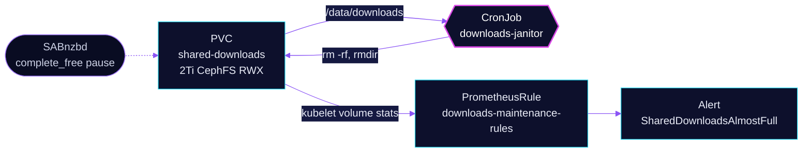

<!-- header: icon=wrench -->
<!-- concept: From dead unpack dirs to free space on the shared volume | calendar-clock Schedule | folder-search Find | trash-2 Delete | gauge Watch -->
<p align="center"></p>

> A daily janitor that deletes dead unpack leftovers on the shared downloads volume, plus an alert when it fills.

**Live facts:** <https://skrumbach.github.io/home-ops/apps/downloads/maintenance/> (workloads, routes, storage, backups, secrets and alerts, generated on every merge)

## What it does

- **Cleans dead attempts** with CronJob `downloads-janitor` at `30 5 * * *`. It removes `_UNPACK_*` and `_FAILED_*`
  directories at depth 2 under `usenet/complete` that have been untouched for more than 24 hours.
- **Prunes empty directories** at the same depth that are older than 7 days.
- **Warns before SABnzbd freezes** with PrometheusRule `downloads-maintenance-rules`: `SharedDownloadsAlmostFull`
  fires as a warning below 15% free and as critical below 7% free on `shared-downloads`.

## Why it is built this way

| Choice | Why |
|---|---|
| **A janitor at all** | SABnzbd retries unpacks as the disk fills and never garbage-collects the failed attempts. The orphans fill the claim until `complete_free` auto-pauses SABnzbd. |
| **Depth 2 under `usenet/complete` only** | It never touches non-empty regular directories (the arrs clean those after import), never the `complete/` root and never `usenet/incomplete`, the live assembly area. |
| **24 hours for `_UNPACK_`/`_FAILED_`** | A live unpack keeps its mtime fresh, so anything a day old is a dead attempt SABnzbd will not reuse. |
| **Thresholds of 15% and 7%** | SABnzbd pauses at 100G free, about 5% of 2 Ti. Both alerts fire before that. |

## How it works

<p align="center"></p>

<details>
<summary><b>Resource graph</b>: every object involved, by name</summary>



</details>

1. Flux applies Kustomization `downloads-maintenance` after `downloads-pvc`, so the claim exists first.
2. Each day the Job starts an `alpine` container as uid `2000` with a read-only root filesystem and the claim mounted at
   `/data/downloads`.
3. A shell script runs two `find` passes with `-mindepth 2 -maxdepth 2` under `/data/downloads/usenet/complete`. The first
   uses `-mmin +1440` and `rm -rf`, the second `-empty -mtime +7` and `rmdir`. It prints each path, then `df -h`.
4. The rules compare `kubelet_volume_stats_available_bytes` with the capacity for `shared-downloads`.

## Settings that matter

All values are in [`app/cronjob.yaml`](app/cronjob.yaml) unless noted.

| Setting | Value | Why |
|---|---|---|
| `schedule` | `30 5 * * *` | The manifest records no reason. |
| `concurrencyPolicy` | `Forbid` | One run at a time. |
| `activeDeadlineSeconds` | `3600` | The manifest records no reason. |

## Operate it

```bash
flux -n downloads get ks downloads-maintenance
kubectl -n downloads get cronjob downloads-janitor
kubectl -n downloads get jobs | grep downloads-janitor
kubectl -n downloads logs job/<job-name>          # deleted paths and df output
kubectl -n downloads get prometheusrule downloads-maintenance-rules
```

### When an alert fires

| Alert | Fires when | First look |
|---|---|---|
| `SharedDownloadsAlmostFull` (warning) | under 15% free for 30m | Look for `_UNPACK_`/`_FAILED_` orphans and side-channel dumps. |
| `SharedDownloadsAlmostFull` (critical) | under 7% free for 15m | Delete orphaned directories under `usenet/complete` from the radarr pod, since SABnzbd's pod cannot see old CephFS data under its RBD mount. Delete a few hundred GiB at a time and watch `ceph status`: sustained `rm -rf` wedges the OSDs. |

## Invariants

- The janitor never touches non-empty regular directories, the `complete/` root, or `usenet/incomplete`.

Upstream: [SABnzbd configuration](https://sabnzbd.org/wiki/configuration/)
