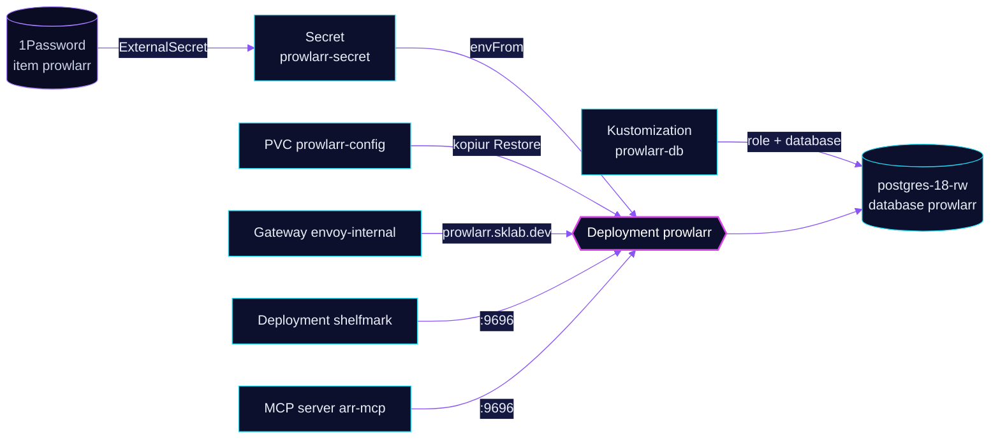

<!-- header: icon=radar -->
<!-- concept: From an indexer to the apps that search it | database Indexers | list-checks Catalogue | search Query | share-2 Serve -->
<p align="center"></p>

> The indexer manager: one place that holds the search indexers for the downloads apps.

**Live facts:** <https://skrumbach.github.io/home-ops/apps/downloads/prowlarr/> (workloads, routes, storage, backups, secrets and alerts, generated on every merge)

## What it does

- **Holds the indexers.** The Homepage annotation describes it as "Indexer manager". Which indexers exist, and which
  apps they sync to, lives in its database and UI, not in Git.
- **Keeps its data in PostgreSQL:** role and database `prowlarr` on `postgres-18-rw` in `database`, created by
  Kustomization `prowlarr-db`.
- **Serves the UI** at `prowlarr.sklab.dev` on `envoy-internal` only.
- **Answers other apps** on Service `prowlarr:9696`: `shelfmark` and the `ai/toolhive` MCP server `arr-mcp`.
- **Touches no media.** It mounts no `shared-downloads` and no NAS export, only its config claim and a `/tmp` emptyDir.

## Why it is built this way

| Choice | Why |
|---|---|
| **No KEDA scaler** | Prowlarr mounts no NFS export, so the overlay does not include `keda/nfs-scaler` and the controller keeps its default replica count. |
| **Its own pod and mover identity** | uid `3002`, gid `3000` in both the pod and `KOPIUR_PUID`, `KOPIUR_PGID`. The manifest records no reason. |
| **`/tmp` emptyDir** | The manifest comment: v3 writes its data-protection key ring under `/tmp`, and the root filesystem is read-only. |

## How it works

<p align="center"></p>

<details>
<summary><b>Resource graph</b>: every object involved, by name</summary>



</details>

1. Flux applies Kustomization `prowlarr` after `prowlarr-db`, `onepassword-store` and `kopiur-repository`. It does not
   wait for `downloads-pvc` or `keda`. The `kopiur/pvc` component owns PVC `prowlarr-config`. The HelmRelease waits
   for `rook-ceph-cluster`.
2. ExternalSecret `prowlarr` reads 1Password item `prowlarr` and builds Secret `prowlarr-secret`: the
   `PROWLARR__POSTGRES__*` settings and `PROWLARR__AUTH__APIKEY`.
3. The app listens on `9696`. Clients reach it through Service `prowlarr` in `downloads`.

## Settings that matter

All values are in [`app/helmrelease.yaml`](app/helmrelease.yaml) unless noted.

| Setting | Value | Why |
|---|---|---|
| `PROWLARR__AUTH__METHOD` | `External`, with no `PROWLARR__AUTH__REQUIRED` | The manifest records no reason. |
| `resources` | request 18m CPU, 128Mi; limit 512Mi memory | The manifest records no reason. |
| Probes | `GET /ping :9696`, startup allows 30 failures at 5s | The manifest records no reason. |
| `KOPIUR_SCHEDULE_R2` (overlay) | `H 11 * * *` | Offsite copy daily in hour 11. The manifest records no reason. |

## Operate it

```bash
flux -n downloads get ks prowlarr prowlarr-db
flux -n downloads get hr prowlarr
kubectl -n downloads get pods -l app.kubernetes.io/name=prowlarr -o wide
kubectl -n downloads get snapshotpolicy,restore,pvc | grep prowlarr
kubectl -n database get database,databaserole prowlarr
```

Restores: [`restore.md`](../../../../../.agents/skills/incident-runbooks/references/restore.md).

Upstream: [Prowlarr docs](https://wiki.servarr.com/prowlarr)
