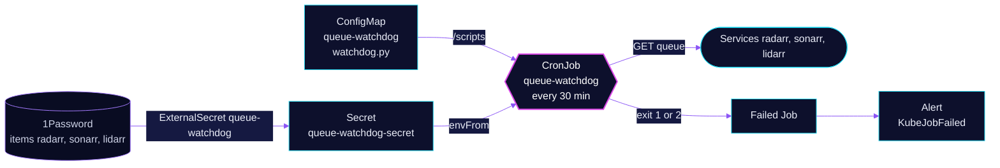

<!-- header: icon=bell-ring -->
<!-- concept: From a stuck queue item to a failed Job | clock Poll | list Queues | hourglass Age | siren Alert -->
<p align="center"></p>

> Fails a Job every 30 minutes when any Radarr, Sonarr or Lidarr queue item is older than 24 hours.

**Live facts:** <https://skrumbach.github.io/home-ops/apps/downloads/queue-watchdog/> (workloads, routes, storage, backups, secrets and alerts, generated on every merge)

## What it does

- **Reads three queues** over the in-cluster Services of Radarr (`:7878`, API `v3`), Sonarr (`:8989`, `v3`) and
  Lidarr (`:8080`, `v1`), one page of up to 1000 records each.
- **Fails on a stale item.** An item whose `added` time is more than 24 hours old makes the script exit `1`.
- **Fails on an unreadable queue.** A request error, a bad payload, or a queue larger than one page exits `2`, so a
  broken check is never reported as healthy.
- **Raises the existing alert.** A failed Job feeds `KubeJobFailed`. There is no route, no Service and no storage.

## Why it is built this way

| Choice | Why |
|---|---|
| **A failed Job, not its own alert** | The existing `KubeJobFailed` rule already pages on it, so no rule lives in this app. |
| **Exit `2` for errors** | An unreadable queue must not look like a clean one. The script prints only counts, item ids and the exception type, because error text may hold the API key. |
| **Stdlib Python from a ConfigMap** | The script uses only the standard library and runs on a stock `python` image, so there is no image to build. |
| **`activeDeadlineSeconds: 600`** | A pod that never starts (a missing Secret) would block every later run under `Forbid`. The deadline turns it into a failed Job. |

## How it works

<p align="center"></p>

<details>
<summary><b>Resource graph</b>: every object involved, by name</summary>



</details>

1. Flux applies Kustomization `queue-watchdog` after `onepassword-store`. A configMapGenerator builds ConfigMap
   `queue-watchdog` from `app/resources/watchdog.py`.
2. Every 30 minutes the container runs `python3 /scripts/watchdog.py` with the three base URLs from `env` and the
   three API keys from the Secret.
3. For each service the script requests `/api/<version>/queue?page=1&pageSize=1000` with an `X-Api-Key` header
   (30 s timeout) and prints `<name>: <n> queued, <m> stale [ids]`.
4. The exit code is the highest of the three results. The Job fails on `1` or `2` and `backoffLimit: 0` means no retry.

## Settings that matter

| Setting | Value | Why |
|---|---|---|
| `schedule` | `*/30 * * * *` | The manifest records no reason. |
| `concurrencyPolicy` | `Forbid` | One run at a time. |
| `successfulJobsHistory` | `1` | With none retained, the last failed Job is the only one left and `KubeJobFailed` latches on it. |
| `ttlSecondsAfterFinished` | `86400` | Backstop so a failed Job ages out instead of pinning `KubeJobFailed`. |
| `STALE_AFTER` in the script | 24 hours | The threshold. It is in [`watchdog.py`](app/resources/watchdog.py), not in a manifest value. |

Payload under `app/resources/` changes the ConfigMap name, so Helm updates the CronJob on every edit.

## Operate it

```bash
flux -n downloads get ks queue-watchdog
kubectl -n downloads get cronjob queue-watchdog
kubectl -n downloads get jobs | grep queue-watchdog
kubectl -n downloads logs job/<job-name>          # lines per service, with stale item ids
```

### When an alert fires

| Alert | Fires when | First look |
|---|---|---|
| `KubeJobFailed` | a watchdog Job failed in the last 12 h | The log names the service. `N stale [ids]` means those queue ids are stuck: open them in the arr's queue. `queue unreadable` means the arr is down or the key is wrong. |

Upstream: [Radarr API](https://radarr.video/docs/api/) • [Sonarr API](https://sonarr.tv/docs/api/)
