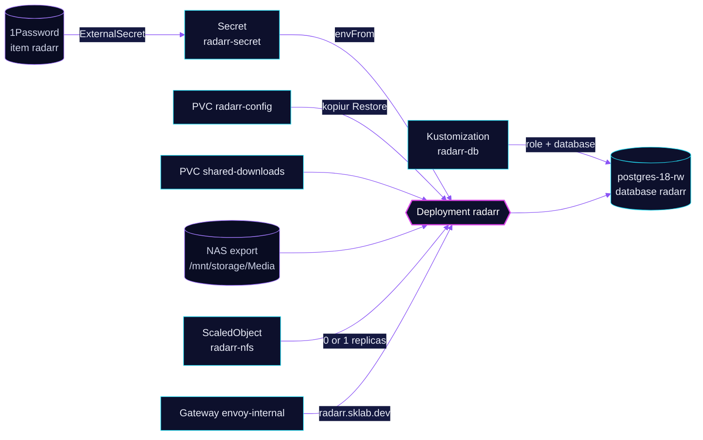

<!-- header: icon=clapperboard -->
<!-- concept: From a wanted film to a file on the NAS | search Wanted | send Hand off | hard-drive-download Download | folder-input Import | clapperboard Library -->
<p align="center"></p>

> The film manager: it tracks movies, hands releases to the download client and imports finished files.

**Live facts:** <https://skrumbach.github.io/home-ops/apps/downloads/radarr/> (workloads, routes, storage, backups, secrets and alerts, generated on every merge)

## What it does

- **Manages films.** The Homepage annotation describes it as "Movies".
- **Imports into the library** on the NAS: `shared-downloads` at `/data/downloads` and the NFS export
  `/mnt/storage/Media` on `nas.sklab.dev` at `/data/nas-media`.
- **Keeps its data in PostgreSQL:** role and database `radarr` on `postgres-18-rw` in `database`, created by
  Kustomization `radarr-db`.
- **Serves the UI** at `radarr.sklab.dev` on `envoy-internal` only.
- **Answers other apps** on Service `radarr:7878`: `recyclarr`, `queue-watchdog`, the `ai/toolhive` MCP server `arr-mcp`
  and a Gatus check of `/api/v3/queue/status` (`monitoring/gatus`, `app/resources/config.yaml`).

## Why it is built this way

| Choice | Why |
|---|---|
| **Database on the shared CNPG cluster** | `radarr-db` creates a role and database on `postgres-18`. Its overlay comment: retain, so removing it never drops data. |
| **KEDA owns the replica count** | `replicas: null` keeps Helm off the Deployment. The `keda/nfs-scaler` component scales it to 0 while the NAS NFS export is unreachable and back to 1 when it returns. |
| **No node rule against talos-3** | The manifest comment: talos-3 carries a `PreferNoSchedule` taint, and with no toleration the score gap keeps the pod off it. A per-app deny-list would fail open for any app that forgets it. |

## How it works

<p align="center"></p>

<details>
<summary><b>Resource graph</b>: every object involved, by name</summary>



</details>

1. Flux applies Kustomization `radarr` after `radarr-db`, `downloads-pvc`, `onepassword-store`, `kopiur-repository`
   and `keda`. The `kopiur/pvc` component owns PVC `radarr-config`, so a recreated claim is filled from the newest
   backup. The HelmRelease waits for `rook-ceph-cluster`.
2. ExternalSecret `radarr` reads 1Password item `radarr` and builds Secret `radarr-secret`: the `RADARR__POSTGRES__*`
   settings and `RADARR__AUTH__APIKEY`.
3. The pod runs as uid and gid `2000`, the same as the kopiur mover (`KOPIUR_PUID`, `KOPIUR_PGID`).
4. Indexers, the download client and the film list live in the Radarr database and UI. Git does not hold them.

## Settings that matter

All values are in [`app/helmrelease.yaml`](app/helmrelease.yaml) unless noted.

| Setting | Value | Why |
|---|---|---|
| `spec.timeout` | `10m` | The manifest records no reason. |
| `resources` | request 100m CPU, 384Mi; limit 4Gi memory | The manifest records no reason. |
| Liveness and readiness | `GET /ping :7878`, 5s timeout, 5 failures | The manifest records no reason. |
| `KOPIUR_CACHE_CAPACITY` (overlay) | `10Gi` | The manifest records no reason. |
| `RADARR__AUTH__METHOD`, `RADARR__AUTH__REQUIRED` | `External`, `DisabledForLocalAddresses` | The manifest records no reason. |
| `KOPIUR_SCHEDULE_R2` (overlay) | `H 11 * * *` | Offsite copy daily in hour 11. The manifest records no reason. |

## Operate it

```bash
flux -n downloads get ks radarr radarr-db
flux -n downloads get hr radarr
kubectl -n downloads get pods -l app.kubernetes.io/name=radarr -o wide
kubectl -n downloads get scaledobject radarr-nfs
kubectl -n downloads get snapshotpolicy,restore,pvc | grep radarr
kubectl -n database get database,databaserole radarr
```

### When an alert fires

| Alert | Fires when | First look |
|---|---|---|
| `RadarrImportQueueBlocked` | the Gatus check "Radarr Import Queue" fails for 30 min | An item is stuck in the queue. In Radarr, open Activity > Queue and import it by hand. |
| `NASNFSExportDown` | the NAS export refuses TCP from the cluster for 5 min | Pods that mount it hang. KEDA scales this one to 0 until the export returns. Rule in `monitoring/blackbox-exporter`. |

Restores: [`restore.md`](../../../../../.agents/skills/incident-runbooks/references/restore.md).

Upstream: [Radarr docs](https://wiki.servarr.com/radarr)
