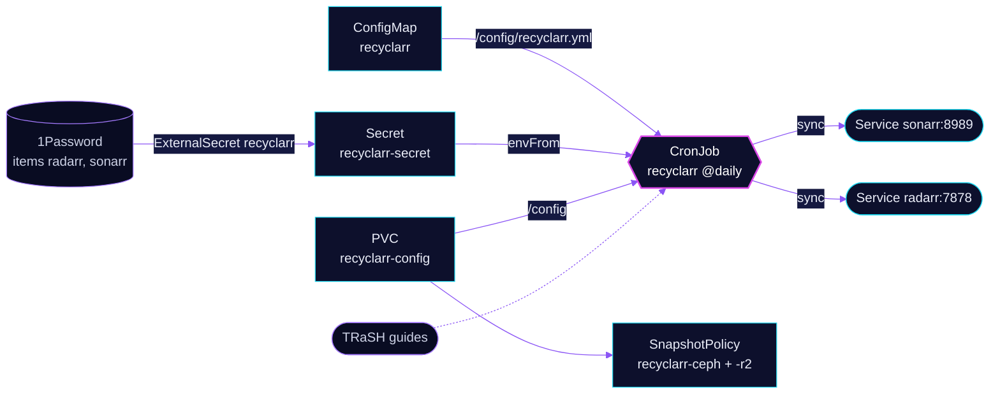

<!-- header: icon=recycle -->
<!-- concept: From a TRaSH guide to a tuned Radarr and Sonarr | book-open Guide | git-compare Compare | sliders-horizontal Score | send Push -->
<p align="center"></p>

> Syncs TRaSH quality profiles and custom formats into Sonarr and Radarr once a day.

**Live facts:** <https://skrumbach.github.io/home-ops/apps/downloads/recyclarr/> (workloads, routes, storage, backups, secrets and alerts, generated on every merge)

## What it does

- **Syncs daily** with a CronJob (`@daily`) that runs `recyclarr sync` and exits. There is no route and no Service.
- **Configures Sonarr** (`sonarr_main`): quality definition `series`, profiles WEB-1080p and WEB-2160p, and
  custom formats for unwanted groups, repacks and streaming services.
- **Configures Radarr** (`radarr_main`): quality definition `sqp-streaming`, four profiles (two SQP-1, two catalogue
  profiles) and the language policy below.
- **Reads the API keys** from Secret `recyclarr-secret` (1Password items `radarr` and `sonarr`).
- **Mounts** PVC `recyclarr-config` at `/config`, backed up by kopiur.

## Why it is built this way

| Choice | Why |
|---|---|
| **Config in Git, state in the arrs** | `app/resources/recyclarr.yml` is the one source for profiles and scores. `delete_old_custom_formats: true` and `reset_unmatched_scores` make a sync remove hand edits. |
| **English audio is required** | The manifest comment records an owner decision of 2026-10-18: a release without English audio scores -35000 on every Radarr profile, so a German dual-audio release still passes. German DL adds +100. |
| **MULTi gets a small penalty (-25)** | Its title format is more likely to defeat Radarr's import parser and strand the queue. The score stays well under `min_format_score`, so a MULTi release is still grabbed when it is the only match. |
| **A catalogue tier on two extra profiles** | `HD Bluray + WEB` and `UHD Bluray + WEB` take titles no TRaSH tier group released, so SQP-1 (min score 1000) stays pure for new releases. |
| **`concurrencyPolicy: Forbid`, `backoffLimit: 0`** | A failed sync is not retried the same day; the next daily run tries again. |

## How it works

<p align="center"></p>

<details>
<summary><b>Resource graph</b>: every object involved, by name</summary>



</details>

1. Flux applies Kustomization `recyclarr` after `onepassword-store` and `kopiur-repository`. The HelmRelease waits for `rook-ceph-cluster`.
2. A configMapGenerator turns `app/resources/recyclarr.yml` into ConfigMap `recyclarr` and rewrites the name in the
   HelmRelease. A change to the file therefore changes the ConfigMap name, so Helm updates the CronJob.
3. Each run mounts the file read-only at `/config/recyclarr.yml`, resolves `!env_var` keys from the Secret, and pushes
   profiles and formats to `sonarr.downloads.svc.cluster.local:8989` and `radarr.downloads.svc.cluster.local:7878`.
4. The pod runs as uid `2000` with a read-only root filesystem; `/config` is the PVC.

## Settings that matter

| Setting | Value | Why |
|---|---|---|
| `cronjob.schedule` | `@daily` | One sync a day. The manifest records no reason for the hour. |
| `ttlSecondsAfterFinished` | `86400` | Backstop so a failed Job ages out instead of pinning `KubeJobFailed`. |
| `successfulJobsHistory` | `1` | With none retained, the last failed Job is the only one left and `KubeJobFailed` latches on it. |
| `resources` | requests 5m CPU, 36M; limit 128M | The manifest records no reason. |

## Operate it

```bash
flux -n downloads get ks recyclarr
kubectl -n downloads get cronjob recyclarr
kubectl -n downloads get jobs | grep recyclarr
kubectl -n downloads logs job/<job-name>          # logs of the last sync
kubectl -n downloads get snapshotpolicy,restore,pvc | grep recyclarr
```

### When an alert fires

| Alert | Fires when | First look |
|---|---|---|
| `KubeJobFailed` | a sync Job failed in the last 12 h | Read the Job's log. An API key mismatch or an unreachable arr is the usual cause. |

Upstream: [Recyclarr docs](https://recyclarr.dev/) • [TRaSH guides](https://trash-guides.info/)
