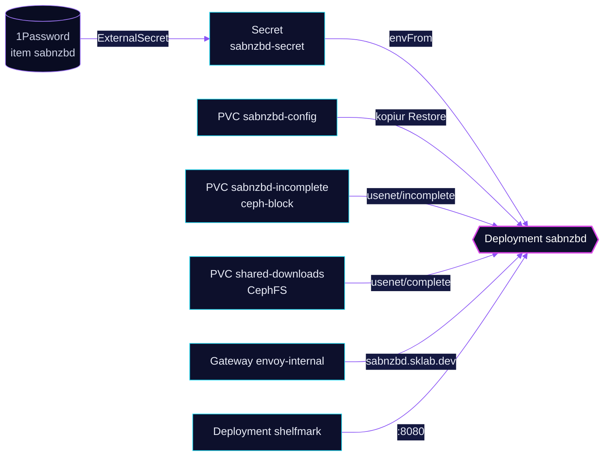

<!-- header: icon=download -->
<!-- concept: From a request to a finished download | inbox Request | package-open Assemble | wrench Repair | folder-check Complete -->
<p align="center"></p>

> The Usenet download client: it fetches what the *arr apps request and drops finished files in `complete`.

**Live facts:** <https://skrumbach.github.io/home-ops/apps/downloads/sabnzbd/> (workloads, routes, storage, backups, secrets and alerts, generated on every merge)

## What it does

- **Downloads from Usenet.** The Homepage annotation describes it as "Usenet downloader". `shelfmark` names it as
  its Usenet client.
- **Sorts finished files** into `/data/downloads/usenet/complete/<category>`, with one directory per category:
  `movies`, `tv`, `music`, `books`, `audiobooks`, `comics`, `magazines`, `other`. Container `init-dirs` creates them.
- **Assembles on block storage.** Scratch lives on PVC `sabnzbd-incomplete`, not on the shared CephFS claim.
- **Serves the UI and API** at `sabnzbd.sklab.dev` on `envoy-internal` only, and on Service `sabnzbd:8080` in-cluster.
- **Has no database and no NAS mount.** State is the `sabnzbd-config` claim. Its Secret holds the API and NZB keys.

## Why it is built this way

| Choice | Why |
|---|---|
| **`incomplete` on `ceph-block`, `complete` on CephFS** | The manifest comment ([`pvc-sabnzbd-incomplete.yaml`](../pvc/app/pvc-sabnzbd-incomplete.yaml)): article assembly writes thousands of tiny `SABnzbd_article_*` files that storm the CephFS MDS metadata journal and can stall the whole filesystem. Block keeps that inside the RBD. `complete` stays on `shared-downloads` so the *arr hardlink and atomic import flow is unchanged. |
| **`strategy: Recreate`** | The manifest comment: one replica with RWO claims, and a rolling update deadlocks because the new pod cannot attach a volume the old pod still holds. |
| **Relaxed probes** | The manifest comment: the API blocks during par2 verify and unrar, and a 1s timeout once killed a busy, healthy process and caused gateway 503s. |
| **No KEDA scaler** | It mounts no NFS export, so the overlay does not include `keda/nfs-scaler`. |

## How it works

<p align="center"></p>

<details>
<summary><b>Resource graph</b>: every object involved, by name</summary>



</details>

1. Flux applies Kustomization `sabnzbd` after `downloads-pvc`, `onepassword-store` and `kopiur-repository`. The
   `kopiur/pvc` component owns PVC `sabnzbd-config`. The HelmRelease waits for `rook-ceph-cluster`.
2. ExternalSecret `sabnzbd` reads `SABNZBD_API_KEY` and `SABNZBD_NZB_KEY` from 1Password item `sabnzbd` into Secret
   `sabnzbd-secret`.
3. Init container `init-dirs` creates the `complete/<category>` directories and `incomplete` under `/data/downloads`.
   Every container runs as uid and gid `2000`.
4. The app mounts `sabnzbd-incomplete` over `usenet/incomplete`, so `download_dir` lands on block storage while
   `complete` stays on CephFS. The manifest comment: the path matches `download_dir` in `sabnzbd.ini`.
5. `SABNZBD__HOST_WHITELIST_ENTRIES` lists the names the app answers to: the Service name at each DNS level up to
   `sabnzbd.downloads.svc.cluster.local`, and `sabnzbd.sklab.dev`.

## Settings that matter

All values are in [`app/helmrelease.yaml`](app/helmrelease.yaml) unless noted.

| Setting | Value | Why |
|---|---|---|
| `resources.limits.memory` | `10240Mi` | The manifest comment: post-processing 60-80GB UHD remuxes (par2 and unrar) is OOM-killed below this. |
| `resources.limits.cpu` | `4000m` | The manifest comment: par2 and 7zip must not be throttled, since a slow API trips the probes. |
| `resources.requests` | 500m CPU, `2048Mi` | The manifest records no reason. |
| Liveness | `/api?mode=version`, every 30s, 15s timeout, 5 failures | See "Relaxed probes". Readiness: 10s period, 10s timeout, 3 failures. |
| `sabnzbd-incomplete` size ([`pvc-sabnzbd-incomplete.yaml`](../pvc/app/pvc-sabnzbd-incomplete.yaml)) | `1500Gi` | The manifest comment: 500Gi filled during large UHD batches and paused downloads on low free space. Transient, so the reservation only uses space when used. |
| `KOPIUR_CACHE_CAPACITY` (overlay) | `10Gi` | The overlay comment: the `2Gi` component default clears this snapshot, and a raise does not update the standing Restore. |
| `spec.files.ignoreRules` ([`app/kustomization.yaml`](app/kustomization.yaml)) | the five kopiur defaults plus `/nzb-backup/` and `/logs/` | `nzb-backup` is about 2.4 GiB of `.nzb` copies SABnzbd re-fetches from the indexer. An explicit list replaces kopiur's defaults, so they are repeated, and the patch lives in the base because `cluster-apps` drops an overlay `spec.patches`. |
| `topologySpreadConstraints` | `maxSkew: 2`, `ScheduleAnyway`, `nodeTaintsPolicy: Honor` | The manifest comment: no toleration for the dedicated taint, so `PreferNoSchedule` keeps it off talos-3 by score. An explicit toleration would be needed to place it there. |

## Operate it

```bash
flux -n downloads get ks sabnzbd
flux -n downloads get hr sabnzbd
kubectl -n downloads get pods -l app.kubernetes.io/name=sabnzbd -o wide
kubectl -n downloads get pvc sabnzbd-config sabnzbd-incomplete shared-downloads
kubectl -n downloads get snapshotpolicy,restore | grep sabnzbd
kubectl -n downloads exec deploy/sabnzbd -c app -- df -h /data/downloads /data/downloads/usenet/incomplete   # exec
```

Restores: [`restore.md`](../../../../../.agents/skills/incident-runbooks/references/restore.md).

### When an alert fires

| Alert | Fires when | First look |
|---|---|---|
| `SharedDownloadsAlmostFull` (`downloads/maintenance`, `app/prometheusrule.yaml`) | `shared-downloads` is under 15% free, and again under 7% | The manifest comment: SABnzbd auto-pauses at its `complete_free=100G` limit and freezes the Usenet pipeline. |

## Invariants

- `usenet/incomplete` is never swept. The `downloads/maintenance` CronJob comment: never `usenet/incomplete`, the
  live assembly area.
- `sabnzbd-incomplete` has no backup. Its manifest comment: disposable scratch.

Upstream: [SABnzbd docs](https://sabnzbd.org/wiki/)
