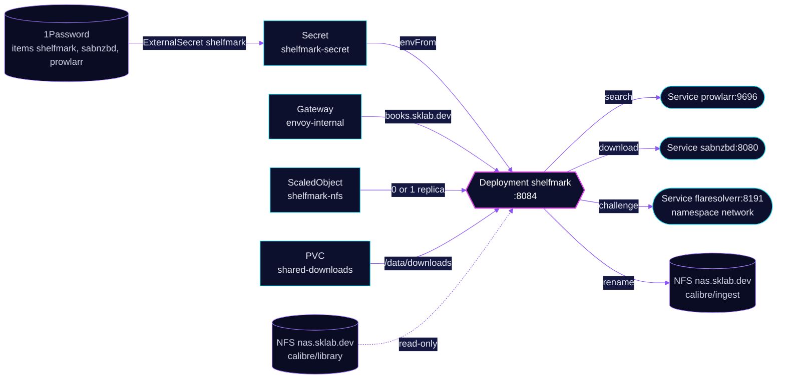

<!-- header: icon=book-open -->
<!-- concept: From a book search to a file in the Calibre ingest folder | search Search | download Fetch | shield-check Bypass | folder-input Ingest -->
<p align="center"></p>

> Finds a book, fetches it by Usenet or direct download, and drops it in the Calibre ingest folder.

**Live facts:** <https://skrumbach.github.io/home-ops/apps/downloads/shelfmark/> (workloads, routes, storage, backups, secrets and alerts, generated on every merge)

## What it does

- **Serves the UI** at `books.sklab.dev` on `envoy-internal`, port `8084`. The route sets `timeouts.request: 0s`,
  which turns the request timeout off; the manifest records no reason.
- **Finds books** through metadata providers (Hardcover, Google Books, Moly) and the sources Prowlarr, Anna's Archive and LibGen.
- **Downloads by Usenet** through Prowlarr (`PROWLARR_USENET_CLIENT: sabnzbd`) and SABnzbd category `books`, or directly
  over HTTP through Anna's Archive mirrors. There is no torrent path.
- **Passes Cloudflare challenges** through FlareSolverr at `flaresolverr.network.svc.cluster.local:8191`.
- **Delivers** renamed files (`{Author} - {Title} ({Year})`) to the NAS folder `ebooks/calibre/ingest`, and reads the
  library folder read-only to see which books already exist.

## Why it is built this way

| Choice | Why |
|---|---|
| **The `lite` image plus FlareSolverr** | The lite image has no Chromium, so Cloudflare challenges go to the external bypasser. |
| **`annas-archive.is` is left out of `AA_MIRROR_URLS`** | It is an impostor that answers 200 with a different page layout, so the parser finds no results. |
| **Settings in env, state in emptyDirs** | Nothing needs to survive a restart. `/config` is scratch because the old release failed on a missing `/config`. There is no PVC and no backup. |
| **KEDA scales it to zero when the NAS is down** | The ingest and library mounts are NFS. Component `keda/nfs-scaler` sets the Deployment to 0 replicas while the NAS export is unreachable, so the pod does not hang on I/O. |
| **API keys only from the Secret** | The manifest comment says the metadata-provider keys must come from the Secret, not from `env`. |

## How it works

<p align="center"></p>

<details>
<summary><b>Resource graph</b>: every object involved, by name</summary>



</details>

1. Flux applies Kustomization `shelfmark` after `downloads-pvc`, `onepassword-store` and `keda`. The
   `keda/nfs-scaler` component adds ScaledObject `shelfmark-nfs`. The HelmRelease sets `replicas: null` so Helm never
   resets the count KEDA owns.
2. The pod runs as uid and gid `2000` (`PUID`/`PGID` are set in list form because app-template mangles bare map keys).
   Settings come from `env`, and the keys from Secret `shelfmark-secret`.
3. A search goes to Prowlarr. A Usenet result is handed to SABnzbd, which downloads to the shared volume at the path
   SABnzbd reports; Shelfmark reads that same path at `/data/downloads`.
4. Shelfmark renames the finished file into `/cwa-book-ingest` (`BOOKS_OUTPUT_MODE: folder`) and Calibre-Web-Automated
   picks it up from there.

## Settings that matter

All values are in [`app/helmrelease.yaml`](app/helmrelease.yaml) unless noted.

| Setting | Value | Why |
|---|---|---|
| `AA_MIRROR_URLS` | `annas-archive.gl, .pk, .gd` | Real mirrors behind Cloudflare, solved through FlareSolverr. |
| `USING_EXTERNAL_BYPASSER`, `EXT_BYPASSER_URL` | `"true"`, FlareSolverr `/v1` | Lite image has no Chromium. |
| `tmp`, `logs`, `app-state` | one emptyDir each, `/tmp`, `/var/log/shelfmark`, `/config` | One emptyDir per path: subPath directories are created root-owned and ignore `fsGroup`, which left the non-root entrypoint unable to write `/tmp/shelfmark`. |
| `/app/downloaded_files` | not mounted | It is a symlink into `/tmp/shelfmark`. A mount there makes the runtime create `/tmp/shelfmark` root-owned. |
| `resources` | requests 10m CPU, 150Mi; limit 500Mi | The manifest records no reason. |
| Liveness / readiness | `GET /api/health :8084`, 30s and 10s initial delay | The manifest records no reason for the delays. |

## Operate it

```bash
flux -n downloads get ks shelfmark
flux -n downloads get hr shelfmark
kubectl -n downloads get deploy,pods -l app.kubernetes.io/name=shelfmark -o wide
kubectl -n downloads get scaledobject shelfmark-nfs
kubectl -n downloads logs deploy/shelfmark
```

### When an alert fires

| Alert | Fires when | First look |
|---|---|---|
| `NASNFSExportDown` | the NAS refused TCP 2049 for 5 minutes | KEDA scales Shelfmark to 0 on the same signal. See [blackbox-exporter](../../monitoring/blackbox-exporter/README.md). |

## Invariants

- API keys for metadata providers come from Secret `shelfmark-secret`, never from `env`.
- `annas-archive.is` stays out of `AA_MIRROR_URLS`.

Upstream: [Shelfmark](https://github.com/calibrain/shelfmark)
