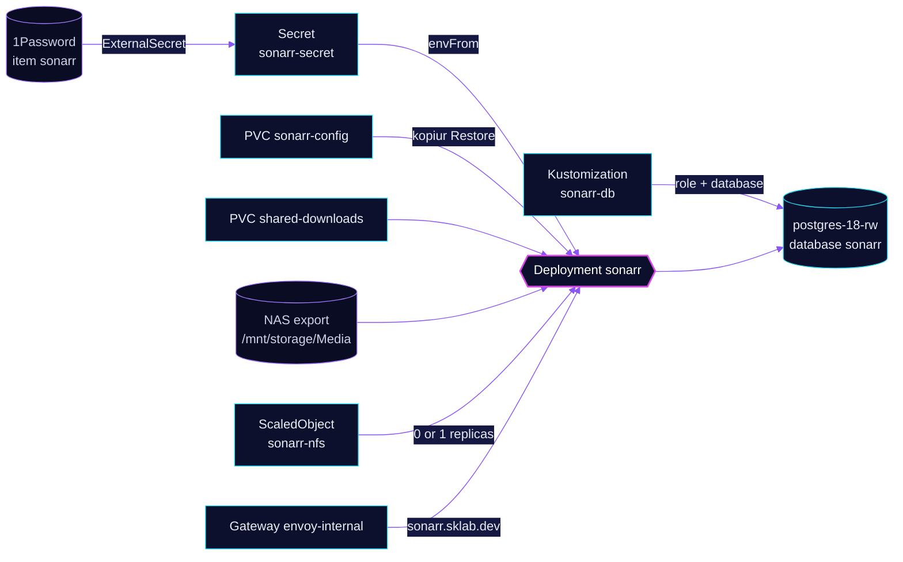

<!-- header: icon=tv -->
<!-- concept: From a wanted episode to a file on the NAS | search Wanted | send Hand off | hard-drive-download Download | folder-input Import | tv Library -->
<p align="center"></p>

> The TV series manager: it tracks shows, hands releases to the download client and imports finished episodes.

**Live facts:** <https://skrumbach.github.io/home-ops/apps/downloads/sonarr/> (workloads, routes, storage, backups, secrets and alerts, generated on every merge)

## What it does

- **Manages TV series** for the household. The Homepage annotation describes it as "TV shows".
- **Imports into the library** on the NAS: it mounts `shared-downloads` at `/data/downloads` and the NAS export
  `/mnt/storage/Media` on `nas.sklab.dev` at `/data/nas-media`.
- **Keeps its data in PostgreSQL**, not SQLite: role and database `sonarr` on `postgres-18-rw` in `database`,
  created by Kustomization `sonarr-db`.
- **Serves the UI** at `sonarr.sklab.dev` on `envoy-internal` only, with no SecurityPolicy in front.
- **Answers other apps** on Service `sonarr:8989`: `recyclarr`, `queue-watchdog` and the `ai/toolhive` MCP server `arr-mcp`.

## Why it is built this way

| Choice | Why |
|---|---|
| **Database on the shared CNPG cluster** | The `sonarr-db` Kustomization creates a role and database on the shared `postgres-18` cluster. Its overlay comment: retain, so removing it never drops data. |
| **KEDA owns the replica count** | `replicas: null` keeps Helm off the Deployment. The `keda/nfs-scaler` component scales it to 0 while the NAS NFS export is unreachable and back to 1 when it returns. |
| **Auth method `External`** | The manifest sets `SONARR__AUTH__METHOD: External` and `DisabledForLocalAddresses`. The manifest records no reason. |

## How it works

<p align="center"></p>

<details>
<summary><b>Resource graph</b>: every object involved, by name</summary>



</details>

1. Flux applies Kustomization `sonarr` after `sonarr-db`, `downloads-pvc`, `onepassword-store`, `kopiur-repository`
   and `keda`. The `kopiur/pvc` component owns PVC `sonarr-config`, so a recreated claim is filled from the newest
   backup. The HelmRelease waits for `rook-ceph-cluster`.
2. ExternalSecret `sonarr` reads 1Password item `sonarr` and builds Secret `sonarr-secret`: the `SONARR__POSTGRES__*`
   settings and `SONARR__AUTH__APIKEY`.
3. The pod runs as uid and gid `2000`, which is also the kopiur mover identity (`KOPIUR_PUID`, `KOPIUR_PGID`).
4. Series, download client and indexer settings live in the Sonarr database and UI. Git does not hold them.

## Settings that matter

All values are in [`app/helmrelease.yaml`](app/helmrelease.yaml) unless noted.

| Setting | Value | Why |
|---|---|---|
| `SONARR__LOG__DBENABLED` | `"False"` | The manifest records no reason. |
| `SONARR__UPDATE__BRANCH` | `develop` | The manifest records no reason. |
| Probes | `GET /ping :8989`; startup allows 30 failures at 5s | The manifest records no reason. |
| `resources` | request 20m CPU, 384Mi; limit 2Gi memory | The manifest records no reason. |
| `topologySpreadConstraints` | `maxSkew: 2`, `ScheduleAnyway`, `nodeTaintsPolicy: Honor` | The manifest comment: `Honor` filters only `NoSchedule` and `NoExecute` taints, so talos-3 stays in the spread domains and its `PreferNoSchedule` taint's score penalty keeps the pod off it. |
| `securityContext` | read-only root, all capabilities dropped; `tmp` and `add-ons` are emptyDirs | The manifest records no reason. |
| `KOPIUR_SCHEDULE_R2` (overlay) | `H 11 * * *` | Offsite copy daily in hour 11. The manifest records no reason. |

## Operate it

```bash
flux -n downloads get ks sonarr sonarr-db
flux -n downloads get hr sonarr
kubectl -n downloads get pods -l app.kubernetes.io/name=sonarr -o wide
kubectl -n downloads get scaledobject sonarr-nfs
kubectl -n downloads get snapshotpolicy,restore,pvc | grep sonarr
kubectl -n database get database,databaserole sonarr
```

Restores: [`restore.md`](../../../../../.agents/skills/incident-runbooks/references/restore.md).

Upstream: [Sonarr docs](https://wiki.servarr.com/sonarr)
