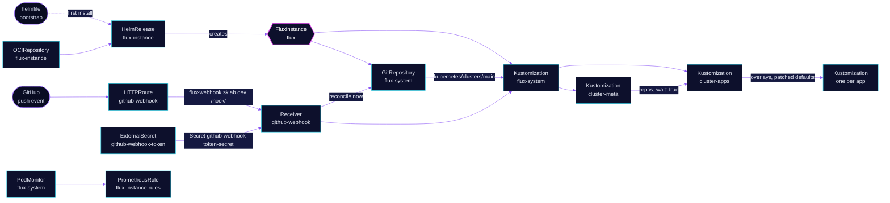

<!-- header: icon=git-pull-request-arrow -->
<!-- concept: From a push to main to a reconciled cluster | git-branch Push | webhook Notify | refresh-cw Fetch | layers Reconcile | heart-pulse Watch -->
<p align="center"></p>

> The Flux controllers and the sync from this repository's `main` branch, tuned for speed and watched by alerts.

**Live facts:** <https://skrumbach.github.io/home-ops/apps/flux-system/flux-instance/> (workloads, routes, storage, backups, secrets and alerts, generated on every merge)

## What it does

- **Runs Flux.** The `flux-instance` chart creates one `FluxInstance` that deploys `source-controller`,
  `kustomize-controller`, `helm-controller` and `notification-controller`. The `flux-operator` app owns the operator.
- **Syncs this repository.** The instance creates the GitRepository `flux-system` for
  `https://github.com/skrumbach/home-ops.git`, branch `main`, and the Kustomization `flux-system` on
  `kubernetes/clusters/main`, with `interval: 1h`.
- **Starts the app tree.** From `kubernetes/clusters/main`, Kustomization `cluster-meta` applies the shared chart
  repositories, then `cluster-apps` applies every overlay in `kubernetes/apps/main`.
- **Defaults every app.** `cluster-apps` patches each child Kustomization with `deletionPolicy: WaitForTermination`
  and HelmRelease install and upgrade defaults.
- **Syncs on push.** Receiver `github-webhook` takes GitHub `ping` and `push` events at `flux-webhook.sklab.dev`
  and reconciles `flux-system` at once, so a merge does not wait for the hourly poll.
- **Alerts on Flux itself.** PrometheusRule `flux-instance-rules` and PodMonitor `flux-system` cover the controllers.

## Why it is built this way

| Choice | Why |
|---|---|
| **Flux Operator, not `flux bootstrap`** | The instance is a `FluxInstance` resource. A HelmRelease manages it, so the controller patches and the sync source live in Git. |
| **Installed at bootstrap, then by Flux** | Flux cannot install itself. The helmfile in [`bootstrap/helmfile/apps.yaml`](../../../../../bootstrap/helmfile/apps.yaml) installs `flux-operator` and `flux-instance`. Its template reads this directory's `ocirepository.yaml` for the chart and `helmrelease.yaml` for the values, so both installs match. |
| **HelmRelease marked `prune: disabled`** | Deleting the Flux Kustomization deletes its resources whatever `prune` says. The annotation keeps the instance in place through that. |
| **Defaults in `cluster-apps`, not per app** | One patch on every child Kustomization means no overlay repeats the HelmRelease install and upgrade settings. |
| **Webhook on `envoy-external`** | GitHub must reach the receiver from the internet. The route matches only `/hook/`. |
| **`networkPolicy: false` on the instance** | The PodMonitor comment relies on it: nothing blocks the metrics scrape. The manifest records no other reason. |

## How it works

<p align="center"></p>

<details>
<summary><b>Resource graph</b>: every object involved, by name</summary>



</details>

1. **Bootstrap.** The helmfile installs `flux-operator`, then `flux-instance`. `flux-instance` needs `flux-operator`
   and the operator needs `cert-manager/cert-manager`.
2. **Flux takes over.** Kustomization `flux-instance` ([overlay](../../../main/flux-system/flux-instance.yaml)) depends on
   `flux-operator` and applies `app/` into `flux-system`. From then on Flux owns the release.
3. **Instance.** The chart renders the `FluxInstance` from `values.instance`. The operator installs the four
   controllers and applies the `kustomize.patches` to them (see Settings).
4. **Sync.** The instance polls `main` and builds `kubernetes/clusters/main`. `cluster-meta` applies the repository
   objects with `wait: true`. `cluster-apps` waits for it, then applies each overlay, one Kustomization per app.
5. **Push.** GitHub posts to `https://flux-webhook.sklab.dev/hook/...`. Envoy routes it to Service
   `webhook-receiver` on port 80, which `notification-controller` serves for Receiver `github-webhook`. The token is
   Secret `github-webhook-token-secret`, built from 1Password item `flux`, field `FLUX_GITHUB_WEBHOOK_TOKEN`.
6. **Watch.** PodMonitor `flux-system` scrapes port `http-prom` of every pod labelled `app.kubernetes.io/part-of: flux`
   once a minute. The alerts below read `flux_instance_info` and `flux_resource_info`.

## Settings that matter

Values are in [`app/helmrelease.yaml`](app/helmrelease.yaml). The `cluster-apps` patches are in
[`kubernetes/clusters/main/apps.yaml`](../../../../clusters/main/apps.yaml).

| Setting | Value | Why |
|---|---|---|
| `instance.sync.path`, `ref`, `interval` | `kubernetes/clusters/main`, `refs/heads/main`, `1h` | The entry point and branch. The webhook shortens the delay after a push. `flux-system/konflate` sets `config.clusterPath` to the same path. |
| `instance.distribution.artifact` | `flux-operator-manifests` OCI image, `version: 2.x` | Renovate bumps the tag through the `flux-operator` group in `.renovate/customManagers.json5`. |
| `instance.components` | source, kustomize, helm, notification | Only these four controllers are listed. The manifest records no reason for leaving others out. |
| `--concurrent` | `10` on all three controllers, `20` on kustomize-controller | More workers for a cluster with many Kustomizations. The manifest records no reason for the numbers. |
| `--requeue-dependency` | `5s` | Set to 5 s on the three controllers. The manifest records no reason. |
| Controller `memory` limit | `2Gi` on the three controllers | Raised for the larger builds. The manifest records no reason for the number. |
| kustomize-controller `temp` volume | `emptyDir` with `medium: Memory` | In-memory kustomize builds, per the patch title. |
| source-controller `--helm-cache-*` | `max-size=10`, `ttl=60m`, `purge-interval=5m` | Caches Helm repository indexes, per the patch title. |
| helm-controller `OOMWatch` | threshold `95`, interval `500ms` | Near-OOM detection for Helm, per the patch title. |
| helm-controller `DisableChartDigestTracking` | `true` | The manifest records no reason. |
| `--watch-configs-label-selector` | `owner!=helm` | helm-controller and kustomize-controller watch the ConfigMaps and Secrets attached to HelmReleases and Kustomizations, but skip Helm's own release Secrets. |
| kustomize-controller `CancelHealthCheckOnNewRevision` | `true` | Per the patch title: a running health check is cancelled when a new revision arrives. |
| HTTPRoute `gatus...endpoint` | `[STATUS] == 404` | The route only serves `/hook/`, so a probe of the host root gets 404 from Envoy. That proves the route and the gateway are up. |
| `cluster-apps` `wait` | `false` | Apps are not health-gated as a group. Each app sets its own `healthChecks`. |

## Operate it

```bash
flux -n flux-system get ks
flux -n flux-system get source git flux-system
flux -n flux-system get hr flux-instance flux-operator
kubectl -n flux-system get fluxinstance flux -o wide
kubectl -n flux-system get receiver github-webhook          # status shows the webhook path
kubectl -n flux-system get pods -l app.kubernetes.io/part-of=flux
flux get hr -A | grep -v True                                # anything not Ready
flux get ks -A | grep -v True
```

The receiver path is in `.status.webhookPath` and is not in Git. Put the full URL, with the host above, in the
GitHub webhook settings.

### When an alert fires

| Alert | Fires when | First look |
|---|---|---|
| `FluxInstanceAbsent` | no `flux_instance_info` for `flux-system/flux` for 5 m | Are the controller pods up, and is the `flux-operator` scrape target present? |
| `FluxInstanceNotReady` | the instance reports `ready` other than `True` for 5 m | `kubectl -n flux-system describe fluxinstance flux` |
| `FluxResourceSuspendedTooLong` | a Flux object has `spec.suspend: true` for 24 h | `flux get all -A --status-selector suspend=true`, then `flux resume`. A suspended object stays Ready and ignores every merge. |
| `FluxResourceNotReadyTooLong` | a HelmRelease, Kustomization or source is not Ready for 30 m | `flux get all -n <namespace>`. A Stalled HelmRelease needs `flux reconcile hr <name> -n <namespace> --reset` once fixed. |

Flux events at error level also reach Alertmanager and, for Kustomizations, GitHub commit status, through the
`alerts` component that the overlay includes.

## Invariants

- **Keep `prune: disabled` on the HelmRelease.** It is the only guard that survives a Kustomization delete.
- **Put an overlay patch in the base Kustomization the child builds.** `cluster-apps` replaces each child's
  `spec.patches`, so an overlay patch is dropped. `scripts/ci/overlay-patches-test.py` gates this.
- **`${...}` in a manifest must be a Flux variable.** Anything else is written `$${VAR}`, or the Kustomization sets
  `kustomize.toolkit.fluxcd.io/substitute: disabled`.

## Known gaps

- **`--concurrent` is set twice on kustomize-controller.** `app/helmrelease.yaml` adds `--concurrent=10` to all
  three controllers, then `--concurrent=20` to kustomize-controller alone. The pod gets both arguments. The Git
  files do not show which one wins.

Upstream: [Flux Operator](https://fluxoperator.dev/docs/) • [Flux docs](https://fluxcd.io/flux/) •
[Receiver](https://fluxcd.io/flux/components/notification/receivers/)
