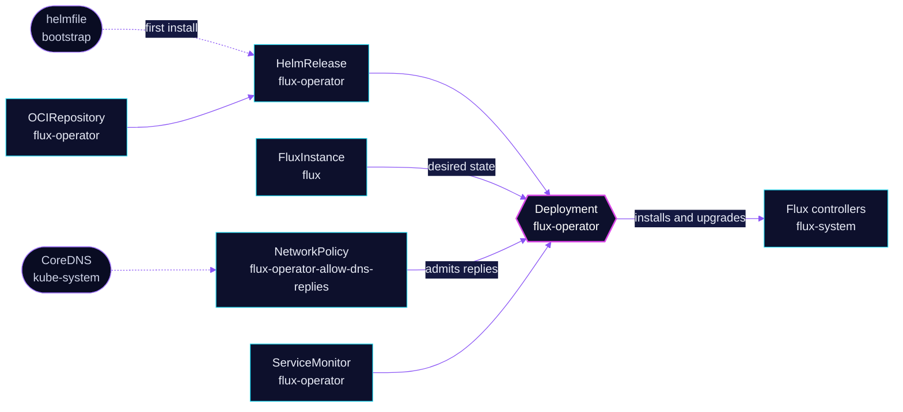

<!-- header: icon=cog -->
<!-- concept: From a FluxInstance to running controllers | file-text Declare | cog Operate | boxes Install | activity Scrape -->
<p align="center"></p>

> The operator that installs and upgrades the Flux controllers from a `FluxInstance` resource.

**Live facts:** <https://skrumbach.github.io/home-ops/apps/flux-system/flux-operator/> (workloads, routes, storage, backups, secrets and alerts, generated on every merge)

## What it does

- **Reconciles the `FluxInstance`.** The operator watches the `FluxInstance` that `flux-system/flux-instance`
  creates, and installs the Flux controllers it describes.
- **Runs at high priority.** `priorityClassName: system-cluster-critical`, so the node keeps it when it is under pressure.
- **Exports metrics.** The chart creates a ServiceMonitor (`serviceMonitor.create: true`). The `flux_instance_info` metric that
  the `FluxInstance*` alerts read comes from the operator side of Flux.
- **Fills a DNS gap.** NetworkPolicy `flux-operator-allow-dns-replies` lets CoreDNS replies reach the operator pod.

## Why it is built this way

| Choice | Why |
|---|---|
| **Installed at bootstrap, then by Flux** | The helmfile in [`bootstrap/helmfile/apps.yaml`](../../../../../bootstrap/helmfile/apps.yaml) installs it after `cert-manager/cert-manager`. Its template reads this directory's `ocirepository.yaml` and `helmrelease.yaml`, so Flux later adopts the same release. |
| **HelmRelease marked `prune: disabled`** | Deleting the Flux Kustomization deletes its resources whatever `prune` says. The annotation keeps the operator in place through that. |
| **A second NetworkPolicy, not an edit** | The chart owns NetworkPolicy `flux-operator-web` and it is not in Git. It does not admit `kube-dns`. Policies on one pod OR-combine, so a supplemental policy with the same `podSelector` adds the missing rule. |

## How it works

<p align="center"></p>

<details>
<summary><b>Resource graph</b>: every object involved, by name</summary>



</details>

1. **Bootstrap.** The helmfile installs this release after `cert-manager/cert-manager`, then `flux-instance`.
2. **Flux.** Kustomization `flux-operator` ([overlay](../../../main/flux-system/flux-operator.yaml)) applies `app/` and
   health-checks Deployment `flux-operator`. `flux-instance` depends on it.
3. **Operate.** The operator reads the `FluxInstance` and applies the controllers and the patches in it. See
   [`flux-instance`](../flux-instance/README.md).
4. **Network.** The chart's own policy `flux-operator-web` guards the pod. `flux-operator-allow-dns-replies` adds an
   ingress rule from pods labelled `k8s-app: kube-dns` in `kube-system`. It has no `ports` on purpose: a DNS reply
   arrives on the pod's ephemeral port, so `port: 53` would drop every reply.

## Settings that matter

| Setting | Value | Why |
|---|---|---|
| `priorityClassName` | `system-cluster-critical` | The manifest records no reason. |
| `serviceMonitor.create` | `true` | Prometheus scrapes the operator. |
| NetworkPolicy `ingress.from` | namespace `kube-system`, pod `k8s-app: kube-dns`, no `ports` | See Invariants. |

## Operate it

```bash
flux -n flux-system get ks flux-operator
flux -n flux-system get hr flux-operator
kubectl -n flux-system get deploy flux-operator
kubectl -n flux-system get networkpolicy
kubectl -n flux-system get fluxinstance flux -o wide
```

## Invariants

- Do not disable or replace the chart's `flux-operator-web` policy. `flux-operator-allow-dns-replies` is
  supplemental and matches its `podSelector` exactly.
- Keep `ports` off the DNS ingress rule. `ports` matches the destination port, and a reply arrives on the pod's
  ephemeral port, so `port: 53` would silently drop every reply.
- Keep `prune: disabled` on the HelmRelease.

Upstream: [Flux Operator](https://fluxoperator.dev/docs/)
