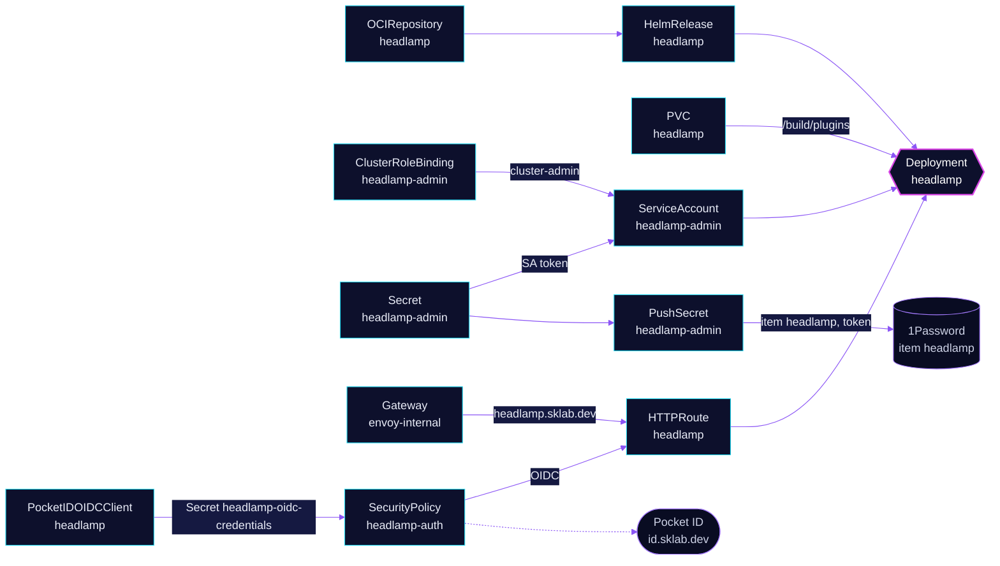

<!-- header: icon=layout-dashboard -->
<!-- concept: From a browser to a signed-in Kubernetes dashboard | globe Browser | fingerprint SSO | key-round Token | layout-dashboard Dashboard | server Cluster -->
<p align="center"></p>

> A Kubernetes and Flux dashboard on the internal gateway, behind Pocket ID, acting as a cluster-admin ServiceAccount.

**Live facts:** <https://skrumbach.github.io/home-ops/apps/flux-system/headlamp/> (workloads, routes, storage, backups, secrets and alerts, generated on every merge)

## What it does

- **Shows the cluster.** Headlamp at `headlamp.sklab.dev` on `envoy-internal` only.
- **Shows Flux.** An init container installs the `headlamp-plugin-flux` plugin into the plugins volume.
- **Signs people in twice.** Envoy checks Pocket ID first (SecurityPolicy `headlamp-auth`, group `admins`). Headlamp's
  own sign-in then takes the token of ServiceAccount `headlamp-admin`.
- **Hands out the token.** PushSecret `headlamp-admin` writes the ServiceAccount token to 1Password item
  `headlamp`, property `token`, the token that Headlamp's own sign-in takes.
- **Keeps plugins** on a 1Gi `ceph-block` PVC named `headlamp`. It is not backed up.

## Why it is built this way

| Choice | Why |
|---|---|
| **OIDC at Envoy, token inside** | Headlamp's token is what the Kubernetes API sees. Pocket ID only decides who may reach the page. |
| **`Recreate` strategy** | A RollingUpdate starts the new pod before the old one stops, and the RWO volume cannot attach to two nodes. |
| **Plugin volume mounted read-only in the main container** | The init container is the only writer. The mount flag is also the signal for `system/pvc-writable-check` to expect a read-only mount. |
| **Explicit OIDC endpoints** | Without them the Envoy Gateway controller fetches the issuer's discovery document on every translation, and a failed fetch turns the route into a 500. |

## How it works

<p align="center"></p>

<details>
<summary><b>Resource graph</b>: every object involved, by name</summary>



</details>

1. Flux applies Kustomization `headlamp` ([overlay](../../../main/flux-system/headlamp.yaml)) into `flux-system`.
2. The init container `headlamp-plugins` runs as root, copies the plugin files to `/build/plugins` on the PVC, and exits.
   The main container mounts the same path read-only (`config.pluginsDir`).
3. The `security/pocket-id-operator` writes Secret `headlamp-oidc-credentials` from `PocketIDOIDCClient` `headlamp`, with the keys
   `client-id` and `client-secret`. The SecurityPolicy reads both.
4. A person opens `https://headlamp.sklab.dev`. Envoy sends them to Pocket ID, which admits only group `admins`, and
   back to `/oauth2/callback`.
5. Headlamp then asks for a token: the one of `headlamp-admin`, bound to `cluster-admin`. Every Kubernetes call from the dashboard runs with that identity.

## Settings that matter

| Setting | Value | Why |
|---|---|---|
| `postRenderers` `/spec/strategy` | `type: Recreate` | The RWO volume cannot attach to two nodes (see above). |
| `serviceAccount` | `create: false`, `name: headlamp-admin` | The ServiceAccount comes from [`app/rbac.yaml`](app/rbac.yaml), with a long-lived token Secret of the same name. |
| `persistentVolumeClaim` | `1Gi`, `ReadWriteOnce`, `ceph-block` | Plugin files. No kopiur component, so no backup. |
| `volumeMounts` `readOnly` | `true` on `/build/plugins` | The init container is the only writer. |
| `podAnnotations` `reloader.stakater.com/auto` | `"true"` | Restarts the pod when a Secret or ConfigMap it uses changes. |
| `HEADLAMP_CONFIG_BACKEND_PROXY_TIMEOUT` | `30s` | The manifest records no reason. |
| `PocketIDOIDCClient` `pkceEnabled` | `true` | Envoy's OAuth2 filter always sends an S256 challenge. This makes Pocket ID require it. |
| `PocketIDOIDCClient` `allowedUserGroups` | `admins` in `security` | Pocket ID refuses anyone outside the group. |

## Operate it

```bash
flux -n flux-system get ks headlamp
flux -n flux-system get hr headlamp
kubectl -n flux-system get pods -l app.kubernetes.io/name=headlamp -o wide
kubectl -n flux-system get securitypolicy headlamp-auth -o jsonpath='{.status}'
kubectl -n flux-system get pocketidoidcclient headlamp
kubectl -n flux-system get pvc headlamp
kubectl -n flux-system get pushsecret headlamp-admin
```

## Invariants

- **Never set `forwardAccessToken` on SecurityPolicy `headlamp-auth`.** It would replace the ServiceAccount token
  with the Pocket ID access token in the `Authorization` header.
- **A policy that fails to translate** (for example, the operator has not written `headlamp-oidc-credentials` yet)
  makes the route answer 500. A policy whose `targetRef` matches no route leaves that route open.
- **Deleting `PocketIDOIDCClient` `headlamp` deletes the client in Pocket ID.**
- The ServiceAccount is `cluster-admin`. Anyone who holds the token holds the cluster.

Upstream: [Headlamp docs](https://headlamp.dev/docs/) • [Flux plugin](https://github.com/headlamp-k8s/plugins)
