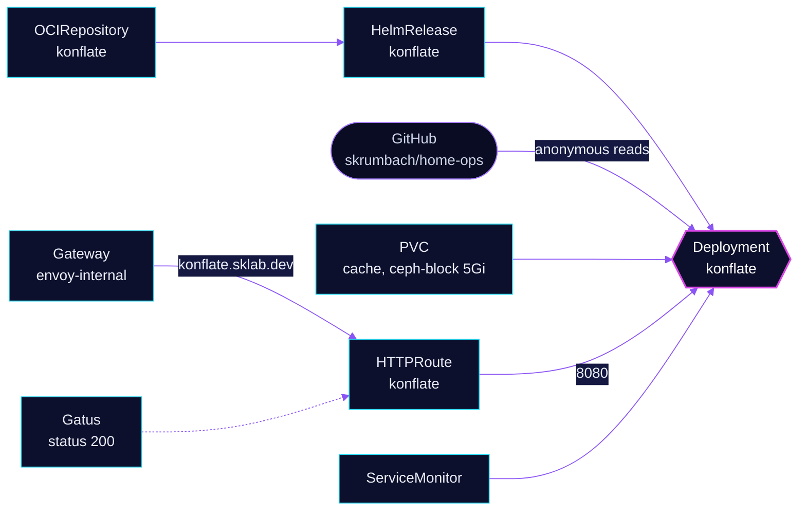

<!-- header: icon=git-pull-request -->
<!-- concept: From an open pull request to a rendered diff | git-pull-request Pull request | download Read | layers Render | file-diff Diff | eye Review -->
<p align="center"></p>

> Read-only UI that renders what each open pull request changes in the cluster, for internal viewing only.

**Live facts:** <https://skrumbach.github.io/home-ops/apps/flux-system/konflate/> (workloads, routes, storage, backups, secrets and alerts, generated on every merge)

## What it does

- **Lists open pull requests** of `skrumbach/home-ops` and renders the Flux manifests each one changes, so a review
  sees the rendered result and not only the YAML.
- **Reads anonymously.** The repository is public. No GitHub credential is in the cluster.
- **Stays read-only.** It posts no commit status and no PR comment, and it does not render fork PRs.
- **Serves internally.** `konflate.sklab.dev` on `envoy-internal`, port 8080, with a Gatus check for HTTP 200.
- **Caches** on a 5Gi `ceph-block` PVC. The claim holds a cache, so it has no backup.

## Why it is built this way

| Choice | Why |
|---|---|
| **Write-back off** | Read-only Flux PR-review UI (`home-operations/konflate`). Captain-approved pilot on 2026-08-29. A write credential would put GitHub write access in the cluster. |
| **Anonymous GitHub reads** | This repository is public, so no token is needed. A read-only token may come later for rate limits. |
| **Chart-pinned image** | The chart pins its image by digest, so the image follows the chart tag that Renovate tracks. An override in the HelmRelease is invisible to Renovate and froze the image once. |
| **`dependsOn` `security/external-secrets`** | The Kustomization has no ExternalSecret. The edge dates from when `postBuild` substituted `cluster-secrets`. It keeps konflate after the secrets operator on a cold bootstrap. |

## How it works

<p align="center"></p>

<details>
<summary><b>Resource graph</b>: every object involved, by name</summary>



</details>

1. Flux applies Kustomization `konflate` ([overlay](../../../main/flux-system/konflate.yaml)) after `security/external-secrets`
   and health-checks Deployment `konflate`.
2. The pod clones `github://skrumbach/home-ops` and takes `kubernetes/clusters/main` as the entry point. Paths in
   `spec.path` values still resolve against the clone root, so this is an entry point, not a chroot.
3. For each open PR it renders the manifests and keeps the result in memory, with the cache on the PVC.
4. `kubeVersion` is the live cluster's Kubernetes version, so charts gated on it render as helm-controller will.
5. A person opens `https://konflate.sklab.dev`. The route has no SecurityPolicy, so the internal gateway is the only gate.

## Settings that matter

All values are in [`app/helmrelease.yaml`](app/helmrelease.yaml).

| Setting | Value | Why |
|---|---|---|
| `config.statusChecks`, `config.prComments` | `false` | Write-back stays off (see Invariants). |
| `config.renderForkPrs` | `false` | The chart notes that a fork runs untrusted code through flate. |
| `config.clusterPath` | `kubernetes/clusters/main` | Matches `sync.path` in `flux-instance`. |
| `config.kubeVersion` | `{{ .Capabilities.KubeVersion.Version }}` | Charts gated on the Kubernetes version render as on the live cluster. The chart runs it through `tpl`. |
| `persistence` | `ceph-block`, `5Gi` | Render cache. |
| `resources.requests.memory` | `512Mi` | The manifest cites a 14-day median of 370-390Mi per pod. |
| `resources.limits.memory` | `3Gi` | The pod was OOM-killed at 2Gi on 2026-11-12 while rendering repo-wide PRs of 280 changed resources. |
| `monitoring.serviceMonitor.enabled` | `true` | Prometheus scrapes the app. |

## Operate it

```bash
flux -n flux-system get ks konflate
flux -n flux-system get hr konflate
kubectl -n flux-system get pods -l app.kubernetes.io/name=konflate -o wide
kubectl -n flux-system get pvc,httproute | grep konflate
kubectl -n flux-system top pod -l app.kubernetes.io/name=konflate     # against the 3Gi limit
```

## Invariants

- **Write-back is off.** `config.statusChecks` and `config.prComments` are
  `false`. Do not add `secret.writeToken`, `secret.appPrivateKey`, or
  `config.appClientId`.
- **No GitHub credential in-cluster.** This repo is public, so konflate lists
  PRs anonymously. A read-only token may be added later for rate limits; a
  write credential may not.
- **Internal only.** `HTTPRoute` attaches to `envoy-internal` and publishes
  only the internal DNS record.
- **Flux entry point** is `kubernetes/clusters/main` (`config.clusterPath`),
  matching the flux-instance HelmRelease `sync.path`.

The chart is single-replica with a Recreate strategy and a RWO cache PVC.
Do not raise `replicaCount`.

## Known gaps

- **The route's `external-dns.kubernetes.io/target` annotation decides nothing.** `app/httproute.yaml` sets
  `internal.sklab.dev`, but the parent Gateway's target decides the DNS record, not a route annotation
  (`AGENTS.md`). The invariant "publishes only the internal DNS record" holds through the `envoy-internal` parent.

Upstream: [konflate](https://github.com/home-operations/konflate)
