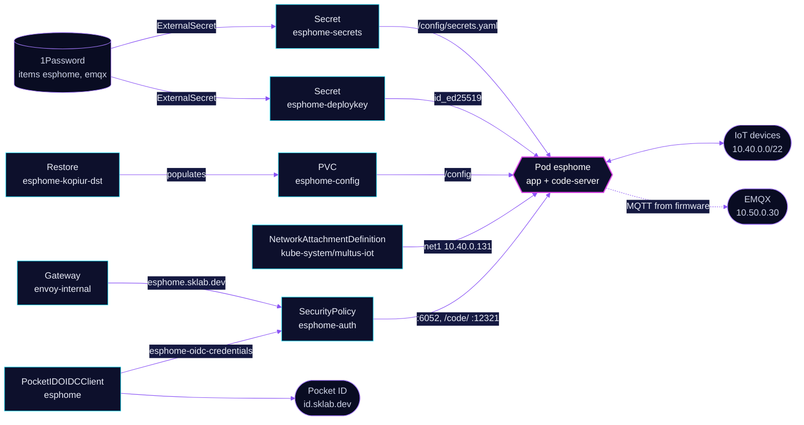

<!-- header: icon=cpu -->
<!-- concept: From a YAML file to a flashed device | file-code Config | hammer Compile | cpu Firmware | network IoT link | fingerprint Sign-in -->
<p align="center"></p>

> The ESPHome dashboard: it builds firmware for the IoT devices and reaches them on their own network.

**Live facts:** <https://skrumbach.github.io/home-ops/apps/home-automation/esphome/> (workloads, routes, storage, backups, secrets and alerts, generated on every merge)

## What it does

- **Builds and flashes firmware** from the device YAML on PVC `esphome-config`, in the `app` container (dashboard on port 6052).
- **Reaches devices directly** on the IoT network: Multus attaches `multus-iot` with the fixed address `10.40.0.131/22`
  and the pinned MAC `3e:59:e4:f7:43:15`.
- **Serves the UI** at `esphome.sklab.dev` on `envoy-internal` only. The whole route sits behind Pocket ID
  (SecurityPolicy `esphome-auth`, client `ESPHome`), and only the group `admins` gets in.
- **Edits the YAML** in a `code-server` sidecar at `esphome.sklab.dev/code/`, which shares `/config` with the dashboard.
- **Feeds the devices their secrets.** Secret `esphome-secrets` is mounted as `/config/secrets.yaml`: Wi-Fi
  credentials, the MQTT login and the MQTT host `10.50.0.30`.
- **Gives `code-server` an SSH key** from Secret `esphome-deploykey` at `/home/coder/.ssh/id_ed25519`, with `GIT_SSH_COMMAND` set. The `app` container does not get it.

## Why it is built this way

| Choice | Why |
|---|---|
| **Envoy OIDC on the whole route** | The dashboard has no login and `code-server` runs with `--auth none`. Pocket ID refuses anyone outside `admins` before a request reaches either. |
| **MQTT host as an IP, `10.50.0.30`** | The host is compiled into the firmware, and the devices live on the IoT LAN. The in-cluster Service name does not resolve there, and the dashboard hostname is an HTTPS route. `10.50.0.30` is the pinned address of the EMQX `emqx-listeners` LoadBalancer. |
| **Gatus probes the Service, not the route** | The route redirects to the Pocket ID sign-in page, so a route check would measure that page. |
| **Home Assistant is not behind this route** | Home Assistant talks to the devices over the ESPHome native API, not through `esphome.sklab.dev`. |

## How it works

<p align="center"></p>

<details>
<summary><b>Resource graph</b>: every object involved, by name</summary>



</details>

1. Flux applies Kustomization `esphome` after `multus-networks`, `onepassword-store` and `kopiur-repository`. The
   `kopiur` and `kopiur/pvc` components own PVC `esphome-config` (5Gi), so a recreated claim is filled from the newest
   ceph snapshot. The HelmRelease waits for `rook-ceph-cluster`.
2. The `app` container runs as uid/gid `2000` with a read-only root filesystem. `/config` is the PVC; `/cache` is an
   emptyDir, so the build cache is not backed up.
3. The comment on the `code-server` memory limit says an ESPHome compile runs in that container.
4. A person opens `https://esphome.sklab.dev`, signs in with Pocket ID, and Envoy forwards to the dashboard.
   `/code/` is rewritten to `/` and goes to `code-server` on port `12321`.
5. The device firmware reads `mqtt_host`, `mqtt_user` and `mqtt_pwd` from `secrets.yaml`, so a device talks to EMQX at
   `10.50.0.30` directly from the IoT LAN.

## Settings that matter

All values are in [`app/helmrelease.yaml`](app/helmrelease.yaml) unless noted.

| Setting | Value | Why |
|---|---|---|
| Pod annotation `k8s.v1.cni.cncf.io/networks` | `multus-iot`, `ips: ["10.40.0.131/22"]`, `mac: 3e:59:e4:f7:43:15` | One stable IoT address. The manifest records no reason for the MAC pin. |
| `mqtt_host` ([`app/externalsecret.yaml`](app/externalsecret.yaml)) | `10.50.0.30` | Compiled into firmware; must be reachable from the IoT LAN (see above). |
| `domain_devices` (same file) | `internal` | The manifest records no reason. |
| Probes (`app`) | all three disabled | The manifest records no reason. |
| `resources` (`app`) | requests 5m CPU, 512Mi; limit 3072Mi | The manifest records no reason. |
| `resources` (`code-server`) | requests 10m CPU, 320Mi; limit 512Mi | 320Mi is 1.58x the 14-day peak of 202Mi. The limit stays high because a compile runs in this container. |
| `code-server` security context | not hardened | The image's setuid `fixuid` remaps `coder` to the pod UID at start. Without it `HOME` is `/` and `code-server` exits. |
| `GIT_SSH_COMMAND` | `mkdir -p /config/.ssh && ssh -o UserKnownHostsFile=/config/.ssh/known_hosts ...` | `known_hosts` lives on the claim, so it survives restarts. Git runs the string through a shell, so `mkdir` creates `.ssh` on first use. |
| Secret `esphome-deploykey` `defaultMode` | `256` (0400) | Owner read-only. The manifest records no reason. |
| `KOPIUR_PUID`, `KOPIUR_PGID` (overlay) | `2000` | Matches the pod's uid and gid. |
| `KOPIUR_SCHEDULE_R2` (overlay) | `H 10 * * *` | The offsite copy runs daily in hour 10. |

## Operate it

```bash
flux -n home-automation get ks esphome
flux -n home-automation get hr esphome
kubectl -n home-automation get pods -l app.kubernetes.io/name=esphome -o wide
kubectl -n home-automation get externalsecret esphome-secrets esphome-deploykey
kubectl -n home-automation get securitypolicy/esphome-auth pocketidoidcclient/esphome
kubectl -n home-automation get snapshotpolicy,snapshotschedule,restore,pvc
```

Restores: [`restore.md`](../../../../../.agents/skills/incident-runbooks/references/restore.md).

## Invariants

- A SecurityPolicy that fails to translate (for example, the operator has not yet written `esphome-oidc-credentials`)
  makes the route answer 500. A policy whose `targetRef` matches no route leaves that route open.
- Deleting the PocketIDOIDCClient `esphome` deletes the client in Pocket ID.

Upstream: [ESPHome docs](https://esphome.io/) •
[Envoy Gateway OIDC](https://gateway.envoyproxy.io/docs/tasks/security/oidc/)
