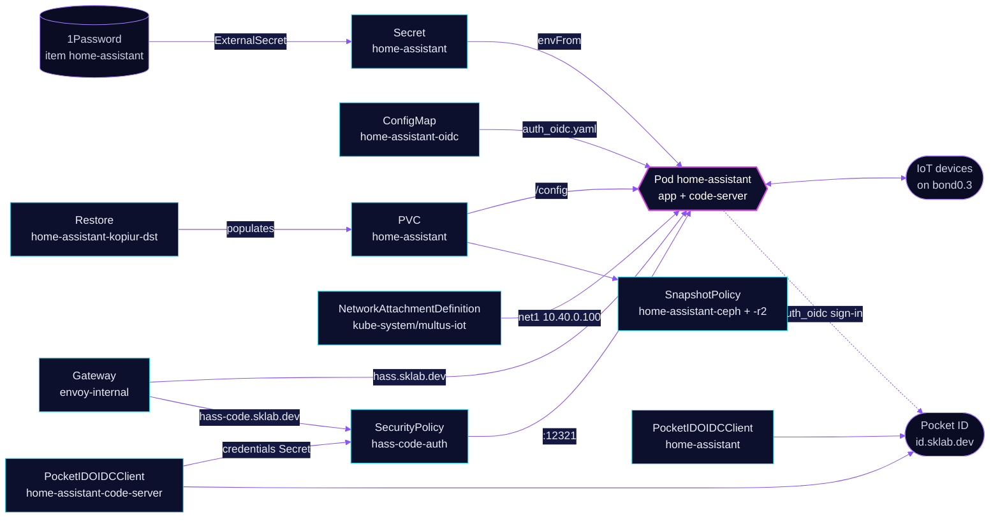

<!-- header: icon=house-plug -->
<!-- concept: From a device on the IoT network to a person on the LAN | lightbulb Devices | network IoT link | house Hub | door-open LAN route | fingerprint Sign-in -->
<p align="center"></p>

> The smart home hub: it talks to devices on their own IoT network and serves people on the LAN only.

**Live facts:** <https://skrumbach.github.io/home-ops/apps/home-automation/home-assistant/> (workloads, routes, storage, backups, secrets and alerts, generated on every merge)

## What it does

- **Reaches devices directly** on the IoT network: Multus attaches a second interface from `multus-iot`
  (macvlan on `bond0.3`) with the fixed address `10.40.0.100/16`.
- **Serves the UI** at `hass.sklab.dev` on `envoy-internal` only. Off-site, the companion app needs the VPN.
- **Signs people in itself** with the `auth_oidc` custom component against Pocket ID (client `home-assistant`).
  Only members of the Pocket ID group `admins` get in.
- **Edits its own config** through a `code-server` sidecar at `hass-code.sklab.dev`, gated at Envoy by
  SecurityPolicy `hass-code-auth`.
- **Keeps its state** in PVC `home-assistant`, backed up by kopiur to the in-cluster `ceph` and the offsite `r2`
  repositories, and restored from the newest ceph snapshot when the claim is recreated.
- **Answers in-cluster clients** on Service `home-assistant:8123`, such as the `ai/toolhive` MCP server `ha-mcp`.

## Why it is built this way

| Choice | Why |
|---|---|
| **A second interface on the IoT network, not the pod network only** | Devices key on IP, so Home Assistant needs one stable address on their network. The macvlan interface puts the pod on that network directly. |
| **Static IP, no MAC pin** | With a pinned MAC on `bond0.3`, the kernel rejects the new pod's `net1` while the old pod's veth still holds it, and a rollout stalls. |
| **Home Assistant signs in, not Envoy** | The companion app, the Google integration and `/auth/token` cannot follow a browser SSO redirect. So the HA route has no SecurityPolicy, and HA runs OIDC itself. |
| **A public OIDC client with PKCE** | `hass-oidc-auth` sends no client secret. Nothing secret is needed, so the settings live in Git as a ConfigMap. |
| **Envoy OIDC in front of code-server** | code-server runs with `--auth none` and can edit every file in `/config`. Pocket ID refuses anyone outside `admins` before the request reaches it. |
| **hass-oidc-auth pinned by checksum, never auto-merged** | It is third-party code in the login path. Renovate bumps `OIDC_VERSION`, and the PR must also set `OIDC_SHA256` ([`.renovate/autoMerge.json5`](../../../../../.renovate/autoMerge.json5)). |

## How it works

<p align="center"></p>

<details>
<summary><b>Resource graph</b>: every object involved, by name</summary>



</details>

1. Flux applies Kustomization `home-assistant` after `onepassword-store`, `kopiur-repository` and `multus-networks`.
   The `kopiur` component adds the two SnapshotPolicies and their schedules and the standing Restore
   `home-assistant-kopiur-dst`. The `kopiur/pvc` component owns PVC `home-assistant`, so a recreated claim is filled
   from the newest ceph snapshot instead of starting empty. The HelmRelease waits for `rook-ceph-cluster`.
2. The init container `install-oidc` installs `hass-oidc-auth` into `/config/custom_components/auth_oidc`. It skips
   the work when `.version` already matches. A failed download or checksum keeps the installed copy, so HA still
   boots; on an empty PVC it fails the pod instead.
3. The `app` container reads its API keys and location from Secret `home-assistant`. `/config` is the PVC, and
   `/config/auth_oidc.yaml` is mounted read-only from ConfigMap `home-assistant-oidc`. `configuration.yaml` lives on
   the PVC, not in Git, and pulls that file in with `auth_oidc: !include auth_oidc.yaml`.
   `/config/logs`, `/config/tts` and `/tmp` are emptyDirs, so logs and the TTS cache are not backed up.
4. Multus adds `net1` with a default route via `10.40.0.1` and source-based routing (`sbr`), so replies from
   `10.40.0.100` leave through `net1`.
5. A person opens `https://hass.sklab.dev`, picks "Pocket ID", and comes back to `/auth/oidc/callback`. Pocket ID
   sends the `groups` claim; `roles.admin` and `roles.user` are both `admins`, so any other account is rejected.
6. `https://hass-code.sklab.dev` goes through SecurityPolicy `hass-code-auth`. Envoy reads the client ID and secret
   from Secret `home-assistant-code-server-oidc-credentials`, which the Pocket ID operator writes.

## Settings that matter

All values are in [`app/helmrelease.yaml`](app/helmrelease.yaml) unless noted.

| Setting | Value | Why |
|---|---|---|
| Pod annotation `k8s.v1.cni.cncf.io/networks` | `multus-iot`, `ips: ["10.40.0.100/16"]`, no `mac` | One stable IoT address; no MAC pin (see above). |
| `HASS_HTTP_TRUSTED_PROXY_1..3` | `10.10.10.0/24`, `10.50.0.0/24`, `10.42.0.0/16` | Node, LoadBalancer pool and pod ranges. HA believes `X-Forwarded-For` (`HASS_HTTP_USE_X_FORWARDED_FOR: "true"`) only from these, so it sees the client address, not Envoy's. |
| Liveness and readiness probes | `GET /manifest.json :8123`, every 10s, 5 failures | The path needs no login, so the probe tests HA's own HTTP server and nothing in front of it. |
| Startup probe | same path, `failureThreshold: 30` | Up to 300s for integrations to load on first boot before liveness counts. |
| `resources` (`app` / `code-server`) | requests 10m CPU and 768Mi / 192Mi; limits 2Gi / 512Mi | Sized from 30-day peak working sets of 393Mi / 148Mi. Without a memory request the node reserves the whole limit. |
| Service `code-server`: `publishNotReadyAddresses` | `true` | code-server stays reachable while HA itself is not Ready, so a broken config can still be fixed. |
| `defaultPodOptions.securityContext` | uid/gid/fsGroup `1000`, `fsGroupChangePolicy: OnRootMismatch` | Matches the kopiur mover identity (component default 1000). |
| `topologySpreadConstraints` | `nodeTaintsPolicy: Honor`, `ScheduleAnyway` | talos-3 keeps its `PreferNoSchedule` taint in play, so the scheduler score keeps the pod off it. |
| `client_id`, `roles` ([`app/resources/auth_oidc.yaml`](app/resources/auth_oidc.yaml)) | `home-assistant`; admin and user both `admins` | Must match `spec.clientID` in [`app/pocketidoidcclient-app.yaml`](app/pocketidoidcclient-app.yaml). |
| `features.automatic_user_linking` | not set | Left on, a later Pocket ID admin whose username equals a local HA login would take that account over. |
| Explicit `authorizationEndpoint`, `tokenEndpoint` ([`app/securitypolicy.yaml`](app/securitypolicy.yaml)) | `id.sklab.dev` paths | Skips discovery on every translation; a failed fetch would turn the route into a 500. |
| `KOPIUR_CAPACITY`, `KOPIUR_SCHEDULE_R2` (overlay) | `5Gi`, `H 10 * * *` | Claim size; the offsite copy runs daily in hour 10 instead of the component default, hour 4. Ceph keeps the default, every 4 hours. |

## Operate it

```bash
flux -n home-automation get ks home-assistant
flux -n home-automation get hr home-assistant
kubectl -n home-automation get pods -l app.kubernetes.io/name=home-assistant -o wide
kubectl -n home-automation logs -l app.kubernetes.io/name=home-assistant -c install-oidc
kubectl -n home-automation get snapshotpolicy,snapshotschedule,restore,pvc
kubectl -n home-automation get securitypolicy/hass-code-auth pocketidoidcclient
```

Edit the YAML config in code-server at `hass-code.sklab.dev`, then restart Home Assistant. A new local
account that should link to Pocket ID needs `automatic_user_linking` on for one login; the match is on the exact,
lowercase username. Restores: [`restore.md`](../../../../../.agents/skills/incident-runbooks/references/restore.md).

### When an alert fires

| Alert | Fires when | First look |
|---|---|---|
| `KubePodNotReady` | the pod is not Ready (the probes above) | `kubectl logs ... -c app`; a crash after a config edit is fixed in code-server. |
| `KopiurBackupStaleCeph` | no ceph backup of `home-assistant-ceph` in 6h | `kubectl -n home-automation describe snapshotpolicy home-assistant-ceph`. |
| `KopiurBackupStaleR2` | no r2 backup of `home-assistant-r2` in 48h | Same, for `home-assistant-r2`. |
| `KopiurBackupEmpty` | the latest backup holds zero files | The claim was empty or unreadable when the snapshot ran. |

## Known gaps

- **The Google integration may not reach HA.** [`app/securitypolicy.yaml`](app/securitypolicy.yaml) line 4 names
  Google as a client of the HA route, and Secret `home-assistant` carries `HASS_GOOGLE_PROJECT_ID`. The route has
  been on `envoy-internal` only since 2026-11-13 (`app/helmrelease.yaml` lines 182-186). Git does not say whether
  Google still needs to call in from outside.
- **Two Gatus checks, one with a stale reason.** The route annotation adds a status-only check on
  `https://hass.sklab.dev/manifest.json`. `monitoring/gatus` `app/resources/config.yaml` lines 87-90 add a second,
  in-cluster check, because "status-only on the HTTPRoute stays green through ext_authz". The HA route has no
  SecurityPolicy, so that reason no longer holds for it.

Upstream: [Home Assistant docs](https://www.home-assistant.io/docs/) •
[hass-oidc-auth](https://github.com/christiaangoossens/hass-oidc-auth) •
[Envoy Gateway OIDC](https://gateway.envoyproxy.io/docs/tasks/security/oidc/)
