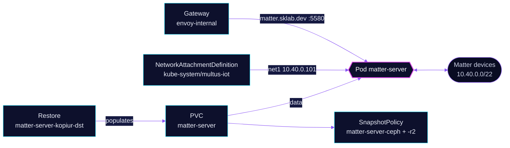

<!-- header: icon=waypoints -->
<!-- concept: From a Matter device to a controller on the LAN | lightbulb Devices | network IoT link | waypoints Controller | database Fabric state | door-open LAN route -->
<p align="center"></p>

> The Matter controller: it commissions Matter devices on the IoT network and serves a WebSocket API on the LAN.

**Live facts:** <https://skrumbach.github.io/home-ops/apps/home-automation/matter-server/> (workloads, routes, storage, backups, secrets and alerts, generated on every merge)

## What it does

- **Controls Matter devices** on the IoT network: Multus attaches `multus-iot` with the fixed address
  `10.40.0.101/22` and the pinned MAC `3e:59:e4:f7:43:11`.
- **Serves a WebSocket API** on port `5580` (Service `matter-server`), also routed at `matter.sklab.dev` on
  `envoy-internal` only.
- **Keeps its state** in PVC `matter-server`, backed up by kopiur to the in-cluster `ceph` and the offsite `r2`
  repositories, and restored from the newest ceph snapshot when the claim is recreated.

## Why it is built this way

| Choice | Why |
|---|---|
| **Root, with group `34`** | The manifest says the server "must be run as root user". It records no reason for supplemental group `34`. |
| **A second interface on the IoT network** | The pod gets an address on the IoT VLAN, as the other home-automation apps do. The manifest records no further reason. |
| **No SecurityPolicy on the route** | The manifest records no reason. |
| **No Gatus check** | The route sets `gatus.home-operations.com/enabled: "false"`. The manifest records no reason. |

## How it works

<p align="center"></p>

<details>
<summary><b>Resource graph</b>: every object involved, by name</summary>



</details>

1. Flux applies Kustomization `matter-server` after `multus-networks` and `kopiur-repository`. The `kopiur` and
   `kopiur/pvc` components own PVC `matter-server` (1Gi), so a recreated claim is filled from the newest ceph snapshot.
2. Multus adds `net1` from `multus-iot` with the fixed IP and MAC.
3. The pod runs as root and listens on `5580` with instance name `matter-server` and application URL `matter.sklab.dev`.
4. The Service and the `envoy-internal` route both point at port `5580`. The route has no sign-in in front of it.

## Settings that matter

All values are in [`app/helmrelease.yaml`](app/helmrelease.yaml) unless noted.

| Setting | Value | Why |
|---|---|---|
| Pod annotation `k8s.v1.cni.cncf.io/networks` | `multus-iot`, `ips: ["10.40.0.101/22"]`, `mac: 3e:59:e4:f7:43:11` | One stable IoT address. The manifest records no reason for the MAC pin. |
| `securityContext` | uid, gid, `fsGroup` `0`, `runAsNonRoot: false`, `supplementalGroups: [34]` | "Must be run as root user." |
| `resources` | requests 10m CPU, 128Mi; limit 256Mi | The 30-day maximum working set was 109Mi (2026-11-07). |
| `KOPIUR_PUID`, `KOPIUR_PGID` (overlay) | `0` | The mover runs as root, which needs `privileged-movers`. |
| `KOPIUR_CAPACITY` (overlay) | `1Gi` | Claim size. The mover cache keeps the component's 2Gi default, which the overlay comment says clears this snapshot. |
| `KOPIUR_SCHEDULE_R2` (overlay) | `H 10 * * *` | The offsite copy runs daily in hour 10. |
| `wait` (overlay) | not set | No Flux Kustomization depends on it, and the standing kopiur Restore is `Ready=False` by design. |

## Operate it

```bash
flux -n home-automation get ks matter-server
flux -n home-automation get hr matter-server
kubectl -n home-automation get pods -l app.kubernetes.io/name=matter-server -o wide
kubectl -n home-automation logs -l app.kubernetes.io/name=matter-server
kubectl -n home-automation get snapshotpolicy,snapshotschedule,restore,pvc
```

Restores: [`restore.md`](../../../../../.agents/skills/incident-runbooks/references/restore.md).

## Invariants

- The Kustomization never sets `wait: true`: it owns a kopiur claim, and the standing Restore is `Ready=False` by design.

Upstream: [python-matter-server](https://github.com/home-assistant-libs/python-matter-server)
