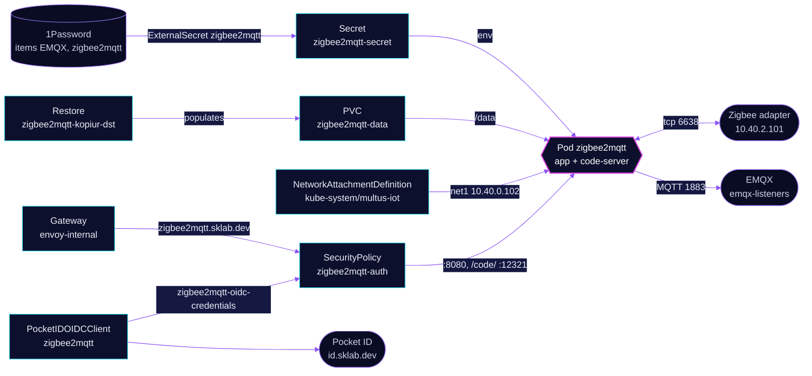

<!-- header: icon=radio -->
<!-- concept: From a Zigbee device to a message on the broker | lightbulb Devices | radio Adapter | network IoT link | message-square MQTT | fingerprint Sign-in -->
<p align="center"></p>

> The Zigbee bridge: it drives a network Zigbee adapter on the IoT VLAN and publishes every device to EMQX over MQTT.

**Live facts:** <https://skrumbach.github.io/home-ops/apps/home-automation/zigbee2mqtt/> (workloads, routes, storage, backups, secrets and alerts, generated on every merge)

## What it does

- **Drives the Zigbee radio** over the network at `tcp://10.40.2.101:6638` (adapter `ember`), through Multus
  `multus-iot` with the fixed address `10.40.0.102/22` and the pinned MAC `3e:59:e4:f7:43:12`.
- **Publishes devices to MQTT** on EMQX at `emqx-listeners.database.svc.cluster.local:1883`, base topic `zigbee2mqtt`,
  with Home Assistant discovery on the `homeassistant` topic. Home Assistant reads it through the broker, not this route.
- **Serves the frontend** at `zigbee2mqtt.sklab.dev` on `envoy-internal` only, behind Pocket ID (SecurityPolicy
  `zigbee2mqtt-auth`, only group `admins`).
- **Edits its config** in a `code-server` sidecar at `zigbee2mqtt.sklab.dev/code/`.
- **Keeps its state** in PVC `zigbee2mqtt-data`, backed up by kopiur to `ceph` and `r2`.

## Why it is built this way

| Choice | Why |
|---|---|
| **The Zigbee network identity lives in 1Password** | `zigbee_pan_id`, `zigbee_ext_pan_id` and `zigbee_network_key` ARE the network. The app writes them into `/data/configuration.yaml` at every start, so a wrong value re-forms the network and unpairs every device. |
| **Settings as `ZIGBEE2MQTT_CONFIG_*` env vars** | Git holds the config. The app writes it into `/data/configuration.yaml` at start. |
| **An init container fixes the IoT route** | Multus installs the connected route only in policy table 100, matched by source IP. The main table sends everything via `eth0`, so an unbound socket to the adapter never uses `net1`. `init-iot-route` runs `ip route replace 10.40.0.0/22 dev net1 src 10.40.0.102`. |
| **Envoy OIDC on the whole route** | The frontend has no login and can permit-join or remove devices, and `code-server` runs with `--auth none`. Pocket ID refuses anyone outside `admins`. |
| **Gatus probes the Service, not the route** | The route redirects to the Pocket ID sign-in page, so a route check would measure that page. |

## How it works

<p align="center"></p>

<details>
<summary><b>Resource graph</b>: every object involved, by name</summary>



</details>

1. Flux applies Kustomization `zigbee2mqtt` after `multus-networks`, `onepassword-store`, `emqx-cluster` and
   `kopiur-repository`. The `kopiur` and `kopiur/pvc` components own PVC `zigbee2mqtt-data` (5Gi). The HelmRelease
   waits for `rook-ceph-cluster`.
2. Init container `init-iot-route` runs as root with only `NET_ADMIN` and replaces the IoT subnet route in the main table.
3. The `app` container (uid/gid `2000`, read-only root filesystem) reads the MQTT login and the three `zigbee_*` values
   from Secret `zigbee2mqtt-secret`, built from the 1Password items `EMQX` and `zigbee2mqtt`.
4. It connects to the adapter at `10.40.2.101:6638` and to EMQX, and serves the frontend on `8080` and a `metrics` port on `9000`.
5. A person opens `https://zigbee2mqtt.sklab.dev`, signs in with Pocket ID, and Envoy forwards to the frontend. `/code/`
   is rewritten to `/` and goes to `code-server` on `12321`.

## Settings that matter

All values are in [`app/helmrelease.yaml`](app/helmrelease.yaml) unless noted.

| Setting | Value | Why |
|---|---|---|
| Pod annotation `k8s.v1.cni.cncf.io/networks` | `multus-iot`, `ips: ["10.40.0.102/22"]`, `mac: 3e:59:e4:f7:43:12` | One stable IoT address. The manifest records no reason for the MAC pin. |
| `ZIGBEE2MQTT_CONFIG_SERIAL_PORT` | `tcp://10.40.2.101:6638` | The adapter is a network device on the IoT VLAN, not a USB stick. |
| `ZIGBEE2MQTT_CONFIG_SERIAL_ADAPTER` | `ember` | The manifest records no reason. |
| `ZIGBEE2MQTT_CONFIG_ADVANCED_CHANNEL` | `20` | The manifest records no reason. |
| `ZIGBEE2MQTT_CONFIG_PERMIT_JOIN` | `false` | The manifest records no reason. |
| `ZIGBEE2MQTT_CONFIG_MQTT_SERVER` | `mqtt://emqx-listeners.database.svc.cluster.local:1883` | In-cluster Service name; see `database/emqx`. |
| `ZIGBEE2MQTT_CONFIG_FRONTEND_URL` | `https://zigbee2mqtt.sklab.dev` | The address of the frontend route on `envoy-internal`. |
| `resources` (`app`) | requests 50m CPU, 384Mi; limit 384Mi | The manifest records no reason. |
| `resources` (`code-server`) | requests 10m CPU, 160Mi; limit 512Mi | 160Mi is 2.4x the 14-day peak of 67Mi. |
| `code-server` security context | not hardened | The image's setuid `fixuid` remaps `coder` to the pod UID at start. Without it `HOME` is `/` and `code-server` exits. |
| Route rules | named `code` and `app`, no `sectionName` on the policy | The SecurityPolicy gates the whole route, both rules. |
| `KOPIUR_PUID`, `KOPIUR_PGID` (overlay) | `2000` | Matches the pod's uid and gid. |
| `KOPIUR_SCHEDULE_R2` (overlay) | `H 10 * * *` | The offsite copy runs daily in hour 10. |

## Operate it

```bash
flux -n home-automation get ks zigbee2mqtt
flux -n home-automation get hr zigbee2mqtt
kubectl -n home-automation get pods -l app.kubernetes.io/name=zigbee2mqtt -o wide
kubectl -n home-automation logs -l app.kubernetes.io/name=zigbee2mqtt -c init-iot-route
kubectl -n home-automation get externalsecret zigbee2mqtt
kubectl -n home-automation get securitypolicy/zigbee2mqtt-auth pocketidoidcclient/zigbee2mqtt
kubectl -n home-automation get snapshotpolicy,snapshotschedule,restore,pvc
```

Restores: [`restore.md`](../../../../../.agents/skills/incident-runbooks/references/restore.md).

## Invariants

- The three `zigbee_*` values in 1Password (`CONFIG_PAN_ID`, `CONFIG_EXT_PAN_ID`, `CONFIG_NETWORK_KEY` of item
  `zigbee2mqtt`) are the Zigbee network identity. A wrong value re-forms the network and unpairs every device.
  The app JSON-parses each: pan ID as a decimal integer, ext pan ID and network key as JSON arrays of 8 and 16
  decimal bytes. It does not validate array length.
- A SecurityPolicy that fails to translate makes the route answer 500. A policy whose `targetRef` matches no route
  leaves that route open.

Upstream: [Zigbee2MQTT docs](https://www.zigbee2mqtt.io/) •
[Envoy Gateway OIDC](https://gateway.envoyproxy.io/docs/tasks/security/oidc/)
