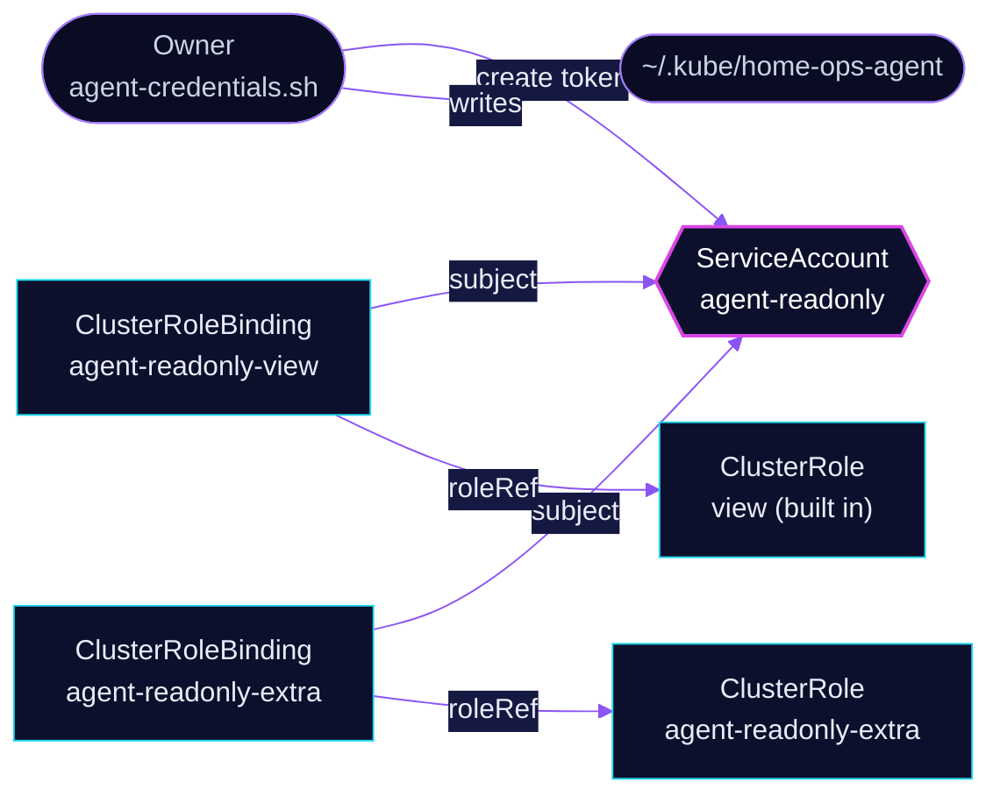

<!-- header: icon=eye -->
<!-- concept: From a minted token to a read-only session | key-round Mint | user-check Identify | eye Read | ban Deny -->
<p align="center"></p>

> The read-only ServiceAccount and RBAC that agent sessions use to inspect the cluster without changing it.

**Live facts:** <https://skrumbach.github.io/home-ops/apps/kube-system/agent-readonly/> (workloads, routes, storage, backups, secrets and alerts, generated on every merge)

## What it does

- **Gives agents an identity.** ServiceAccount `agent-readonly` in `kube-system` is the identity for agent
  sessions (Claude Code, later Hermes).
- **Grants the built-in `view` role** cluster-wide through ClusterRoleBinding `agent-readonly-view`.
- **Adds the reads `view` leaves out** through ClusterRole `agent-readonly-extra`: nodes, PersistentVolumes,
  Namespaces, CRDs, and every resource in twelve infrastructure API groups (storage, snapshot, Rook-Ceph,
  Cilium, Prometheus Operator, Gateway API, Envoy Gateway, kopiur, CloudNativePG, tuppr, Intel device
  plugins, KEDA).
- **Holds no Secret access and no write verb.** Every rule is `get`, `list` or `watch`.

## Why it is built this way

| Choice | Why |
|---|---|
| **A separate identity, not the admin kubeconfig** | Admin is the default for `kubectl` here, so an agent shell with no override can write. This identity cannot. |
| **`view` plus a short extra role** | `view` already aggregates the Flux, Flux Operator, cert-manager and External Secrets view roles and excludes Secrets. The extra role only adds cluster-scoped objects and the infra CRDs agents debug. |
| **Credential-bearing groups stay out** | The `litellm`, `toolhive`, `tailscale` and `talos.dev` groups can carry credentials, so the role names none of them. |

## How it works

<p align="center"></p>

<details>
<summary><b>Resource graph</b>: every object involved, by name</summary>



</details>

1. **Flux.** Kustomization `agent-readonly` ([overlay](../../../main/kube-system/agent-readonly.yaml)) applies
   `app/` into `kube-system`: the ServiceAccount, the ClusterRole and both bindings.
2. **Mint.** The owner runs `scripts/agent-credentials.sh` with admin credentials. It checks that the
   ServiceAccount exists, runs `kubectl -n kube-system create token agent-readonly` (default duration `720h`,
   override with `AGENT_TOKEN_DURATION`) and writes `~/.kube/home-ops-agent`. The same script writes
   `~/.talos/home-ops-agent`, a Talos client certificate with role `os:reader`, which this app does not manage.
3. **Read.** An agent that sets `KUBECONFIG=~/.kube/home-ops-agent` is authorized by the two bindings and can
   read everything `view` and the extra role cover.
4. **Deny.** Secrets, `exec`, and every write are not granted, so the API server refuses them.

## Settings that matter

| Setting | Value | Why |
|---|---|---|
| `agent-readonly-view` `roleRef` | `ClusterRole view` | Aggregated read role, no Secrets. |
| `agent-readonly-extra` core rule | `nodes`, `persistentvolumes`, `namespaces` | Cluster-scoped objects `view` does not cover. |
| `agent-readonly-extra` CRD rule | `customresourcedefinitions` | Lets an agent discover which kinds exist. |
| `agent-readonly-extra` group rule | `resources: ["*"]` in twelve groups | Whole groups, so a new kind in them needs no edit. The groups were picked as the infra an agent debugs. |
| All verbs | `get`, `list`, `watch` | Read only. |

## Operate it

```bash
flux -n kube-system get ks agent-readonly
kubectl -n kube-system get serviceaccount agent-readonly
kubectl get clusterrole,clusterrolebinding | grep agent-readonly
KUBECONFIG=~/.kube/home-ops-agent kubectl auth can-i --list      # what the agent identity may do
KUBECONFIG=~/.kube/home-ops-agent kubectl auth can-i get secrets -A   # expect "no"
```

A missing `~/.kube/home-ops-agent` means the owner has not run `scripts/agent-credentials.sh`. Renew the
token before the expiry the script prints.

## Invariants

- **Read verbs only, no Secrets.** Adding a group that can carry credentials, or any write verb, defeats the
  purpose of this identity. The comment in `app/clusterrole.yaml` lists the groups kept out on purpose.
- **Agents never run `scripts/agent-credentials.sh`.** It needs admin credentials, so the owner runs it.

Upstream: [Kubernetes RBAC](https://kubernetes.io/docs/reference/access-authn-authz/rbac/)
