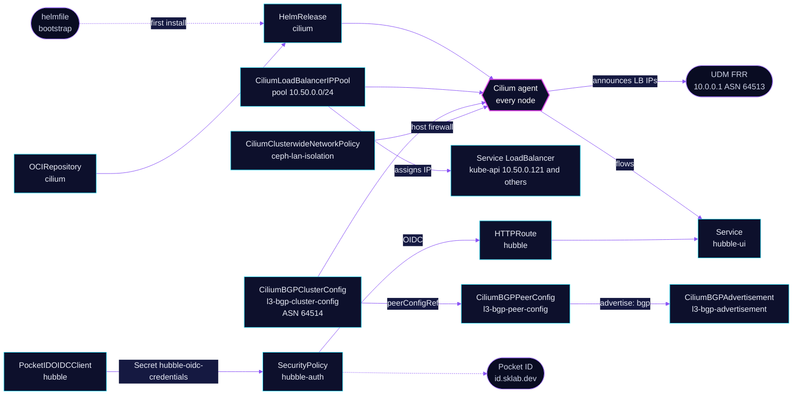

<!-- header: icon=network -->
<!-- concept: From a pod packet to a routed LoadBalancer IP | plug Attach | route Route | scale Balance | radio-tower Announce | shield Filter | eye Observe -->
<p align="center"></p>

> Pod network, Service load balancing, BGP-announced LoadBalancer IPs and a host firewall for all three nodes.

**Live facts:** <https://skrumbach.github.io/home-ops/apps/kube-system/cilium/> (workloads, routes, storage, backups, secrets and alerts, generated on every merge)

## What it does

- **Connects pods.** Talos ships no CNI (`cni.name: none`). Cilium gives every pod an address from
  `10.42.0.0/16` and routes it natively between the nodes, with no tunnel.
- **Replaces kube-proxy.** Talos runs no kube-proxy (`proxy.disabled: true`). Cilium serves every Service in
  eBPF, with Maglev hashing and direct server return.
- **Hands out and announces LoadBalancer IPs.** Pool `pool` assigns addresses from `10.50.0.0/24`. Every node
  announces them over BGP to the UDM, so the LAN can reach `envoy-internal`, `envoy-external`, `kube-api` and
  the other LoadBalancer Services.
- **Firewalls the hosts.** `ceph-lan-isolation` ([`app/ciliumclusterwidenetworkpolicy.yaml`](app/ciliumclusterwidenetworkpolicy.yaml))
  denies LAN (`world`) access to host-network Ceph ports and to unauthenticated metrics ports on the node IPs.
- **Shows the flows.** Hubble relay and UI are on. The UI is `hubble.sklab.dev` on `envoy-internal`, behind
  Pocket ID. Flow metrics and dashboards go to Prometheus and the Grafana `Cilium` folder.

## Why it is built this way

| Choice | Why |
|---|---|
| **Installed at bootstrap, then by Flux** | Flux needs a pod network to run. The helmfile in [`bootstrap/helmfile/apps.yaml`](../../../../../bootstrap/helmfile/apps.yaml) installs Cilium first, from this directory's `ocirepository.yaml` tag and `helmrelease.yaml` values, so both installs are the same. |
| **`networking.yaml` holds five objects** | Bootstrap applies `app/networking.yaml` by path, so the pool, the BGP objects and `kube-api` exist before Flux starts. Splitting the file means changing `apps.yaml` too. |
| **BGP, not L2 announcements** | `l2announcements.enabled: false`. The pool sits outside the node subnet, and no static route covers `10.50.0.0/24`. The UDM learns each LoadBalancer IP from the nodes' BGP sessions. |
| **API through KubePrism, not a Service** | Cilium implements Services itself, so it cannot depend on one. It talks to the API server at `127.0.0.1:7445`, the Talos KubePrism port in `talos/machineconfig.yaml.j2`. |
| **A subtractive host firewall** | Every Ceph daemon runs on host network, so pod-level NetworkPolicy cannot reach it. The policy only denies; `enableDefaultDeny` is false both ways, because default-deny is OR-ed across policies and would lock the nodes out. |
| **Guaranteed QoS for the agent** | Requests equal limits on every container, init containers included, so the Talos OOMController never picks the agent. Killing it takes the node's network plane down. |
| **Hubble UI behind Pocket ID at Envoy** | Hubble UI has no login of its own and shows every flow in the cluster. |
| **HelmRelease marked `prune: disabled`** | Deleting the Flux Kustomization deletes its resources whatever `prune` says. The annotation keeps the CNI in place through that. |

## How it works

<p align="center"></p>

<details>
<summary><b>Resource graph</b>: every object involved, by name</summary>



</details>

1. **Bootstrap.** The helmfile installs the chart, waits for the pool and BGP CRDs, then server-side applies
   `app/networking.yaml` as field manager `kustomize-controller`. CoreDNS, Spegel, cert-manager and Flux follow.
2. **Flux.** Kustomization `cilium` ([overlay](../../../main/kube-system/cilium.yaml)) applies `app/` into
   `kube-system`. From then on Flux owns the chart and every object in this directory.
3. **Attach and route.** The agent on each node gives pods `netkit` devices and routes `10.42.0.0/16` natively
   (`autoDirectNodeRoutes`). The host firewall is enforced on the `bond+` devices.
4. **Balance.** Services, NodePorts and LoadBalancer IPs are served in eBPF: Maglev picks the backend, and DSR
   lets the backend answer the client directly. Host-namespace sockets use socket LB; pod traffic does not.
5. **Announce.** A LoadBalancer Service gets an IP from `pool`, or the one it pins with `lbipam.cilium.io/ips`.
   Each node runs BGP instance `cilium` (ASN 64514) and peers with `unifi` at `10.0.0.1` (ASN 64513), eBGP
   multihop 4, graceful restart 15 s. `l3-bgp-advertisement` matches every Service. On the UDM, `bgp.conf`
   puts `10.10.10.11`, `.12` and `.13` in peer group `k8s`.
6. **Filter.** `ceph-lan-isolation` selects nodes with `node-role.kubernetes.io/control-plane`, which is all
   three. Host-endpoint labels are not node labels: `kubernetes.io/os` and `kubernetes.io/hostname` are
   stripped, so a selector on them matches nothing. It denies `world` on Ceph ports (3300, 6789, 80, 9283,
   9926, 8003, 7000, 8443, 6800-7568) and on metrics ports (etcd 2381, node-exporter 9100, Cilium
   9962-9965). Pods and other nodes are not `world`, so Prometheus still scrapes.
7. **Observe.** Hubble relay collects flows from every agent. The UI route sits on `envoy-internal` with
   `SecurityPolicy` `hubble-auth`; Pocket ID admits only group `admins`. Gatus checks the in-cluster Service,
   because the OIDC gate answers 302 and would stay green through an outage.

## Settings that matter

Chart values are in [`app/helmrelease.yaml`](app/helmrelease.yaml), BGP and the pool in
[`app/networking.yaml`](app/networking.yaml). The chart version is pinned in
[`app/ocirepository.yaml`](app/ocirepository.yaml) and Renovate bumps it.

| Setting | Value | Why |
|---|---|---|
| `kubeProxyReplacement` | `true` | Talos runs no kube-proxy. Cilium is the only Service datapath. |
| `k8sServiceHost`, `k8sServicePort` | `127.0.0.1`, `7445` | KubePrism on every node, so the agent never needs a Service to reach the API. |
| `routingMode`, `ipv4NativeRoutingCIDR`, `autoDirectNodeRoutes` | `native`, `10.42.0.0/16`, `true` | No tunnel. The CIDR matches Talos `podSubnets`. |
| `bpf.datapathMode` | `netkit` | No `bpf.tproxy`: Cilium refuses it with netkit and the agents fail to start. No L7/FQDN policy uses it. |
| `loadBalancer.mode`, `algorithm`, `acceleration` | `dsr`, `maglev`, `best-effort` | Direct server return with consistent hashing. The manifest records no reason. |
| `devices` | `bond+` | Matches `bond0`, `bond0.3` and `bond0.90`, where the host firewall is enforced. |
| `bgpControlPlane.enabled`, `l2announcements.enabled` | `true`, `false` | LoadBalancer IPs reach the LAN by BGP only. |
| `hostFirewall.enabled` | `true` | Enforces `ceph-lan-isolation` on the host endpoint. |
| `policyAuditMode` | `false` | Host and pod policy enforce. Lockout safety is `enableDefaultDeny: false` in the policy, not this flag. Rollback: set it `true`, or delete the policy. |
| `socketLB.hostNamespaceOnly` | `true` | Required by Talos `forwardKubeDNSToHost`. The pod datapath is unchanged. |
| `cni.exclusive` | `false` | Cilium leaves other CNI configs on the node. `kube-system/multus` runs alongside. The manifest records no reason. |
| `updateStrategy.rollingUpdate.maxUnavailable` | `1` | The chart default 2 would restart two thirds of the datapath at once. 1 keeps two nodes and etcd quorum through a bad `bpf_host` load. |
| `resources`, `initResources`, `cni.resources`, `cgroup.autoMount.resources` | 500m/1536Mi agent, 100m/128Mi init, requests equal limits | Guaranteed QoS. `cgroup.autoMount.resources` sizes the mount-cgroup init container, not `initResources`. |
| `prometheus.port`, `operator.prometheus.port`, `envoy.prometheus.port`, `hubble.metrics.port` | `9962`, `9963`, `9964`, `9965` | Pinned because `ceph-lan-isolation` denies `world` on 9962-9965. Keep both lists in sync. |
| `hubble.metrics.enabled` | dns, drop, tcp, flow, port-distribution, icmp, httpV2 | No IP labels, for cardinality. httpV2 stays empty until a pod gets L7 visibility. |
| `hubble.tls.auto.method` | `cronJob` | See [Invariants](#invariants). |
| `l7Proxy` | unset | A release with cilium/cilium#47914 refuses to start with netkit, `endpointRoutes` and the L7 proxy. Set it `false` before that bump ([`app/ocirepository.yaml`](app/ocirepository.yaml)). |
| Pool `allowFirstLastIPs` | `"No"` | The network and broadcast addresses of `10.50.0.0/24` are never handed out. |
| `CiliumBGPPeerConfig` `gracefulRestart.restartTimeSeconds` | `15` | Routes survive an agent restart for 15 s. `terraform/unifi/bgp.tofu` names the same value. |

## Operate it

```bash
flux -n kube-system get ks cilium
flux -n kube-system get hr cilium
kubectl -n kube-system get ds,deploy,cronjob -o wide | grep -E 'cilium|hubble'
kubectl get ciliumloadbalancerippool pool                       # IPs available and in use
kubectl get svc -A | grep LoadBalancer                          # who holds which LB IP
kubectl get ciliumbgpclusterconfig,ciliumbgppeerconfig,ciliumbgpadvertisement
kubectl get ciliumclusterwidenetworkpolicy ceph-lan-isolation
kubectl -n kube-system get securitypolicy hubble-auth -o jsonpath='{.status}'
```

Agent state needs `exec`, which only the admin kubeconfig grants. These commands read and change nothing:

```bash
kubectl -n kube-system exec ds/cilium -c cilium-agent -- cilium-dbg status --brief
kubectl -n kube-system exec ds/cilium -c cilium-agent -- cilium-dbg bgp peers
kubectl -n kube-system exec ds/cilium -c cilium-agent -- cilium-dbg bpf policy get --all   # verify a CCNP selector change
```

On the UDM, `vtysh -c 'show bgp summary'` shows the router side. Confirm the running config there before any
change to `bgp.conf`.

## Invariants

- **BGP peer.** UniFi is not reconciled from here. The UDM's FRR config is
  `terraform/unifi/bgp.conf` (OpenTofu); change it together with `app/networking.yaml`.
- **Hubble TLS.** Certs use
  `hubble.tls.auto.method: cronJob`: the chart's `helm` method reuses its leaf
  certs on every upgrade and never renews them, while certgen renews every four
  months and keeps the Secrets out of the release, so no `driftDetection`
  ignore is needed.

## Known gaps

- **`tunneling.mtu: 9000` sets nothing.** The pinned chart's values have no `tunneling` key; the MTU
  override is the top-level `MTU`. The line in `app/helmrelease.yaml` is ignored, and Cilium uses its
  detected MTU. Routing is native, so there is no tunnel to size either way.
- **`localRedirectPolicy: true` has no user.** No `CiliumLocalRedirectPolicy` exists in Git, and no comment
  says what the flag is for.

Upstream: [Cilium docs](https://docs.cilium.io/en/stable/)
