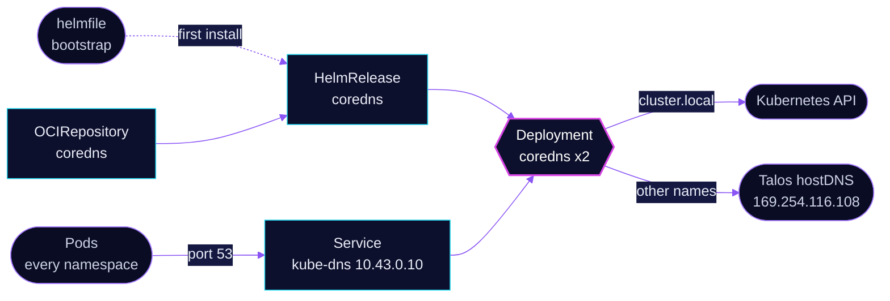

<!-- header: icon=globe -->
<!-- concept: From a pod lookup to an answer | search Ask | network Resolve | database Cache | arrow-right-left Forward -->
<p align="center"></p>

> Cluster DNS for every pod: Service names, an IPv4-only answer policy and a cached forward to the Talos host resolver.

**Live facts:** <https://skrumbach.github.io/home-ops/apps/kube-system/coredns/> (workloads, routes, storage, backups, secrets and alerts, generated on every merge)

## What it does

- **Resolves Service and Pod names.** The `kubernetes` plugin answers `cluster.local`, `in-addr.arpa` and
  `ip6.arpa`. The Service is named `kube-dns` with the fixed ClusterIP `10.43.0.10`.
- **Answers AAAA with NODATA.** The cluster is IPv4-only, so resolvers fall back to the A record at once.
- **Forwards everything else** to the Talos host resolver at `169.254.116.108`, and caches the answers
  (`prefetch 20`, `serve_stale`).
- **Runs two replicas on control-plane nodes**, spread one per node.
- **Exports metrics** on `0.0.0.0:9153` through the `prometheus` plugin.

## Why it is built this way

| Choice | Why |
|---|---|
| **Installed at bootstrap, then by Flux** | [`bootstrap/helmfile/apps.yaml`](../../../../../bootstrap/helmfile/apps.yaml) installs it right after Cilium, from this directory's `ocirepository.yaml` tag and `helmrelease.yaml` values, so both installs are the same. |
| **AAAA answered with NODATA** | No IPv6 egress exists, so a AAAA answer is an unreachable address. This avoids wasted attempts, for example Flux source-controller pulling from ghcr or github.io. It matches what the `kubernetes` plugin already returns for Services and Pods. |
| **`dnsPolicy: None` with a pinned nameserver** | `forward` reads `/etc/resolv.conf`. The pin makes that file hold only Talos hostDNS (`169.254.116.108`), the nameserver the Default policy uses, without inheriting the node resolv.conf. |
| **No `autopath`** | With `serve_stale` set, `autopath` turns answers into NXDOMAIN after about 30 s per name. A DHCP search domain (DNSSEC NODATA) then breaks external names and dotted Service FQDNs. |
| **`maxSkew: 1`, `nodeTaintsPolicy: Honor`** | One drain cannot take both replicas. `Honor` does not exclude talos-3 while its taint is `PreferNoSchedule`. |
| **HelmRelease marked `prune: disabled`** | Deleting the Flux Kustomization deletes its resources whatever `prune` says. The annotation keeps cluster DNS in place through that. |

## How it works

<p align="center"></p>

<details>
<summary><b>Resource graph</b>: every object involved, by name</summary>



</details>

1. **Bootstrap.** The helmfile installs the chart after `kube-system/cilium`. Spegel waits for it.
2. **Flux.** Kustomization `coredns` ([overlay](../../../main/kube-system/coredns.yaml)) applies `app/`
   into `kube-system`. From then on Flux owns the release.
3. **Ask.** The Service is `kube-dns` and `k8sAppLabelOverride` is `kube-dns`, so the pods carry the
   `k8s-app: kube-dns` label. Network policies in other apps select that label to admit DNS.
4. **Resolve and cache.** `servers[0].plugins` enables `errors`, `health`, `ready`,
   `kubernetes`, `template` (AAAA), `forward`, `cache`, `loop`, `reload`, `loadbalance`, `prometheus`, `log`.
   `log` is set to `class error`, so only errors are logged.
5. **Forward.** Names outside the cluster go to `/etc/resolv.conf`, which holds `169.254.116.108` only. Talos
   `hostDNS` is on with `forwardKubeDNSToHost: true` in `talos/machineconfig.yaml.j2`.

## Settings that matter

All values are in [`app/helmrelease.yaml`](app/helmrelease.yaml). The chart tag is in
[`app/ocirepository.yaml`](app/ocirepository.yaml).

| Setting | Value | Why |
|---|---|---|
| `replicaCount` | `2` | One per node at `maxSkew: 1`. The manifest records no further reason. |
| `service.clusterIP` | `10.43.0.10` | Fixed address for `kube-dns`. The manifest records no reason. |
| `k8sAppLabelOverride` | `kube-dns` | Pod label `k8s-app: kube-dns`, which other apps' network policies select. |
| `servers[0].zones[0].use_tcp` | `true` | The manifest records no reason. |
| `template ANY AAAA` | `rcode NOERROR` | IPv4-only cluster: NODATA for AAAA, see above. |
| `cache` | `prefetch 20`, `serve_stale` | The manifest records no reason for these values. `serve_stale` is why `autopath` stays out. |
| `deployment.dnsPolicy`, `dnsConfig.nameservers` | `None`, `169.254.116.108` | Pins `forward`'s upstream at Talos hostDNS. |
| `affinity` | `node-role.kubernetes.io/control-plane` Exists | Replicas run on control-plane nodes. |
| `tolerations` | `CriticalAddonsOnly`, control-plane `NoSchedule` | Lets them run there. |
| `topologySpreadConstraints` | `maxSkew: 1`, `DoNotSchedule`, `nodeTaintsPolicy: Honor` | One drain cannot take both replicas. |
| `resources` | 100m CPU, 70Mi request; 170Mi limit | The manifest records no reason. |

## Operate it

```bash
flux -n kube-system get ks coredns
flux -n kube-system get hr coredns
kubectl -n kube-system get pods -l k8s-app=kube-dns -o wide     # one per node
kubectl -n kube-system get svc kube-dns
kubectl -n kube-system logs -l k8s-app=kube-dns --tail=50       # errors only (log class error)
```

## Invariants

- **Keep `autopath` out while `serve_stale` is set.** It breaks external names and dotted Service FQDNs after
  about 30 s per name.
- **Keep the HelmRelease annotated `prune: disabled`.** Deleting the Kustomization would otherwise delete
  cluster DNS.

Upstream: [CoreDNS docs](https://coredns.io/manual/toc/)
