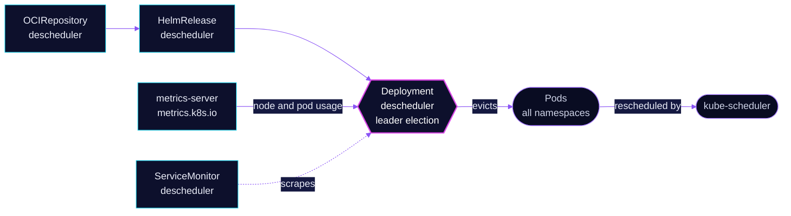

<!-- header: icon=scale -->
<!-- concept: From a lopsided node to an evicted pod | gauge Measure | filter Select | log-out Evict | map-pin Reschedule -->
<p align="center"></p>

> Evicts pods that sit badly after scheduling, so the scheduler can place them again across the three nodes.

**Live facts:** <https://skrumbach.github.io/home-ops/apps/kube-system/descheduler/> (workloads, routes, storage, backups, secrets and alerts, generated on every merge)

## What it does

- **Balances load.** Plugin `LowNodeUtilization` evicts from nodes above the target thresholds toward nodes
  below the low thresholds. Utilization comes from live metrics, not requests.
- **Balances spread.** `RemovePodsViolatingTopologySpreadConstraint` evicts pods that break a spread rule.
- **Removes pods that no longer fit.** `RemovePodsViolatingInterPodAntiAffinity`,
  `RemovePodsViolatingNodeAffinity` (required rules only) and `RemovePodsViolatingNodeTaints`.
- **Cleans up failed pods.** `RemoveFailedPods` removes pods in `ContainerStatusUnknown`, `NodeAffinity`,
  `NodeShutdown`, `Terminated` or `UnexpectedAdmissionError`, once they are 30 minutes old.

## Why it is built this way

| Choice | Why |
|---|---|
| **`nodeFit: true`** | The manifest comment: only evict when another node fits the pod's requests, affinity and taints. Otherwise a pod is evicted and lands in the same place. |
| **Metrics from `KubernetesMetrics`** | `metricsProviders` and `metricsUtilization.source` use the metrics API served by `kube-system/metrics-server`, so balancing follows real use. The manifest records no further reason. |
| **Jobs are excluded from `RemoveFailedPods`** | `excludeOwnerKinds: [Job]`. The manifest records no reason. |

## How it works

<p align="center"></p>

<details>
<summary><b>Resource graph</b>: every object involved, by name</summary>



</details>

1. **Flux.** Kustomization `descheduler` ([overlay](../../../main/kube-system/descheduler.yaml)) applies
   `app/` into `kube-system`. The chart runs as a `Deployment` (`kind: Deployment`) with leader election, and
   its Service and ServiceMonitor are enabled.
2. **Measure.** Profile `Default` reads node and pod usage through the metrics API.
3. **Select.** `LowNodeUtilization` treats a node as under-used when CPU, memory and pods are all below 20
   percent, and as over-used when any is above 60 percent. Deschedule plugins pick pods that violate a rule.
4. **Evict.** `DefaultEvictor` skips pods with local storage and system-critical pods, but evicts failed bare
   pods. With `nodeFit` it only evicts when another node can take the pod.
5. **Reschedule.** The scheduler places the replacement pod.

## Settings that matter

All values are in [`app/helmrelease.yaml`](app/helmrelease.yaml). The chart tag is in
[`app/ocirepository.yaml`](app/ocirepository.yaml), a mirror under `ghcr.io/home-operations/charts-mirror`.

| Setting | Value | Why |
|---|---|---|
| `deschedulerPolicyAPIVersion` | `descheduler/v1alpha2` | The policy schema the chart renders. |
| `DefaultEvictor.nodeFit` | `true` | See above. |
| `DefaultEvictor.evictLocalStoragePods` | `false` | Pods with `emptyDir` or hostPath data stay. The manifest records no reason. |
| `DefaultEvictor.evictSystemCriticalPods` | `false` | System-critical pods stay. The manifest records no reason. |
| `DefaultEvictor.evictFailedBarePods` | `true` | Failed pods with no owner can go. |
| `LowNodeUtilization.thresholds` | cpu 20, memory 20, pods 20 | Below this on all three, a node counts as under-used. |
| `LowNodeUtilization.targetThresholds` | cpu 60, memory 60, pods 60 | Above this on any, a node counts as over-used. |
| `RemoveFailedPods.minPodLifetimeSeconds` | `1800` | Failed pods get 30 minutes first. |
| `leaderElection.enabled` | `true` | Only one instance evicts at a time. |

## Operate it

```bash
flux -n kube-system get ks descheduler
flux -n kube-system get hr descheduler
kubectl -n kube-system get deploy descheduler -o wide
kubectl -n kube-system logs deploy/descheduler --tail=100      # which pods it evicted and why
kubectl get nodes -o wide
kubectl top nodes                                              # the numbers LowNodeUtilization sees
```

## Invariants

- **Needs `metrics-server`.** With `KubernetesMetrics` as the source, `LowNodeUtilization` has no data when
  the metrics API is down.

Upstream: [descheduler](https://github.com/kubernetes-sigs/descheduler)
