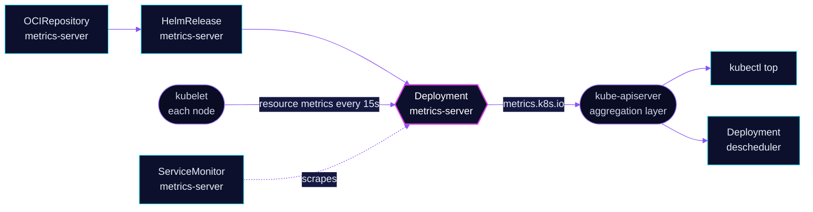

<!-- header: icon=activity -->
<!-- concept: From a kubelet reading to kubectl top | cpu Scrape | layers Aggregate | server Serve | gauge Consume -->
<p align="center"></p>

> Serves the Kubernetes resource metrics API, the live CPU and memory numbers behind `kubectl top`.

**Live facts:** <https://skrumbach.github.io/home-ops/apps/kube-system/metrics-server/> (workloads, routes, storage, backups, secrets and alerts, generated on every merge)

## What it does

- **Scrapes every kubelet** every 15 seconds (`--metric-resolution=15s`) for node and pod CPU and memory.
- **Serves `metrics.k8s.io`** through the API aggregation layer, so `kubectl top nodes` and `kubectl top pods` work.
- **Feeds in-cluster readers.** `kube-system/descheduler` uses it for `LowNodeUtilization`. The `homepage`
  ClusterRole, the `kubectl-mcp` RBAC and the `hermes` RBAC grant read on `metrics.k8s.io`.
- **Exports its own metrics** (`metrics.enabled`, `serviceMonitor.enabled`) to Prometheus.

## How it works

<p align="center"></p>

<details>
<summary><b>Resource graph</b>: every object involved, by name</summary>



</details>

1. **Flux.** Kustomization `metrics-server` ([overlay](../../../main/kube-system/metrics-server.yaml)) applies
   `app/` into `kube-system`.
2. **Scrape.** metrics-server dials each node by `InternalIP`, then `ExternalIP`, then `Hostname`, on the
   node's status port, and skips verification of the kubelet certificate.
3. **Serve.** The API server proxies `metrics.k8s.io` requests to the Service. A client with a token that may
   read that group gets node and pod usage.

## Settings that matter

All values are in [`app/helmrelease.yaml`](app/helmrelease.yaml).

| Setting | Value | Why |
|---|---|---|
| `--kubelet-insecure-tls` | set | Skips the kubelet serving certificate check. The manifest records no reason. |
| `--kubelet-preferred-address-types` | `InternalIP,ExternalIP,Hostname` | Dials the node IP first. The manifest records no reason. |
| `--kubelet-use-node-status-port` | set | Uses the port the node reports. The manifest records no reason. |
| `--metric-resolution` | `15s` | Scrape interval. The manifest records no reason. |
| `--kubelet-request-timeout` | `10s` | Per-node request limit. The manifest records no reason. |
| `metrics.enabled`, `serviceMonitor.enabled` | `true` | Prometheus scrapes metrics-server itself. |
| `resources` | 50m CPU, 64Mi request; 128Mi limit | Every limit has a request. The manifest records no further reason. |

## Operate it

```bash
flux -n kube-system get ks metrics-server
flux -n kube-system get hr metrics-server
kubectl get apiservice v1beta1.metrics.k8s.io                  # Available must be True
kubectl -n kube-system get deploy metrics-server -o wide
kubectl top nodes
kubectl top pods -A --sort-by=memory | head
```

Upstream: [metrics-server](https://github.com/kubernetes-sigs/metrics-server)
